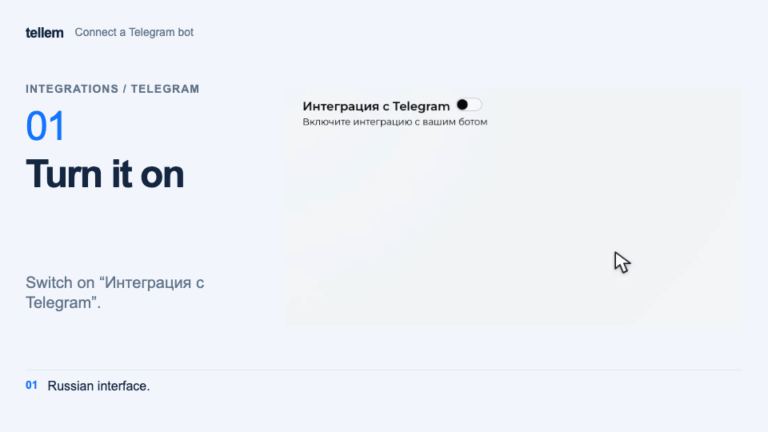

# Telegram { #telegram }

Connect a bot so customers can sign in through Telegram and open your store inside it as a Mini App. The bot also sends [customer messages](../modules/app/customer-notifications.md) and [employee notifications](../modules/crm/crm-notifications.md).

Where: **Integrations → Telegram**.

You need your bot's token. If you do not have a bot or do not know where to find its token, start with [creating a Telegram bot](telegram-bot.md).

<span id="1"></span>

## 1. Connect the bot { #1-connect-the-bot }

1. Open **Integrations → Telegram**.
2. Enable **Telegram integration**.
3. Paste the token from BotFather into **Bot token**. Press **Tab** or click outside the field to finish editing.

???+ example "Example: connect a bot, add a welcome message and a link"

    Example with demo data; the token in the recording is a placeholder. The recording also covers the [welcome message](#2-write-a-welcome-message) and [links](#4-add-links-optional) and shows the Russian interface.

    <figure markdown="span">
    [{ width="960" height="540" loading=lazy }](../media/crm/crm-telegram-setup.en.gif)
    </figure>

Treat the token like a password. There is no **Save** button on the main form; changes are saved after editing. Turning integration off stops the bot and disables Telegram sign-in.

Telegram sign-in and account linking need no separate setup. The Telegram button appears on the app's sign-in screen when the integration is enabled and the token is valid.

<span id="2"></span>

## 2. Write a welcome message { #2-write-a-welcome-message }

On the same screen, enter the text customers should receive after pressing **Start** or sending `/start` in **Welcome message**. By default, the field contains “Welcome!”; replace it with your own text.

For example, replace “My Store” with your name:

```text
Welcome to My Store!
Browse our catalog and place an order here.
Press the button below to start shopping.
```

The bot adds a button based on the business type chosen in the [first sign-in wizard](registration.md): **Open store** for an offline store, **Open catalog** for an online store, or **Open menu** for a restaurant or café. If no type is selected, it uses **Open store**. You do not need to create this button manually.

If **Multilingual editor** is enabled in [Settings → General](../modules/crm/general-settings.md), fill in the welcome message and additional button labels for the languages you use.

<span id="3"></span>

## 3. Add an image — optional { #3-add-an-image-optional }

Click **Load image** in the welcome message block and choose a welcome image. This image appears in the message; the bot's avatar is [configured separately in BotFather](telegram-bot.md).

The file can be up to **10 MB**. Supported formats are PNG, JPG/JPEG, SVG, GIF, WebP, BMP, and HEIC. With an image, the message becomes a caption, which [Telegram limits](https://core.telegram.org/bots/api#sendphoto) to **1024 characters**. The cross next to the file removes the welcome image.

<span id="4"></span>

## 4. Add links — optional { #4-add-links-optional }

1. Click **Functional buttons**. The **Welcome message buttons** window opens.
2. Click **Create**. Set a label in **Text**, such as **Our website**. Enter the page address in the field below; the `https://` prefix is already present.
3. Click **Save** in the editing window. Use **Edit** and **Delete** for later changes.

Each link appears as a separate button below the welcome message, before the app launch button.

## 5. Set up a Mini App for product links { #4-mini-app }

**Share** on a product page gives signed-in customers a Telegram link and guests a website link. For a Telegram link to open the app with that product, the bot needs a Mini App with the short name **app**. Without it, Telegram opens the bot chat.

1. Copy the store address: **Open website** in your personal account, or the CRM user menu → **Go to app**.
2. Send `/newapp` to [@BotFather](https://t.me/BotFather) and select your bot.
3. Follow BotFather's questions; enter the store address and the short name **app**.

You can also configure the chat menu button: `/mybots` → your bot → **Bot Settings → Menu Button**, then the store address.

<span id="6"></span>

## 6. Check the customer experience { #6-check-the-customer-experience }

1. Reload the CRM page: the switch should remain enabled, the token filled in, and the welcome message unchanged.
2. Open your bot in Telegram using its username. Press **Start** or send `/start`.
3. Check the welcome text and image, if uploaded, then each additional link.
4. Open the store, catalog, or menu using the bot's button on your phone. It should open your store's app. If you configured a Mini App, also check a product's **Share** link.

After checking, you can share the bot link or a QR code with customers.

**No reply from the bot?** Check the switch and token: it must belong to this bot and be pasted in full, without spaces. If the welcome message arrives but the app does not open, contact support with a screenshot of the error and your store address. Hide the token in the screenshot.
