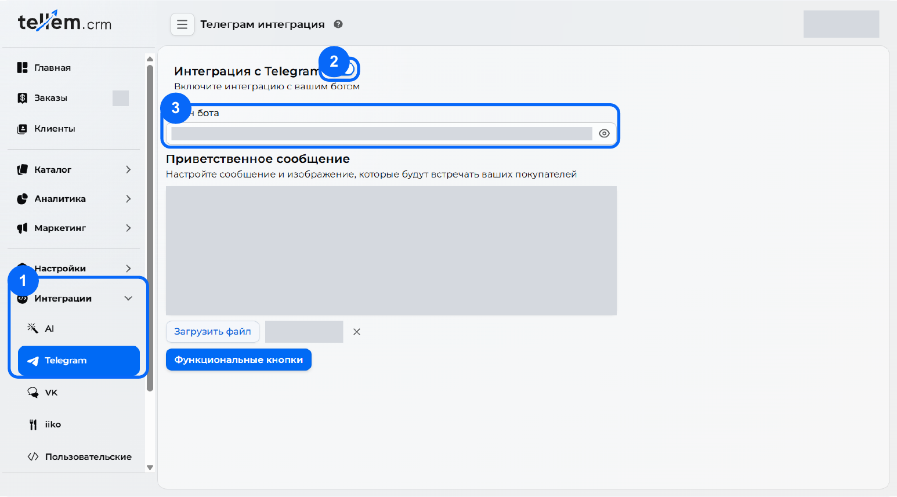
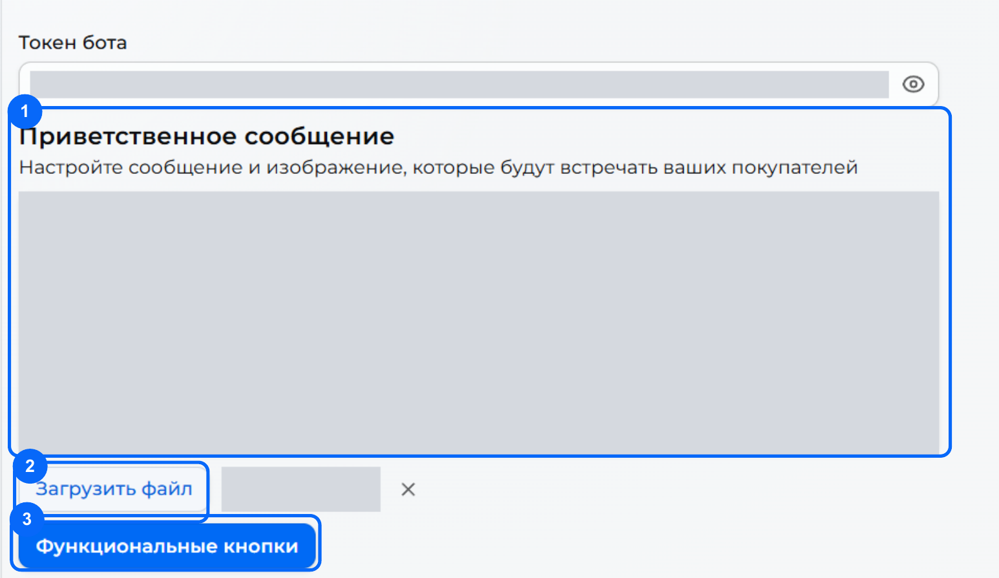
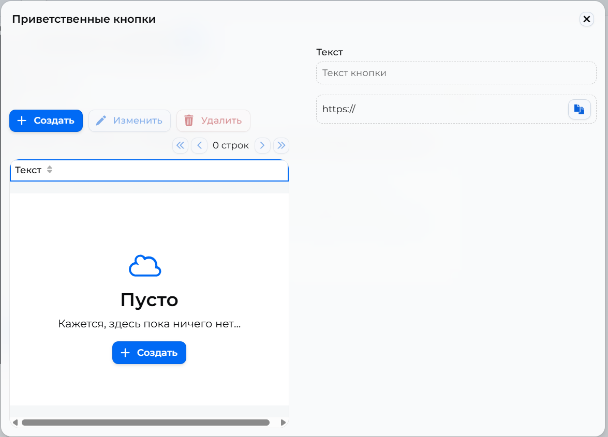

# Telegram { #telegram }

Подключите бота, чтобы покупатели входили через Telegram и открывали магазин внутри него как Mini App. Бот также присылает [сообщения покупателям](../modules/app/customer-notifications.md) и [уведомления сотрудникам](../modules/crm/crm-notifications.md).

Где: **Интеграции → Telegram**.

Понадобится токен вашего бота. Если бота ещё нет или вы не знаете, где взять токен, начните с [создания Telegram-бота](telegram-bot.md).

<span id="1"></span>

## 1. Подключите бота { #1-connect-the-bot }

1. Откройте **Интеграции → Telegram** — отметка **1** на скриншоте.
2. Включите «Интеграция с Telegram» — отметка **2**.
3. Вставьте токен из BotFather в «Токен бота» — отметка **3**. Нажмите **Tab** или щёлкните вне поля, чтобы завершить ввод.



[Открыть скриншот крупнее](../media/telegram/crm-connect.png).

Токен храните как пароль. На основной форме нет кнопки «Сохранить»: изменения сохраняются после ввода. Выключение интеграции останавливает бота и отключает вход через Telegram.

Вход через Telegram и привязка аккаунта отдельной настройки не требуют: кнопка со значком Telegram появляется на экране входа в приложение, когда интеграция включена и токен верный.

<span id="2"></span>

## 2. Напишите приветствие { #2-write-a-welcome-message }

Останьтесь на том же экране. В блоке **«Приветственное сообщение»** введите текст, который покупатель получит после **«Запустить» / Start** или команды `/start`. Пока текст пуст, бот отвечает «Welcome!».

Например, замените «Мой магазин» на своё название:

```text
Добро пожаловать в «Мой магазин»!
Здесь можно посмотреть каталог и оформить заказ.
Нажмите кнопку ниже, чтобы перейти к покупкам.
```



[Открыть скриншот крупнее](../media/telegram/crm-welcome.png).

Бот добавляет кнопку по типу бизнеса из [мастера первого входа](registration.md): **«Открыть Магазин»** для офлайн-магазина, **«Открыть Каталог»** для онлайн-магазина или **«Открыть Меню»** для ресторана и кафе. Если тип не выбран, будет «Открыть Магазин». Создавать эту кнопку вручную не нужно.

Если в [«Настройки → Основные»](../modules/crm/general-settings.md) включён «Мультиязычный редактор», заполните приветствие и подписи дополнительных кнопок для используемых языков.

<span id="3"></span>

## 3. Добавьте картинку — по желанию { #3-add-an-image-optional }

Нажмите **«Загрузить файл»** — отметка **2** на скриншоте выше — и выберите изображение приветствия. Это картинка в сообщении; аватар бота [настраивается отдельно в BotFather](telegram-bot.md).

Размер файла — до **10 МБ**. Доступны PNG, JPG/JPEG, SVG, GIF, WebP, BMP и HEIC. С картинкой текст становится подписью; [Telegram ограничивает подпись](https://core.telegram.org/bots/api#sendphoto) **1024 символами**. Крестик рядом с файлом удаляет изображение из приветствия.

<span id="4"></span>

## 4. Добавьте ссылки — по желанию { #4-add-links-optional }

1. Нажмите **«Функциональные кнопки»** — отметка **3** на скриншоте выше. Откроется окно **«Приветственные кнопки»**.
2. Нажмите **«Создать»**. В поле **«Текст»** задайте подпись, например **«Наш сайт»**. В поле ниже укажите адрес страницы: префикс `https://` уже стоит.
3. Нажмите **«Сохранить»** в окне редактирования. Для следующих изменений используйте **«Изменить»** и **«Удалить»**.



[Открыть скриншот крупнее](../media/telegram/crm-buttons.png).

Каждая ссылка появится отдельной кнопкой под приветствием, перед кнопкой запуска приложения.

## 5. Настройте Mini App для ссылок на товары { #4-mini-app }

Кнопка **«Поделиться»** на странице товара даёт вошедшему покупателю ссылку в Telegram, гостю — ссылку на сайт. Чтобы ссылка Telegram открывала приложение с товаром, у бота должна быть Mini App с коротким именем **app**. Без неё Telegram показывает чат с ботом.

1. Скопируйте адрес магазина: **«Открыть Сайт»** в личном кабинете или меню пользователя в CRM → **«Перейти в приложение»**.
2. В [@BotFather](https://t.me/BotFather) отправьте `/newapp` и выберите своего бота.
3. Следуйте вопросам BotFather; укажите адрес магазина и короткое имя **app**.

Дополнительно можно настроить кнопку меню в чате: `/mybots` → ваш бот → **Bot Settings → Menu Button**, затем адрес магазина.

<span id="6"></span>

## 6. Проверьте глазами покупателя { #6-check-the-customer-experience }

1. Обновите страницу CRM: переключатель должен остаться включённым, токен — заполненным, приветствие — на месте.
2. Откройте своего бота в Telegram по выбранному username. Нажмите **«Запустить» / Start** или отправьте `/start`.
3. Проверьте текст приветствия и картинку, если загружали её, затем каждую дополнительную ссылку.
4. Нажмите кнопку открытия магазина, каталога или меню на телефоне. Должно открыться приложение именно вашего магазина. Если настроили Mini App, проверьте и ссылку **«Поделиться»** у товара.

После проверки можно размещать ссылку на бота или QR-код для покупателей.

**Бот не отвечает?** Проверьте переключатель и токен: он должен относиться к этому боту и быть вставлен целиком, без пробелов. Если приветствие приходит, а приложение не открывается, обратитесь в поддержку и приложите скриншот ошибки и адрес магазина. Токен на скриншоте закройте.
