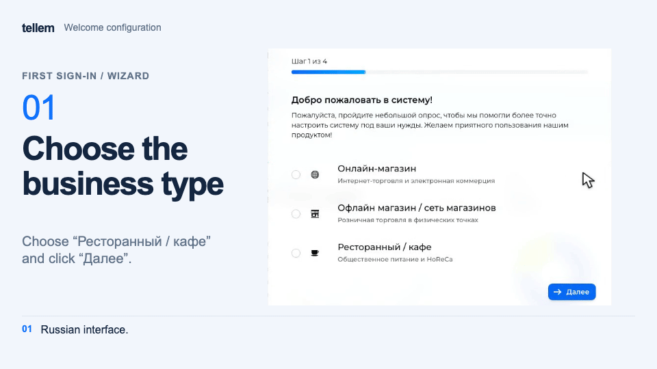

# Connection and first sign-in { #connection-and-first-sign-in }

Create a subscription and get access to the CRM, then set up your store.

## Personal account { #personal-account }

1. Open [tellem.tech/lk](https://tellem.tech/lk) and click **No account? Register**. Enter your first name, last name, and email, then enter the **Confirmation code** from the email. You can also sign in with Yandex or VK ID.
2. Under **Subscriptions**, click **Add subscription**, select a **Plan**, and enter a **Subdomain**: up to 63 lowercase Latin letters, digits, and hyphens; a hyphen cannot be the first or last character. The subdomain `myshop` gives you `myshop.tellem.store`.
3. Click **Confirm** and pay for the subscription on the page that opens. The store is deployed automatically after payment.

**Open CRM** and **Open website** appear on the subscription card before the store is ready. The addresses work after payment and preparation. If you close the payment page, click **Renew** to return to it.

!!! note "CRM access"
    The Tellem team will send your CRM sign-in details. Contact [Tellem support](https://t.me/tellem_tech_bot) to add employees as well.

## Signing in to the CRM { #signing-in-to-the-crm }

Open `https://<subdomain>.tellem.store/crm` (or **Open CRM** in your personal account), enter your **Login** and **Password**, and click **Sign in**.

There is no password recovery button. Contact [Tellem support](https://t.me/tellem_tech_bot) if you lose your password.

To change your password, open **the user menu in the header → Profile → Password**, enter the new password and confirmation, then click **Save**.

To open your personal account in a new tab, choose **the user menu in the header → Personal account**.

## Welcome configuration wizard { #welcome-configuration-wizard }

Complete the wizard on your first sign-in and click **Finish**. Until it is finished, the wizard opens on every CRM page load for every employee. Choose at least one option for each question.

???+ example "Example: welcome configuration wizard"

    Example with demo data. The recording shows the Russian interface.

    <figure markdown="span">
    [{ width="960" height="540" loading=lazy }](../media/crm/crm-welcome-wizard.en.gif)
    </figure>

The business type affects the [Telegram bot's button label](bot-setup.md). **Online shop** also hides store addresses in the app. The other answers do not configure the store; follow the checklist below.

Before creating a store or order, check the [country in general settings](../modules/crm/general-settings.md). You cannot change it afterwards.

Next: [store launch checklist](../modules/crm/getting-started.md).
