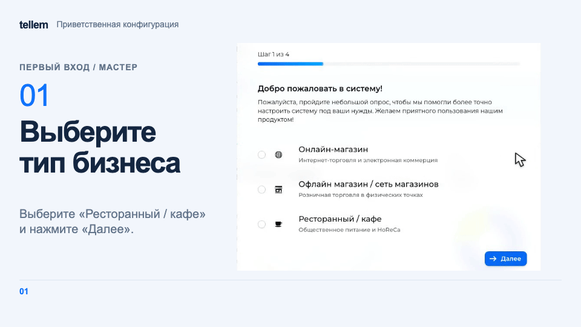

# Подключение и первый вход { #connection-and-first-sign-in }

Создайте подписку и получите доступ к CRM, затем перейдите к настройке магазина.

## Личный кабинет { #personal-account }

1. Откройте [tellem.tech/lk](https://tellem.tech/lk) и нажмите «Нет аккаунта? Зарегистрируйтесь». Укажите имя, фамилию и почту, затем введите «Код подтверждения» из письма. Войти можно и через Яндекс или VK ID.
2. В разделе «Подписки» нажмите «Добавить подписку», выберите «Тариф» и введите «Поддомен»: до 63 строчных латинских букв, цифр и дефисов, дефис не в начале и не в конце. Поддомен `myshop` даст адрес `myshop.tellem.store`.
3. Нажмите «Подтвердить» и оплатите подписку на открывшейся странице. После оплаты магазин разворачивается автоматически.

Кнопки «Открыть CRM» и «Открыть Сайт» на карточке подписки появляются до готовности магазина: адреса заработают после оплаты и подготовки. Если закрыли страницу оплаты, нажмите «Продлить», чтобы вернуться к ней.

!!! note "Доступ в CRM"
    Данные для входа в CRM пришлёт команда Tellem. Для добавления сотрудников тоже обратитесь в [поддержку Tellem](https://t.me/tellem_tech_bot).

## Вход в CRM { #signing-in-to-the-crm }

Откройте `https://<поддомен>.tellem.store/crm` (или «Открыть CRM» в личном кабинете), введите «Логин» и «Пароль» и нажмите «Войти».

Кнопки восстановления пароля нет: если пароль утерян, напишите в [поддержку Tellem](https://t.me/tellem_tech_bot).

Чтобы сменить пароль, откройте **меню пользователя в шапке → Профиль → Пароль**, введите новый пароль и подтверждение, затем нажмите «Сохранить».

Чтобы открыть личный кабинет в новой вкладке, выберите **меню пользователя в шапке → Личный кабинет**.

## Мастер «Приветственная конфигурация» { #welcome-configuration-wizard }

При первом входе заполните мастер и нажмите «Завершить». Пока мастер не завершён, он открывается при каждой загрузке CRM у всех сотрудников. В каждом вопросе выберите хотя бы один вариант.

???+ example "Пример: мастер «Приветственная конфигурация»"

    Пример с демонстрационными данными.

    <figure markdown="span">
    [{ width="960" height="540" loading=lazy }](../media/crm/crm-welcome-wizard.gif)
    </figure>

Тип бизнеса влияет на [подпись кнопки Telegram-бота](bot-setup.md). Вариант «Онлайн-магазин» также скрывает адреса магазинов в приложении. Остальные ответы не настраивают магазин: пройдите чек-лист ниже.

До создания магазина или заказа проверьте [страну в основных настройках](../modules/crm/general-settings.md): позже сменить её нельзя.

Дальше — [чек-лист запуска магазина](../modules/crm/getting-started.md).
