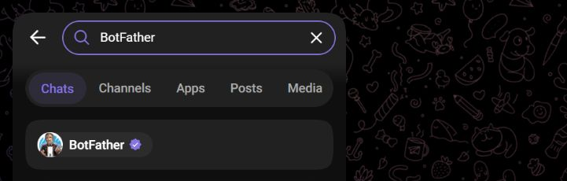
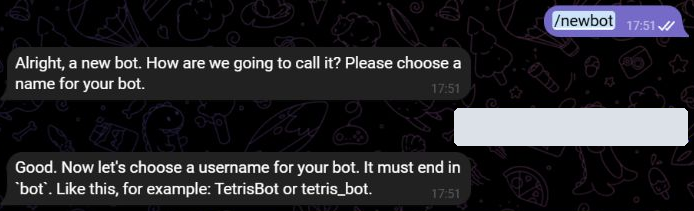
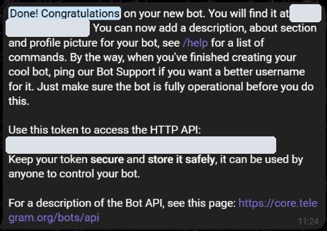

# Создание Telegram-бота { #creating-a-telegram-bot }

Создайте бота для своего магазина или заведения: через него покупатели смогут открыть каталог, войти в приложение и получать уведомления.

Понадобятся Telegram-аккаунт владельца, название для покупателей и свободное имя бота для поиска и ссылки (username). Для следующего шага подготовьте доступ к своей CRM.

!!! info "Бот уже есть?"
    Создавать ещё одного не нужно. В аккаунте владельца откройте [@BotFather](https://t.me/BotFather), отправьте `/mybots`, выберите своего бота и нажмите **API Token**, чтобы скопировать текущий токен. Затем переходите к [подключению в CRM](bot-setup.md). Для повторной настройки работающего бота не нужно удалять его или перевыпускать токен.

## 1. Откройте BotFather { #1-open-botfather }

1. Войдите в Telegram с аккаунта, которому должен принадлежать бот.
2. Откройте [@BotFather](https://t.me/BotFather) по ссылке или найдите его через поиск Telegram.
3. Проверьте точный username **@BotFather** и значок верификации. Откройте чат и нажмите **«Запустить» / Start**, если такая кнопка есть.

[Открыть скриншот крупнее](../media/telegram/botfather-search.png).

## 2. Задайте название и username { #2-choose-a-name-and-username }

1. Отправьте BotFather команду `/newbot`.
2. В ответ на **“Please choose a name for your bot”** отправьте название, которое увидят покупатели. Например: **Мой магазин | Каталог и заказы**. Его можно написать по-русски.
3. На следующий вопрос отправьте свободный username, например **my_shop_order_bot**. Знак `@` вводить не нужно.

[Открыть скриншот крупнее](../media/telegram/botfather-newbot.png).

Username — это имя для поиска и ссылки вида `https://t.me/my_shop_order_bot`. В нём должно быть от **5 до 32 символов**: латинские буквы, цифры и подчёркивание; окончание — **bot**. Если имя занято, попробуйте другой вариант. Это [правила Telegram](https://core.telegram.org/bots/features#creating-a-new-bot).

## 3. Скопируйте токен { #3-copy-the-token }

После создания BotFather пришлёт сообщение **“Done! Congratulations on your new bot”** со ссылкой на бота и токеном доступа.

1. Найдите строку под **“Use this token to access the HTTP API”**.
2. Скопируйте её целиком: цифры, двоеточие и все символы после него, без пробелов и переносов.
3. Сохраните токен: его нужно вставить в поле **«Токен бота»** при подключении CRM. Ссылка `t.me/…`, username и название бота для этого поля не подходят.

{ width="470" }

[Открыть скриншот крупнее](../media/telegram/botfather-token.png).

!!! warning "Токен храните как пароль"
    Он позволяет управлять ботом. Не публикуйте его в чатах, инструкциях и на скриншотах. На примерах здесь токен и данные владельца скрыты.

## 4. Добавьте аватар и описание { #4-add-an-avatar-and-description }

Этот шаг необязателен, но помогает покупателю узнать ваш магазин. В чате с BotFather отправьте команду, выберите созданного бота и следуйте подсказкам:

- `/setuserpic` — загрузите логотип или другую картинку для аватара бота.
- `/setdescription` — напишите, что можно сделать через бота. Например: «Каталог и заказы магазина „Мой магазин“. Нажмите „Запустить“, чтобы начать».

Описание видно до запуска бота. Приветственное сообщение после **«Запустить»** настраивается отдельно в CRM.

**Дальше: [подключите бота к CRM, настройте приветствие и проверьте открытие каталога](bot-setup.md).**
