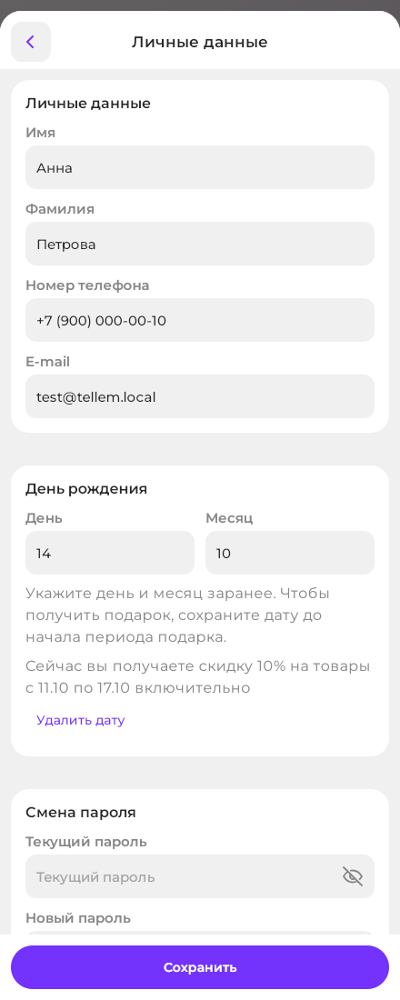
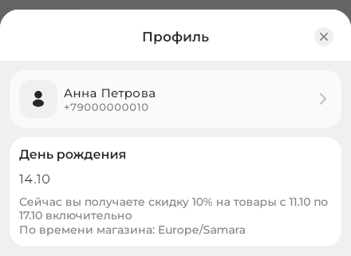

# Аккаунт, установка и уведомления

Вход, профиль, бонусы, установка приложения и push. Подключение Telegram и VK для сообщений о заказах — [«Уведомления покупателю»](customer-notifications.md). Что доступно без входа — на странице [«Витрина и корзина»](ui-and-pages.md).

## Профиль

Профиль открывает кнопка в шапке главного экрана. Сверху вниз:

- карточка с именем — «Личные данные»;
- карточки бонусов (если владелец включил бонусную систему), «Мои заказы» и «Адреса доставки»;
- «Зона продаж», «Тема интерфейса» и «Язык интерфейса»;
- «Уведомления» — «Рассылки», «Куда присылать» (Telegram, VK, почта) и push;
- меню: «Активные сессии», «Поддержка» (её нет, если владелец не добавил контакты), «Установить приложение», «О приложении» (может быть неактивна) и информационные разделы владельца;
- способы входа («Привязать» или «Отвязать») и кнопка «Выйти».

Гость видит «Войти», тему, язык, установку и публичные информационные разделы. Язык по умолчанию берётся из Telegram или браузера; выбор вошедшего покупателя сохраняется в аккаунте.

## Вход и регистрация

Вход и регистрация проходят в одной форме «Вход или регистрация»: укажите e-mail, нажмите «Получить код», затем введите шестизначный код из письма и нажмите «Войти». Новый аккаунт создаётся только после подтверждения кода.

Если вход начат из карточки товара, после входа открывается тот же товар. Выбранная до входа зона продаж сохраняется в профиле, даже если раньше там была другая зона. Это работает и при возврате из VK ID или Yandex; кнопка «Назад» возвращает к предыдущему экрану. Закрытие формы входа также возвращает к товару.

Код действует 15 минут, повторно его можно запросить через 60 секунд; после пяти неверных попыток он перестаёт действовать. Флажок «Я даю согласие на получение информационных рассылок» включён по умолчанию и учитывается только при создании аккаунта; позже подписку меняет переключатель «Рассылки». При первом входе по коду на e-mail приходит письмо с автоматически созданным паролем.

- **«Войти по паролю»** — вход по e-mail и паролю; «Войти по одноразовому коду» возвращает к коду. «Забыли пароль?» присылает на e-mail шестизначный код (15 минут, новый запрос отменяет прежний); новый пароль — не короче 8 символов.
- **Telegram, VK ID и Yandex** — кнопки над формой. Кнопка Telegram есть, если владелец подключил бота: она открывает бота магазина, после его запуска приложение входит само. На подтверждение даётся 5 минут; если Telegram не открылся, нажмите «Telegram не открылся? Перейти по ссылке». Вход через Google недоступен.

В Telegram Mini App вход автоматический, по аккаунту Telegram. Там скрыты пароль, «Активные сессии», «Выйти», строка Telegram среди способов входа и push; чтобы управлять ими, откройте ссылку магазина в браузере и войдите кнопкой Telegram.

## Личные данные и способы входа

Карточка с именем открывает «Личные данные»: имя, фамилия, телефон и необязательный день рождения без года. Новый e-mail подтверждается кодом, отправленным на этот адрес. Ниже — «Смена пароля» (нужен текущий пароль) или «Установка пароля», если собственного пароля ещё нет, например при входе только через внешний сервис. Смена пароля завершает сессии на других устройствах.

После входа или привязки внешнего сервиса доступные имя, фамилия и телефон заполняются автоматически, если эти поля ещё пусты. Доступность телефона зависит от разрешений сервиса. Ручные правки и удалённые вручную значения не заменяются при следующем входе. Имя и телефон подставляются при [оформлении заказа](checkout.md); уже введённые данные получателя сохраняются.

День рождения можно указать или удалить в «Личных данных»: выберите день и месяц, год не нужен. Если магазин включил подарок, рядом с датой показаны размер и конкретные даты его действия. Для скидки дату нужно сохранить до начала периода акции, для бонусов — до начала дня рождения. Позднее сохранение не открывает уже начавшийся подарок. Для бонусов нужен подключённый счёт; подключить его можно и в сам праздник, если дата уже была указана заранее.

### День рождения: пример со скидкой { #birthday }

Откройте **Профиль → карточка с именем → Личные данные**. В блоке «День рождения» укажите день и месяц и нажмите **«Сохранить»**. Карточка дня рождения в профиле и описание подарка под датой видны только при действующей акции ко дню рождения или включённом подарке в текущих бонусных правилах. Без подарка дату по-прежнему можно указать или удалить в «Личных данных», описание не показывается. «Удалить дату» очищает оба поля, изменение также нужно сохранить.

{ width="440" loading=lazy }

Если дата была указана заранее, карточка в профиле показывает доступный подарок и его полный период. Например, скидка **10%** действует **3 дня до + день рождения + 3 дня после** — всего 7 дней:

{ width="440" loading=lazy }

Настройка примера в CRM — [«Акция ко дню рождения»](../crm/promo-codes.md#birthday).

«Отвязать» появляется, пока остаётся другой способ войти: собственный пароль или другой привязанный сервис. Если сервис уже привязан к другому аккаунту Tellem, приложение предложит «Объединение аккаунтов»: заказы, бонусы, адреса и избранное перенесутся в выбранный аккаунт, действие необратимо. Канал, выключенный в любом из двух аккаунтов, останется выключенным, если после объединения остаётся хотя бы один включённый канал; иначе сохраняются каналы выбранного аккаунта.

## Адреса и бонусы

В «Адреса доставки» адрес можно добавить, изменить и удалить; название выбирается из «Дом», «Работа», «Другое». Сохранённый адрес выбирается при [оформлении](checkout.md).

Чтобы подключить бонусы, нажмите «Подключить бонусную систему» на карточке и «Разрешить»; если в профиле нет телефона, укажите его в окне «Укажите номер телефона». Счёт создаётся при подключении — тогда же приходят приветственные бонусы, если владелец их включил, — и только после этого бонусы копятся. Баланс и ближайшую дату сгорания показывает карточка, правила накопления, срок действия и историю — экран «Бонусы».

## Активные сессии

«Активные сессии» показывает устройства, где выполнен вход; текущее помечено «Текущее». «Выйти со всех устройств» (с подтверждением «Выйти на других устройствах?») завершает остальные сессии.

## Установка

Установленное приложение появляется на домашнем экране и открывается в отдельном окне. Строка «Установить приложение» доступна и без входа:

- В браузерах на Chromium строка появляется, только когда браузер предложил установку, и открывает системный диалог; внизу экранов просмотра ещё появляется баннер «Установите приложение», смахните его, и он не вернётся. После показа диалога строка и баннер исчезают до перезагрузки страницы.
- На iPhone и iPad строка есть всегда и показывает инструкцию: в Safari нажмите «Поделиться» и выберите «На экран «Домой»». Баннера нет.
- Внутри Telegram, в уже установленном приложении и в браузерах без поддержки установки строки нет.

## Куда присылать { #channels }

«Профиль → Уведомления» устроен сверху вниз. **«Рассылки»** — отдельный переключатель информационных рассылок магазина: новости и полезная информация, не реклама. Это согласие, а не канал; он не управляет сообщениями о заказах и бонусах, включая напоминания о сгорании. Ниже — **«Куда присылать»**: строка на каждый канал (Telegram, VK, почта) со статусом и одним действием. Показаны только каналы, которые подключил магазин.

- Подключённый канал — переключатель; по умолчанию включено всё. Если магазин предлагает один канал и он подключён и включён, переключателя нет.
- Telegram: «Подключить» или «Открыть бота», если бот не запущен. Нажмите «Запустить» в боте и вернитесь: строка обновится сама. В Telegram Mini App вместо кнопки подсказка «Нажмите «Запустить» в чате с ботом».
- VK: «Подключить» или «Разрешить», если нужно разрешение на сообщения. После «Подключить» вы вернётесь на «Уведомления».
- Почта: «Добавить», если адреса нет, или «Подтвердить»: откроются «Личные данные», код придёт на текущий адрес. У неподтверждённой почты переключателя нет: письма начнут приходить после подтверждения.

Сообщения о заказах, бонусах и рассылки приходят во все включённые каналы, которые сейчас доступны. Выключенный канал другим не заменяется. Последний включённый канал выключить нельзя: его переключатель неактивен («Последний канал — выключить нельзя»), пока вы не включите или не подключите другой канал. Если ни один подключённый канал не включён, сверху будет подсказка «Подключите канал…». Рассылки приходят, только если включены «Рассылки»; push настраиваются отдельно ниже, а письма входа и письма, которые магазин отправляет вручную, отключить нельзя.

Если запретить сообщения сообщества в VK, доставка в VK остановится, а строка VK изменится после ближайшего сообщения: появится «Разрешить». Нажмите её в «Профиль → Уведомления». Повторная привязка VK и разрешение, выданное в самом VK, доставку не возобновят.

## Push-уведомления { #push }

После входа откройте «Профиль → Уведомления» и включите «Push-уведомления» («Статусы заказов на этом устройстве»); браузер запросит разрешение. Push приходят только о смене статуса заказа, нажатие открывает заказ; рассылки и бонусы push не отправляются. Если уведомления запрещены, подпись «Запрещены в настройках браузера»: разрешите их в настройках браузера или системы. На iPhone и iPad в обычной вкладке переключателя нет, подпись «Работают только в установленном приложении» и кнопка «Установить приложение»: push работают только в установленном приложении. Карточки нет, если push не настроены на платформе или не поддерживаются браузером. Выход из аккаунта отключает push на этом устройстве — после нового входа включите их снова. «Выйти со всех устройств» останавливает push на остальных устройствах до их следующего входа.

Сообщения о заказе в Telegram, VK и на e-mail — [зачем и как подключить](customer-notifications.md).

!!! info "Для владельца"
    - «Настройки → PWA» (название и иконка), «Настройки → Поддержка» (контакты), «Настройки → Основные» (информационные разделы профиля): [Основные, Поддержка, PWA](../crm/general-settings.md).
    - «Настройки → Поля Заказа» (поля адреса): [Поля заказа](../crm/custom-fields.md). «Маркетинг → Бонусы» (правила накопления и сгорания): [Бонусы](../crm/bonus-system.md). Вход через Telegram и Mini App — после подключения бота: [Telegram](../../getting-started/bot-setup.md).
