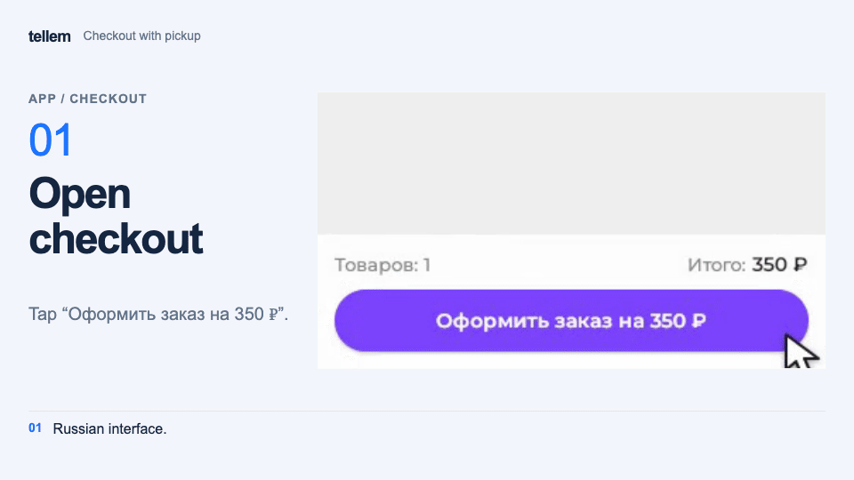
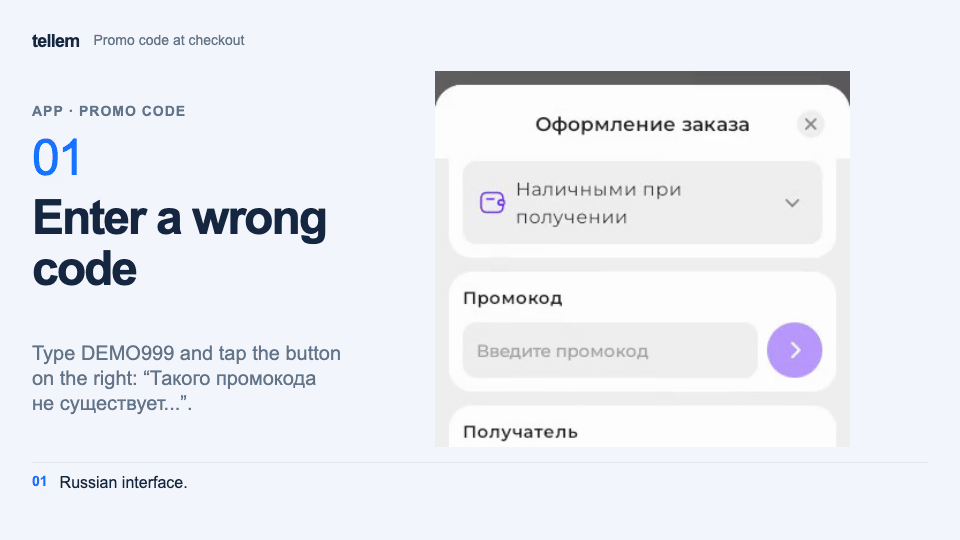

# Checkout and orders { #checkout-and-orders }

You need an account to check out — see [Account, installation, and notifications](account.md). The [cart](ui-and-pages.md) determines which items enter the order.

## Checkout screen { #checkout-screen }

If you leave before placing the order, the app asks **Leave checkout?** Choose **Continue checkout** to keep your entered details on screen, or **Leave** to close checkout without saving them. The confirmation also appears when you use the browser's Back button.

### Delivery method { #delivery-method }

Choose an available fulfillment method. The app selects the first suitable method in the order set by the store. With more than two methods, tap the field and choose one in **Choose a delivery method**. Its cost and delivery time appear below the name when known, or the reason it is unavailable. You cannot place an order while delivery is being calculated; if calculation fails, click **Try again**.

The following fields depend on the method type:

- **Delivery** — an address: **Select a delivery address** or **Add new address**. If none are saved, the tip says **No saved addresses. Add one in your profile.**
- **Pickup** — a store location. Tap it to choose another one in **Choose a pickup point**; until a location is selected, the field reads **Choose location**.
- **CDEK or Yandex Delivery pickup point** — choose **City / locality**: enter at least two letters and select the suggestion with the correct region. Then find a pickup point by street, name, or code. You do not need to create a home address. Select the point again if you change the city or method. If loading fails, click **Try again**.
- **Ozon pickup point** — first select an address, which determines the city, then **Choose a pickup point** with **Search by address or name**. Select the point again if you change the address or method. The recipient's phone number must be registered with Ozon; insurance is already included in the delivery cost.
- **In establishment** — the same **Choose location** field. Opening the app from an iiko table QR code fills in the venue and table number automatically; you can change the number. The table association resets after an order, when you change the venue or fulfillment method, and when the association expires. Check the table number before checkout.
- **Online** — no physical delivery or handover; no address or venue is needed.

???+ example "Example: a pickup order with payment on receipt"

    Example with demo data. The recording shows the Russian interface.

    <figure markdown="span">
    [{ width="960" height="540" loading=lazy }](../../media/app/app-checkout-pickup.en.gif)
    </figure>

If no fulfillment method is currently available, the checkout button says **Ordering is unavailable**.

If the method has a free delivery threshold, a tip below it shows how much more to add. Reaching the threshold shows **Free delivery**. Check the condition after the order is recalculated.

### Payment method { #payment-method }

Check the selected payment method: the app selects the first enabled method in the order set by the store. Choose another if needed.

- **On receipt** — no payment is needed in the app.
- **Online** — pay on the provider's page, opened by **Pay online** after placing the order (see **Confirmation and payment**).

If no methods are enabled, the field stays empty (**Select a payment method**) and you cannot place an order. In reservation mode, this section is absent and the button says **Reserve**: the product is reserved without payment.

### Promo code { #promo-code }

Enter a code in **Enter promo code** and apply it using the round button on the right. The field then becomes locked; tap **×** in the field to remove the code. Codes are case-sensitive; leading and trailing spaces are ignored. The discount appears under **Discount** and applies only to selected items included in the promo code.

??? example "Example: a wrong code, DEMO250 and removing the code"

    Example with demo data. The recording shows the Russian interface.

    <figure markdown="span">
    [{ width="960" height="540" loading=lazy }](../../media/app/app-promo-code-apply.en.gif)
    </figure>

| Message below the field | Reason |
|---|---|
| **This promo code does not exist…** | A typo, incorrect letter case, or the code has not started or has ended |
| **This promo code has reached its maximum usage limit** | The overall usage limit is exhausted |
| **You have already used this promo code** | The per-customer limit is exhausted |
| **Promo code didn't match** | The code is valid, but none of the selected items are included |

If the code ends or reaches its limit before you confirm the order, the order is not created. Remove the code or use another.

### Other sections { #other-sections }

Fill in required recipient details and additional fields if the store asks for them. Recipient fields depend on the payment method. First name, last name, phone, and email are filled in from your profile; if you edit or clear a field, profile updates do not replace it.

For another recipient, leave **Save for future orders** disabled. Existing profile details stay unchanged, but an empty first or last name is filled in from the order even with this option disabled. Before ordering for someone else, fill in your own first and last name in your profile.

Under **Bonuses**, choose **Spend** to use points from your [connected bonus account](account.md). Checkout shows the permitted amount: 1 point equals 1 unit of the store currency, and points cannot cover delivery. Purchase points are awarded after the order is completed.

Check discounts, delivery, and the total in the cost details. Delivery to an address appears separately, including free delivery; other fulfillment methods show this row when their cost is above zero.

Prices and totals retain the fractional precision of the store currency. If the total after redeeming points is zero, the order is marked paid immediately and no payment service page is needed.

## Confirmation and payment { #confirmation-and-payment }

If a [birthday gift](account.md#birthday) is available, its discount appears separately in the price details. For each item, the better price is chosen, accounting for promotions and the promo code. A commission is shown separately; points are redeemed against the final product amount including the commission.

If product prices change before checkout, the app recalculates the order. Review the new total and confirm again; a second order is not created automatically.

Click **Place Order**; the app identifies required fields that still need filling in. On **Thanks for your order!**, open **View order** or **Pay online** if you selected online payment.

For online payment:

1. The order is created as **Awaiting payment**; payment on receipt creates a **New** order.
2. **Pay online** is available on **Thanks for your order!** and in the order card while payment is pending.
3. After payment, the app shows **Payment accepted** or **Payment was not completed**. The order status updates after the provider confirms payment.
4. If payment fails or its deadline expires, the order receives **Payment error** and can no longer be paid.

## Orders and statuses { #orders }

Open **Profile → My orders**, then choose an order. Check fulfillment, payment, and cost on **Details**, and the order contents on **Items**.

| Status | Meaning |
|---|---|
| **New** | Placed, but not yet accepted for processing |
| **Awaiting payment** | Waiting for online payment |
| **Paid** | Payment confirmed |
| **Payment error** | Payment failed or its deadline expired |
| **Pending processing** | Accepted by a manager |
| **Getting ready** | Items are being assembled |
| **In delivery** | Handed over for delivery |
| **Pending pickup** | Ready at the pickup location |
| **Completed** | Handed over to the customer |
| **Canceled** | Order canceled |
| **Returned** | A return has been recorded |

The store changes the status; online payment is confirmed automatically. For CDEK and Yandex Delivery shipments, the status updates using carrier data with a delay. Arrival at a pickup point does not itself complete the order.

To receive messages about status changes, [connect notifications](customer-notifications.md).

Actions on the **Details** tab:

| Button | When available | What it does |
|---|---|---|
| **Cancel** | **New**, **Pending processing**, **Awaiting payment** | Asks for confirmation (**Cancel the order?**). Only a manager can cancel at later stages |
| **Repeat** | **Completed**, **Canceled**, **Returned** | Adds the order's products to the cart and opens it; you must check out again |
| **Pay online** | **Awaiting payment**, with online payment | Opens the provider's page |
| **Support** | Alongside any button above, if the owner added contact details | Opens support contacts |

If the cancellation button is no longer available or you need a refund, contact the store through **Profile → Support**, if the store has added its contacts. Include the order number and ask the store about the refund procedure and timing.

!!! info "For store owners"
    Fulfillment, payment, and reservation setup: [store launch checklist](../crm/getting-started.md). See separate guides for [free delivery thresholds](../crm/free-delivery.md) and [order fields](../crm/custom-fields.md). For processing and cancellations, see [CRM orders](../crm/orders.md).
