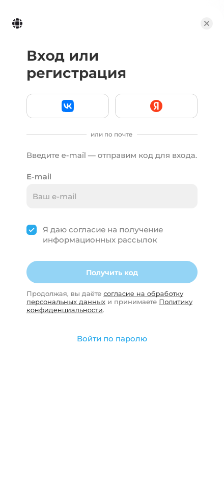
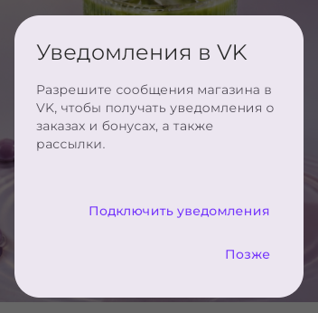

# Уведомления покупателю

Уведомления помогают узнать, что заказ принят в работу, передан в доставку или готов к выдаче, без постоянной проверки приложения. Статус и детали всегда доступны в **«Профиль → Мои заказы»**.

Можно получать сообщения в Telegram или VK, письма на подтверждённый e-mail и push на устройстве. Магазин отправляет сообщение во все включённые вами и доступные каналы: **Telegram, VK, e-mail**. Включённые push приходят дополнительно.

Настройки собраны в **«Профиль → Уведомления»**. Сверху — **«Рассылки»**, ниже **«Куда присылать»**: Telegram, VK и почта, у каждого канала статус и одно действие — переключатель, «Подключить», «Разрешить» или «Подтвердить» ([подробнее](account.md#channels)). Последним идут push. Подпись пункта в профиле перечисляет подключённые и включённые каналы.

## VK { #vk }

### Войдите или привяжите VK

На экране **«Вход или регистрация»** выберите **VK ID**. Если аккаунт магазина уже есть, войдите привычным способом, откройте профиль и нажмите **«Привязать»** рядом с **VK** или **«Подключить»** в строке VK на экране **«Профиль → Уведомления»** — так уведомления будут связаны с вашими заказами. С экрана «Уведомления» после VK вы вернётесь на него же.

{ width="440" }

### Разрешите сообщения

1. После входа или привязки появится окно **«Уведомления в VK»**.
2. Разрешите сообщения кнопкой VK внутри окна. Используйте тот же аккаунт VK, с которым вошли в магазин.
3. Дождитесь завершения подключения. Если разрешение уже было выдано, нажмите **«Подключить уведомления»**.

{ width="440" }

На примере разрешение в VK уже выдано, поэтому вместо кнопки VK показана **«Подключить уведомления»**.

Разрешение относится к личным сообщениям сообщества: в них приходят сообщения о заказах и бонусах, а при включённых «Рассылках» — и рассылки магазина. Оно не добавляет вас в участники сообщества и не подписывает на его записи.

**«Позже»** закрывает предложение: вход и оформление заказа остаются доступными. Чтобы вернуться к подключению, откройте **«Профиль → Уведомления»** и нажмите **«Разрешить»** в строке VK: то же окно откроется без повторного входа. После подключения у строки VK появится переключатель.

### Если не получилось

- **«В виджете открыт другой аккаунт VK»** — переключитесь в VK на аккаунт, привязанный к магазину.
- **«Виджет VK недоступен»** — нажмите **«Повторить»** или **«Открыть VK»**, разрешите сообщения в диалоге сообщества и вернитесь к **«Подключить уведомления»**.
- **«Не удалось подключить уведомления»** — повторите **«Подключить уведомления»**. Уже выданное разрешение не нужно выдавать снова.

Чтобы отключить сообщения, выключите VK в «Куда присылать» или запретите их в диалоге с сообществом в VK. Это не мешает входу через VK ID и покупкам.

## Telegram

Нажмите **Telegram** на экране входа, **«Привязать»** рядом с Telegram в профиле или **«Подключить»** в **«Профиль → Уведомления»**. В открывшемся боте магазина нажмите **Start / «Запустить»** и вернитесь в приложение. Не блокируйте бота, чтобы он мог присылать сообщения о заказе: если бот остановлен, в «Уведомлениях» будет «Бот не запущен» и **«Открыть бота»**. В Telegram Mini App аккаунт подключается при открытии магазина.

## E-mail

Войдите по коду из письма или подтвердите адрес в **«Профиль → Личные данные»**: у неподтверждённой почты в «Уведомлениях» есть кнопка **«Подтвердить»**. Письма о заказе приходят на подтверждённый адрес, если магазин настроил отправку почты и почта включена в «Куда присылать». У неподтверждённой почты переключателя нет; после подтверждения письма начнут приходить.

## Push на устройстве

Откройте **«Профиль → Уведомления»**, включите **«Push-уведомления»** и разрешите уведомления в запросе браузера. Они сообщают о статусах заказа на этом устройстве; нажатие открывает заказ. На iPhone и iPad сначала установите приложение на экран «Домой» — [установка и ограничения push](account.md#push).

## Уведомления о заказе и рассылки

**«Рассылки»** в **«Профиль → Уведомления»** — информационные рассылки магазина: новости и полезная информация, не реклама. Этот переключатель не управляет сообщениями о заказах и бонусах, включая напоминания о сгорании бонусов. Для новостей в VK нужны оба действия: разрешить сообщения сообщества и включить «Рассылки».

Если доступны несколько каналов, сообщение приходит в каждый из них: после подключения VK оно придёт и в Telegram, и в VK. Лишний канал выключается в «Куда присылать» ([как](account.md#channels)); последний включённый выключить нельзя.

!!! info "Для владельца"
    Подключите [сообщество VK](../crm/vk.md) или [Telegram-бота](../../getting-started/bot-setup.md). Информационные сообщения создаются в [«Рассылках»](../crm/mass-mailings.md). Настройки [«Уведомления» в CRM](../crm/crm-notifications.md) предназначены для сотрудников; покупатель разрешает сообщения в своём приложении.
