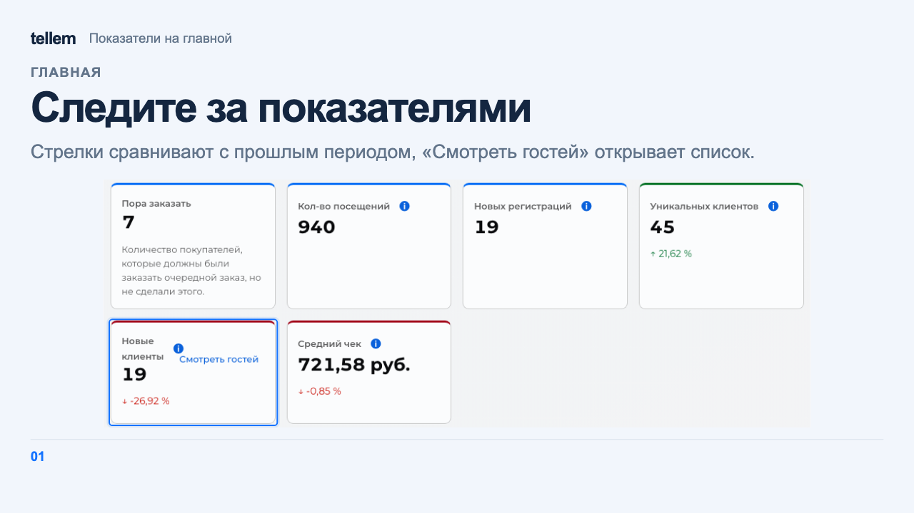
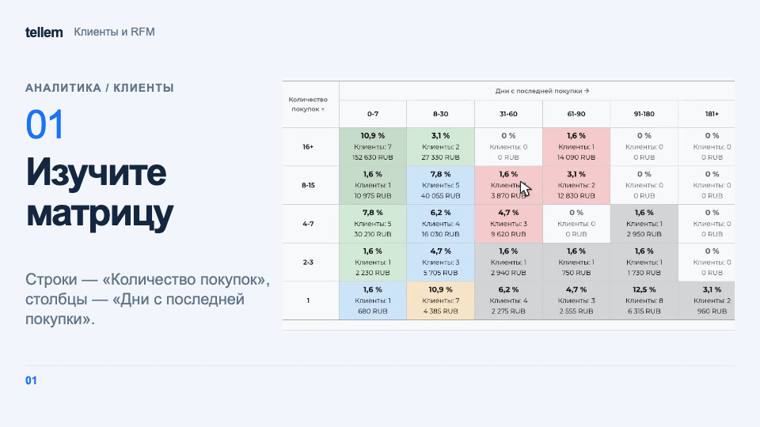
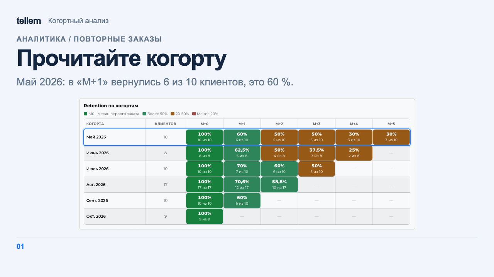

# Главная и аналитика { #home-and-analytics }

На «Главной» и в «Аналитике» можно проверить продажи, повторные покупки и состав клиентов. При одинаковых фильтрах «Главная» и «Обзор» показывают одинаковые показатели.

Где: **Главная** и **Аналитика**.

## Фильтры и расчёт { #filters-and-calculations }

Выберите период, точки, город, тип заказа и платформу. Для произвольного периода выберите «Свои даты» и заполните «С» и «По». Фильтры сохраняются в ссылке.

Единственная точка выбирается автоматически. При нескольких точках пустой выбор означает всю сеть.

В показатели покупок входят только завершённые заказы по дате заказа в часовом поясе CRM. Выручка включает доставку и комиссию, списанные бонусы уже вычтены. Отмена, возврат и ошибка оплаты не считаются покупками. Исправление старого заказа меняет показатели его исходного периода.

Новый покупатель совершил первый завершённый заказ всей сети в выбранный период. Фильтр точки или платформы не меняет дату первой покупки сети. Для небольшой базы часть долей и процентных изменений скрыта; вместо них показаны абсолютные значения. «—» означает, что показатель или сравнение нельзя вычислить.

## Главная { #home }

Формулы показателей доступны по кнопке информации. Изменения сравниваются с предыдущим периодом той же длины. «Смотреть гостей» на карточке открывает соответствующий список клиентов.

??? example "Пример: показатели на главной"

    Пример с демонстрационными данными.

    <figure markdown="span">
    [{ width="1280" height="720" loading=lazy }](../../media/crm/crm-dashboard.png)
    </figure>

Неактивными считаются гости без завершённых заказов за последние 90 дней на конец выбранного периода, но не позже текущего момента. Без фильтров по всей сети учитываются и гости без покупок. При выбранной точке, в том числе единственной, городе, типе заказа или платформе учитываются покупатели этого среза за всю историю.

## Клиенты и RFM { #rfm }

В **Аналитика → Клиенты** покупатели сгруппированы по давности, частоте и сумме покупок. Такой способ группировки называется RFM. Выберите сегмент, чтобы увидеть его клиентов, затем откройте карточку нужного гостя. «Все клиенты» у матрицы включает и гостей без покупок в общем срезе сети.

???+ example "Пример: от матрицы RFM до заказов клиента"

    Пример с демонстрационными данными.

    <figure markdown="span">
    [{ width="960" height="540" loading=lazy }](../../media/crm/crm-rfm-drilldown.gif)
    </figure>

Матрица считает RFM за всю историю выбранных точек: покупки клиента объединяются, и каждый клиент учитывается один раз. Для рассылок и сохранённых сегментов используется отдельный расчёт по каждой точке за всё время, который обновляется отдельно, в том числе после сохранения **Настройки → RFM аналитика**. Поэтому состав групп может отличаться. Гости без завершённых заказов не получают RFM-сегмент.

### Сегменты аудитории { #audience-segments }

Чтобы выбрать клиентов по собственным условиям и оценить доступность связи, откройте **Аналитика → Сегменты**. Порядок работы и ограничения описаны в [сегментах](segments.md).

## Когорты { #cohorts }

В **Аналитика → Повторные заказы** в блоке «Когортный анализ» сравните повторные покупки клиентов, впервые купивших в одном месяце. Такая группа называется когортой.

??? example "Пример: когортная таблица"

    Пример с демонстрационными данными.

    <figure markdown="span">
    [{ width="1280" height="720" loading=lazy }](../../media/crm/crm-cohorts.png)
    </figure>

- Строка соответствует месяцу первой завершённой покупки; «Клиентов» показывает размер группы.
- «M+0» равно 100 %. В следующих месяцах показаны доля вернувшихся и «N из M». Каждый клиент учитывается один раз в месяц; будущие месяцы отмечены «—».
- «Год когорты» задаёт год первой покупки. Повторные покупки учитываются и в следующем году. В отчёт входят завершённые заказы всех магазинов по дате завершения.
- Выбрать когорту для рассылки нельзя.

## Обзор { #overview }

В **Аналитика → Обзор** режим «Владелец» показывает ключевые показатели и сравнение точек. «Маркетолог» добавляет подробные разбивки продаж, товаров, отмен, оплат и регистраций.

«Регистрации» включает гостей, зарегистрировавшихся за период, в том числе без покупок. Фильтры типа и платформы заказа оставляют гостей с соответствующими покупками. Без меток «Первая известная атрибуция», то есть первый известный источник клиента, показывает «Не определено»; платформа заказа его не определяет.

Без покупок графики скрыты, но регистрации и неактивность доступны. При выгрузке CSV сохраняются текущие фильтры; список гостей выгружается целиком, включая остальные страницы. Действия с карточкой покупателя описаны в [разделе «Клиенты»](clients.md).

## Метки { #tags }

В **Аналитика → Источники** сравните [первые и повторные покупки по меткам](utm-marks.md#effectiveness). Графики ниже показывают привязки [пригласительных ссылок](utm-marks.md#tag-links), включая существующих клиентов.

## Отчеты { #reports }

Откройте **Отчеты → Отчёты об остатках**, выберите «Остатки на складах» и нажмите «Скачать». Кнопки Excel на экранах заказов, клиентов, товаров и наличия выгружают соответствующие таблицы.
