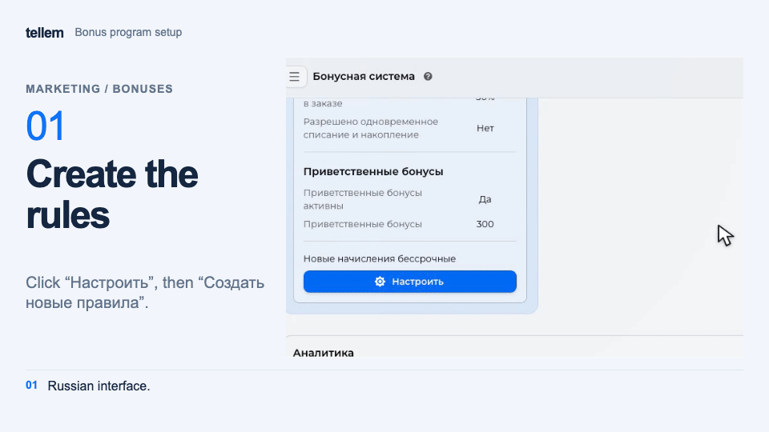
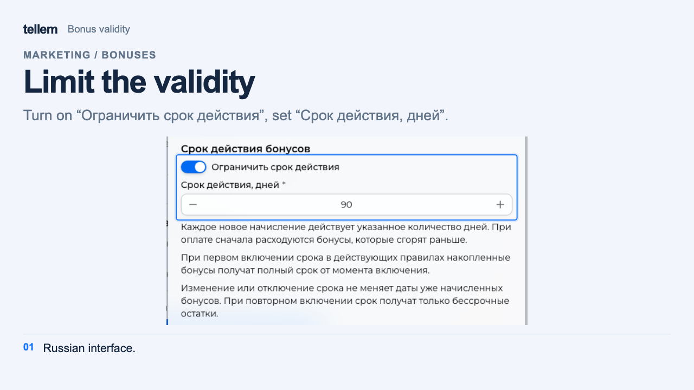

# Loyalty program { #loyalty-program }

Buyers earn points for orders and use them to pay for part of their products. One point equals one unit of the store's currency, such as ₽1 for a store using rubles.

Where: **Marketing → Bonuses**. See the [application profile](../app/account.md) for how buyers join.

## Enable and configure { #enable-and-configure }

Rules and the “Configure” button appear when the loyalty program is on. Review the active earning percentages, redemption limits, welcome gift, and validity period. Contact the Tellem team about a third-party loyalty program.

???+ example "Example: bonus rules"

    Example with demo data. The recording shows the Russian interface.

    <figure markdown="span">
    [{ width="960" height="540" loading=lazy }](../../media/crm/crm-bonus-setup.en.gif)
    </figure>

1. Enable the loyalty program with the switch on the main screen. The same switch disables it immediately.
2. For Tellem rules, click “Configure”. Rule sets open as tabs; to add a set, click “Create new rules”. Only one set can be active.
3. Add at least one earning condition: an order amount from 0 and a percentage from 1 to 99. Set the maximum redemption percentage from 0 to 100 and decide whether to allow earning and redeeming together.
4. Enable welcome points if needed. Buyers receive them when joining the program, rather than when registering in the store.
5. For a new set, click “Make active”, then “Save rules”. Without the first action, the set remains a draft. Changes to active rules also apply after saving.

!!! warning "Deleting rules"
    Only inactive sets can be deleted. “Delete rules” removes the set immediately, without confirmation.

## How points are calculated { #how-points-are-calculated }

- The calculation base is product cost after promotions, promo codes, and [payment method fees](payment-providers.md). Delivery is excluded.
- Earning uses the highest percentage among conditions whose threshold does not exceed the base. If earning and redeeming together is allowed, the threshold and percentage use the base minus redeemed points. Otherwise, an order with redeemed points earns none.
- The earned amount is rounded down and fixed when the order is created; later rule changes do not affect it. Buyers receive points after order completion.
- Redemption is limited to the configured share of the base and the available balance. Points with the nearest expiry date are spent first.
- Cancellation or return restores redeemed points and reverses points earned for a completed order. Restored points keep their original expiry date; if it has passed, they remain valid for another 7 days. Already expired points are not deducted again.

A buyer's balance and transactions are available in the [customer record](clients.md#bonuses).

The monetary base used to calculate whole points is rounded down to a whole currency unit; earning thresholds use the exact amount. For online payments, redemption is limited so that a positive balance meets the payment service minimum. A fully covered order is marked paid without opening a payment page.

## Birthday points { #birthday }

In **Marketing → Bonuses → Configure**, open the active Tellem rule set, enable “Grant birthday bonuses”, enter a positive whole amount, and click “Save rules”. The loyalty program must be enabled.

The shared screenshot shows the Russian interface.

Only one gift can be enabled: points or a [birthday discount](promo-codes.md#birthday). To change the gift type, first disable the previous one in its editor. Points already awarded remain available.

A program member receives the gift if their birthday was saved before that day began. An account is not created automatically; buyers can [join the program](../app/account.md#birthday) on their birthday if they provided the date in advance. No purchase is required. Points may appear after a delay and have the same validity as new awards. Cancelling an order does not reverse the gift.

### Compensate for a missed gift { #birthday-compensation }

Missed birthdays are not compensated automatically. In **Clients → customer record**, an owner or administrator can click “Compensate birthday gift” and confirm.

Compensation is available for a saved customer for the most recent birthday, including one in the previous calendar year. The date must have been provided in advance, birthday points enabled, and a Tellem account already created. Confirming again does not award a second gift for the same year.

## Expiry and reminders { #expiry }

In Tellem rules, enable “Limit bonus validity” and enter a positive whole number of days in “Valid for, days”.

??? example "Example: bonus validity"

    Example with demo data. The image shows the Russian interface.

    <figure markdown="span">
    [{ width="1280" height="720" loading=lazy }](../../media/crm/crm-bonus-expiry.en.png)
    </figure>

- Each new award, including a manual top-up, lasts this many days from crediting.
- When expiry is first enabled, the existing balance receives the full period starting when the rules are saved.
- Changing or disabling expiry does not alter dates on points already awarded. Enabling it again assigns dates only to points without expiry.

Under “Warn guests”, enable “Send expiration reminders” and set the lead time from one day to the full validity period. A reminder with the amount and expiry date in Coordinated Universal Time (UTC) goes to available, enabled Telegram, VK, and email channels; it may arrive after a delay.

This is a service message: opting out of mailings and the Telegram “Mass mailing” notification setting do not disable it. Buyers check channel availability in their [profile](../app/account.md#channels).

If points are spent before sending, the reminder is cancelled. Each available channel receives one reminder per expiry date; a channel connected later does not receive it. A channel disabled or unavailable at sending time also receives no message.
