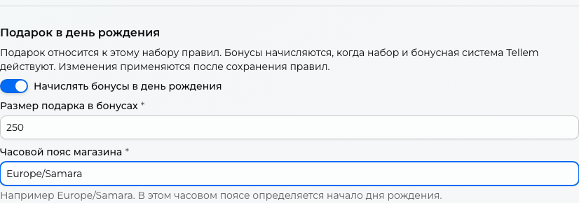

# Бонусная система

Покупатели копят бонусы за заказы и оплачивают ими часть стоимости товаров. 1 бонус равен одной денежной единице магазина (в рублях — 1 ₽).

Где: **Маркетинг → Бонусы**. Как покупатель вступает в программу и видит бонусы — [Аккаунт, установка и уведомления](../app/account.md).

## По умолчанию

Система выключена. Провайдер по умолчанию — «Tellem» (внутренняя система; для сторонней бонусной системы напишите команде Tellem). Действует набор правил «Базовые настройки»:

- накопление: 3 % при сумме заказа от 0, 5 % — от 5000, 7 % — от 10000;
- списание: до 50 % от стоимости товаров; одновременно списывать и копить нельзя;
- приветственные бонусы: 300.

## Экран «Бонусная система»

- Переключатель вверху карточки включает систему (единственный провайдер выбирается сам) и выключает её сразу.
- «Система учёта бонусов» — активный провайдер; ниже действующие «Правила накопления», «Правила списания», «Приветственные бонусы» и срок новых начислений.
- «Настроить» открывает правила. Кнопка видна, только если есть действующий набор.
- В блоке «Аналитика» — «Участники бонусной системы», «Всего получено бонусов», «Всего потрачено бонусов» (в скобках доля от полученных; сгоревшие не входят), «Сгоревшие бонусы» и таблица «Последние операции».

## Наборы правил

В окне «Редактирование бонусной системы» у каждого набора своя вкладка, новый создаёт «Создать новые правила». Действующим может быть только один набор.

1. Укажите «Наименование». В «Правилах накопления» добавьте хотя бы одно условие («Добавить условие»): «Сумма заказа от» (0 или больше) и «Начисление» (1–99 %).
2. В «Правилах списания» задайте «Макс. процент для списания в заказе» (0–100, обязательно) и, если нужно, «Разрешено одновременное списание и накопление».
3. Включите «Приветственные бонусы активны» и укажите «Приветственные бонусы». Их получают при вступлении в программу, а не при регистрации в магазине.
4. Нажмите «Сделать действующими», затем «Сохранить правила» (она закрывает окно). Без первой кнопки набор остаётся черновиком и на покупателей не влияет. Правки действующего набора тоже вступают в силу после «Сохранить правила».

«Удалить правила» доступна только для неактивного набора и удаляет его сразу, без подтверждения.

## Как считаются бонусы

- База расчёта — стоимость товаров заказа с учётом акций, промокода и комиссии способа оплаты ([«Оплата»](payment-providers.md)). Доставка в неё не входит.
- Начисление: наибольший процент из условий, у которых «Сумма заказа от» не больше базы. Если в заказе списаны бонусы и «Разрешено одновременное списание и накопление» включено, порог и процент считаются от базы за вычетом списанного; если выключено, такой заказ ничего не начисляет. Результат округляется вниз и фиксируется при создании заказа, поздние правки правил его не меняют. Бонусы зачисляются, когда заказ становится «Завершён».
- Списание: не больше «Макс. процент для списания в заказе» от базы и не больше баланса. Сначала тратятся бонусы с ближайшим сроком сгорания.
- При «Отменён» и «Возврат» откатывается списание, а если заказ уже был завершён, то и начисление. Возвращённые бонусы сохраняют прежнюю дату сгорания, а если она прошла, действуют ещё 7 дней. Уже сгоревшие бонусы отмена начисления повторно не списывает.

## Бонусы в день рождения { #birthday }

Подарок настраивается в **Маркетинг → Бонусы → Настроить**, внутри нужного набора правил Tellem. Включите «Начислять бонусы в день рождения», укажите положительное целое количество, затем нажмите **«Сохранить правила»**. Набор должен быть действующим, а бонусная система — включённой. Отмена окна не применяет изменения.

Одновременно может действовать один подарок: birthday-бонусы или [birthday-акция](promo-codes.md#birthday). Чтобы включить другой вариант, сначала выключите прежний в его редакторе. Уже начисленные бонусы сохраняются.

Бонусы начисляются в сам день рождения без покупки участникам программы, указавшим дату до начала праздника; новый счёт автоматически не создаётся. Проверка работает каждые 15 минут и при входе или подключении программы в сам праздник.

Срок действия подарочных бонусов — как у новых начислений по действующим правилам; операция видна в истории как «Бонусы в день рождения». Подарок не зависит от завершения заказа и не отменяется при отмене заказа.

Полностью пропущенный из-за простоя день автоматически не компенсируется. В **Клиенты → карточка клиента** владелец или администратор может нажать «Компенсировать подарок в день рождения» и подтвердить действие. Кнопка доступна только для сохранённого клиента. Компенсация возможна за последний наступивший день рождения, включая праздник 31 декабря после перехода в новый год, если дата была указана заранее, подарочные бонусы включены и счёт Tellem уже существует. Запись в годовом журнале предотвращает повторный подарок; повторное нажатие сумму не увеличивает.

## Срок действия и напоминания

В правилах Tellem включите «Ограничить срок действия» и укажите «Срок действия, дней» (целое, больше нуля).

- Каждое новое начисление действует это число дней от зачисления, ручное пополнение баланса тоже.
- При первом включении срока накопленный остаток получает полный срок от момента сохранения правил.
- Изменение или отключение срока не меняет даты уже начисленных бонусов. При повторном включении срок получают только бонусы без даты.

«Предупреждать гостей»: включите «Напоминать о сгорании» и задайте «За сколько дней предупредить» (от 1 дня до срока действия, по умолчанию 7 или весь срок, если он короче). Предупреждение приходит в каждый канал, который гость не выключил и который доступен: Telegram, VK, электронная почта. Используются настроенные интеграции и доступные контакты гостя.

- Напоминание — служебное сообщение, как статус заказа: его получают и клиенты, отказавшиеся от рассылок, если у них есть включённый и доступный канал: активный Telegram, доступный VK или подтверждённая почта. В Telegram оно не зависит от типа «Массовая рассылка» в «Настройки → Уведомления». В нём сумма и дата сгорания (UTC).
- Задание работает раз в 15 минут, поэтому сообщение может прийти чуть позже начала периода.
- Если бонусы потрачены до отправки, напоминание отменяется. На одну дату сгорания напоминания создаются один раз, по одному на каждый доступный в тот момент канал; канал, подключённый позже, его не получит. Если канал выключили или он стал недоступен до отправки, напоминание в него отменяется.

!!! note "Изменение в этой версии"
    С этой версии напоминания приходят и без согласия на рассылки, в том числе в VK и в Telegram при выключенной «Массовой рассылке».
