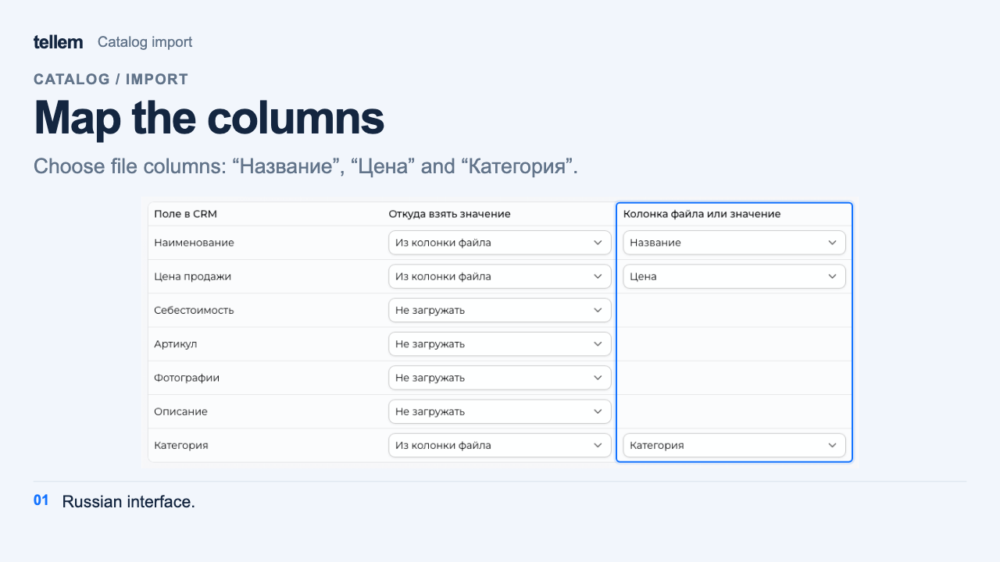

# Catalog import { #catalog-import }

Upload products or categories from a CSV table or a **Yandex Market** export (YML). Excel and JSON are not supported. Test the import with a few rows first.

For a restaurant menu, use [the iiko menu import](iiko.md#import-products).

Where: **Catalog → Import**.

1. Under “Loading data”, choose the file type and upload the file. For CSV, also choose “Product” or “Category” in “Entity type”: one type of record can be imported at a time.
2. For CSV, under “Import configuration”, match file columns to CRM fields. Skip fields you do not need; common values can be entered once for all rows. Use links for photos.
3. If rows with the same name in one category should become variants of one product, enable “Combine rows with the same product name” in the product merging section and specify the differences, such as weight, size, or color.
4. Under “Review before saving”, correct the entries and check photos. The price appears in the product window that opens from the product name. Wait for linked photos to finish loading, then click “Save to catalog”. CRM shows a success message, and the products appear in **Catalog → Products**.

The catalog does not change until the last step.

???+ example "Example: importing two products from CSV"

    Example with demo data. The recording shows the Russian interface.

    <figure markdown="span">
    [{ width="960" height="540" loading=lazy }](../../media/crm/crm-catalog-import.en.gif)
    </figure>

## CSV example { #csv-example }

[Download an example with two products](../../examples/catalog-products.en.csv). The product names and prices are examples for a store using RUB; replace them before uploading your own catalog.

During configuration, map **Name** to the product name, **Price** to the selling price, and **Category** to the category. Skip the remaining fields and leave product merging disabled.

<figure markdown="1">

{ loading=lazy }

<figcaption>Mapping the example file's three columns to CRM fields. The screenshot shows the Russian interface and the Russian CSV example.</figcaption>
</figure>

Before saving, check the result: **Green tea** priced at 250.00 and **Ground coffee** priced at 490.00 in **Drinks**. After saving, set [stock in the store](inventory.md#by-store).

## Format and limitations { #format }

In CSV, the first row must contain headers. The delimiter is detected automatically: comma, semicolon, tab, or “|”. YML skips configuration and imports nested categories, article codes, photos, weight, and dimensions; cost price is set equal to the price.

Prices retain the fractional precision of the store currency. Negative amounts, excess significant decimal places, and invalid prices appear in the error report; CRM skips those rows. The export currency must match the store currency: import does not convert amounts at an exchange rate.

In CSV, use a dot or comma for the decimal part and spaces to separate thousands. For example, `1 234,50` means 1234 rubles and 50 kopecks when the store currency is RUB. CRM treats a single dot or comma as the decimal separator.

!!! warning "Check prices, categories, and stock"
    In CSV, skipping the price field during import configuration sets the product price to 0. If you map a price column, enter a numeric value; use `0` for a free product. YML requires a price.

    Without a category, a product goes to the uncategorized category, which buyers cannot see. A category named in CSV is created if it does not exist in CRM.

    Imported products have quantity 0 in every store. Assign [categories](products-and-categories.md#categories) and set [stock](inventory.md#by-store) before offering products to buyers.
