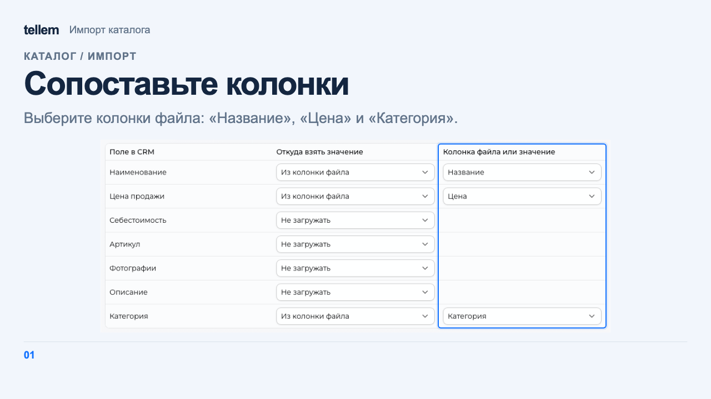

# Импорт каталога { #catalog-import }

Загрузите товары или категории из таблицы CSV либо выгрузки «Яндекс Маркет» (YML). Excel и JSON не поддерживаются. Сначала проверьте импорт на нескольких строках.

Для меню ресторана используйте [добавление товаров из iiko](iiko.md#import-products).

Где: **Каталог → Импорт**.

1. На шаге «Загрузка данных» выберите тип файла и загрузите его. Для CSV также выберите в «Тип сущности» «Товар» или «Категория»: за один раз можно загрузить один тип записей.
2. Для CSV на шаге «Настройка импорта» сопоставьте колонки файла с полями CRM. Ненужные поля пропустите; общие значения можно указать сразу для всех строк. Для фотографий используйте ссылки.
3. Если строки с одинаковым названием в одной категории должны стать вариантами одного товара, в разделе «Объединение товаров» включите «Объединять строки с одинаковым названием» и задайте отличия, например вес, размер или цвет.
4. На шаге «Проверьте перед сохранением» исправьте записи и проверьте фотографии. Цена видна в окне товара, которое открывается по его названию. Дождитесь загрузки фотографий по ссылкам и нажмите «Сохранить в каталог». CRM покажет «Успешно!», а товары появятся в **Каталог → Товары**.

До последнего шага каталог не меняется.

???+ example "Пример: импорт двух товаров из CSV"

    Пример с демонстрационными данными.

    <figure markdown="span">
    [{ width="960" height="540" loading=lazy }](../../media/crm/crm-catalog-import.gif)
    </figure>

## Пример CSV { #csv-example }

[Скачайте пример с двумя товарами](../../examples/catalog-products.csv). Это учебные названия и цены для магазина с валютой RUB; замените их перед загрузкой своего каталога.

На шаге настройки сопоставьте колонку «Название» с названием товара, «Цена» с ценой продажи, «Категория» с категорией. Остальные поля пропустите, объединение товаров оставьте выключенным.

<figure markdown="1">

{ loading=lazy }

<figcaption>Сопоставление трёх колонок учебного CSV с полями CRM.</figcaption>
</figure>

Перед сохранением проверьте результат: «Чай зелёный» по цене 250,00 и «Кофе молотый» по цене 490,00 в категории «Напитки». После сохранения задайте [наличие в магазине](inventory.md#by-store).

## Формат и ограничения { #format }

В CSV первая строка должна содержать заголовки. Разделитель определяется автоматически: запятая, точка с запятой, табуляция или «|». YML пропускает шаг настройки и переносит вложенные категории, артикул, фото, вес и габариты; себестоимость становится равной цене.

Цены сохраняют дробную часть с точностью валюты магазина. Отрицательная цена, лишние значащие знаки после запятой или неверно записанная цена попадут в отчёт об ошибках; CRM пропустит такую строку. Валюта выгрузки должна совпадать с валютой магазина: импорт не пересчитывает суммы по курсу.

В CSV используйте точку или запятую для дробной части, а пробелы для разделения тысяч. Например, `1 234,50` означает 1234 рубля 50 копеек при валюте магазина RUB. Одиночную точку или запятую CRM считает десятичным разделителем.

!!! warning "Проверьте цены, категории и наличие"
    Если при настройке CSV пропустить цену, товар получит цену 0. Если колонка цены выбрана, заполните её числом; для бесплатного товара укажите `0`. В YML цена обязательна.

    Без категории товар попадёт в «Без категории», которую покупатели не видят. Категория из CSV, которой ещё нет в CRM, будет создана.

    После импорта количество товаров равно 0 во всех магазинах. Назначьте [категории](products-and-categories.md#categories) и задайте [наличие](inventory.md#by-store), прежде чем предлагать товары покупателям.
