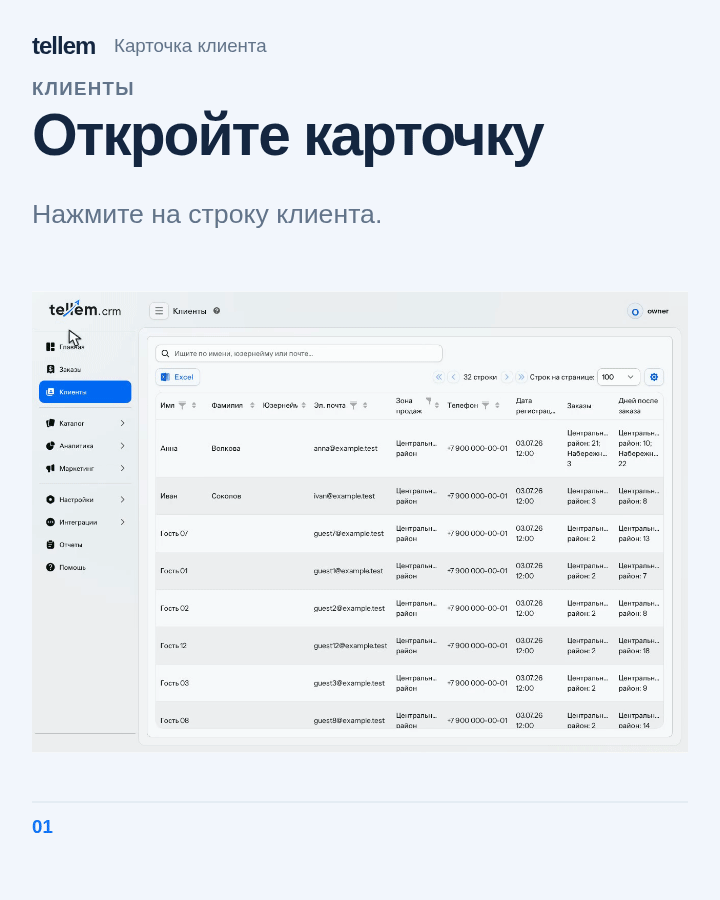

# Customers { #customers }

Find a buyer, contact them, or check their orders and points.

Where: **Clients**. A buyer appears in the list after using the application; you cannot create or delete their record manually.

## Find and contact a customer { #find-and-contact-a-customer }

Enter a query and press Enter: search matches first name, last name, patronymic, Telegram username, and email. For phone numbers, use the column header filter. The Excel button exports the table.

Open the customer portrait and use the buttons in the contacts block to open Telegram or your email application. You can use an unverified email address to send a message. Use [Mailings](mass-mailings.md) to message several customers.

## Customer record { #customer-record }

Click a customer row, or select it and press Enter, to open “Customer portrait”. On a wide screen, the portrait opens in a panel on the right over the table, keeping the table's width; on a small screen, it opens in a dialog.

On a wide screen, drag the panel's left edge to change its width. While the section stays open, your chosen width remains when you switch customers or reopen the portrait.

Close the portrait with its close button or Escape. If you edited data, confirm whether to save or discard the changes before closing it or choosing another customer.

When you open the portrait from an analytics list, CRM keeps the report's locations and period. If you open the portrait for a specific location, CRM keeps that location selected. Otherwise, CRM chooses the available location with the highest total R + F + M score from the [saved calculation](analytics.md#rfm), respecting the report's location filter. CRM selects a single location even without scores; with several locations and no scores, choose one manually.

Above the tabs, review the RFM segment, completed purchases over all time, their total, and days without a purchase. The entire summary uses the segment color from [Analytics](analytics.md#rfm). With no purchases, the record explains this instead of showing zero metrics. Select a “Sales area” in the summary to review that location.

[{ loading=lazy width=720 height=900 }](../../media/crm/client-profile-campaigns.gif)

*The shared GIF shows Russian interface labels and captions.*

Contacts and addresses are read-only: the buyer changes them in their [application profile](../app/account.md). On the “Permissions” tab, you can disable delivery or pickup orders. Buyers then stop seeing all methods of that type, including carriers. “Online” and “In establishment” remain available; the catalog-viewing permission has no effect on access.

“[username unavailable]” in the Telegram contact means the buyer has linked Telegram, but the username is unavailable. This label does not indicate whether they receive bot messages. A dash means Telegram is not linked.

The “Orders” tab shows the customer's order history. To process an order, find it by number in [Orders](orders.md).

### Purchase profile { #purchase-profile }

In **“Profile”**, review **“Purchase rhythm”**: the customer follows the usual rhythm, is due for an invitation, or has not purchased for a long time. The last purchase and the usual interval for customers at the selected location appear beside it. This is the location's benchmark, not the customer's personal schedule. With insufficient data, the assessment is unavailable.

Day, time, product, and fulfillment preferences appear when the purchase history supports them. If the location's purchase count differs from the RFM summary, it appears separately. Historical report metrics do not overwrite the current marketing profile.

### Campaigns { #campaigns }

Select a location in the summary and open **“Campaigns”**. Select a row and click **“Open campaign”** to review the original settings and message.

The history shows membership in the audience at launch. Opt-outs, new orders, and segment changes do not alter it; membership does not confirm delivery or reading. See [Campaigns and mailings](mass-mailings.md) for launch and repeat rules.

### Points { #bonuses }

“Bonuses” is available when the loyalty program is enabled. Check the balance, next expiry, and transaction history there. Buyers who have not joined have no balance. Manual balance changes are available only for Tellem and appear as a manual adjustment in history. See the [loyalty program](bonus-system.md) for calculation and expiry rules.

### Birthday { #birthday }

Enter or change the day and month without a year, then save before the gift period begins. If you delete the date manually, the application does not fill it again from an external service. Buyers see gift conditions in their [profile](../app/account.md#birthday).

An owner or administrator can compensate for missed points with “Compensate birthday gift” in the contact block. Review the [compensation conditions](bonus-system.md#birthday-compensation) before confirming.

Use [Segments](segments.md) to select an audience by purchase behavior, or [Analytics](analytics.md#rfm) to review customer metrics.
