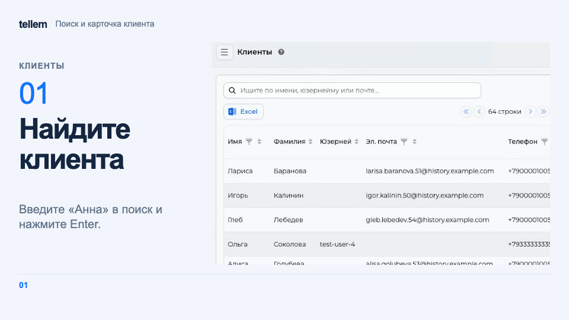

# Клиенты { #customers }

Найдите покупателя, свяжитесь с ним или проверьте его заказы и бонусы.

Где: **Клиенты**. Покупатель появляется в списке после действий в приложении; создать или удалить его вручную нельзя.

## Найти и связаться { #find-and-contact-a-customer }

Введите запрос и нажмите Enter: поиск работает по имени, фамилии, отчеству, имени пользователя Telegram и почте. Для телефона используйте фильтр в заголовке колонки. Кнопка Excel выгружает таблицу.

Выберите клиента и откройте «Связаться». В меню видны только каналы, доступные этому клиенту:

- «Телеграм» откроет чат, если у клиента есть имя пользователя Telegram.
- «Эл. почта» откроет окно письма на подтверждённый адрес; первая строка станет темой. Если письмо не удалось отправить, проверьте доступность почтовой отправки у команды Tellem.

???+ example "Пример: поиск и карточка клиента"

    Пример с демонстрационными данными.

    <figure markdown="span">
    [{ width="960" height="540" loading=lazy }](../../media/crm/crm-client-card.gif)
    </figure>

Кнопки связи внутри карточки клиента открывают Telegram или вашу почтовую программу; там можно использовать и неподтверждённую почту. Для сообщения нескольким клиентам используйте [рассылки](mass-mailings.md).

## Карточка клиента { #customer-record }

Откройте карточку «Портрет клиента» кнопкой «Изменить» или выберите «Показать заказы», чтобы перейти сразу к заказам. Сохраните изменения перед выходом.

Контакты и адреса доступны только для просмотра: покупатель меняет их в [профиле приложения](../app/account.md). На вкладке «Права» можно отключить заказы с доставкой или самовывозом. Покупатель перестанет видеть все способы выбранного типа, включая перевозчиков. «Онлайн» и «В заведении» останутся доступны; «Просмотр каталога» на доступ не влияет.

Во вкладке «Заказы» видна история заказов клиента. Чтобы обработать заказ, найдите его по номеру в [разделе «Заказы»](orders.md).

### Бонусы { #bonuses }

Вкладка «Бонусы» доступна при включённой бонусной системе. В ней можно проверить баланс, ближайшее сгорание и историю операций. Если покупатель не подключил программу, баланса нет. Вручную менять баланс можно только для Tellem; в истории появится «Ручная корректировка бонусов». Правила расчёта и сгорания находятся в [бонусной системе](bonus-system.md).

### День рождения { #birthday }

Укажите или измените день и месяц без года, затем сохраните карточку до начала периода подарка. Удалённую вручную дату приложение не заполнит повторно из внешнего сервиса. Условия подарка покупатель увидит в [профиле](../app/account.md#birthday).

Владелец или администратор может компенсировать пропущенные бонусы кнопкой «Компенсировать подарок в день рождения» в бонусном разделе. Перед подтверждением проверьте [условия компенсации](bonus-system.md#birthday-compensation).

Для выбора аудитории по покупкам откройте [сегменты](segments.md); для показателей по клиентам используйте [аналитику](analytics.md#rfm).
