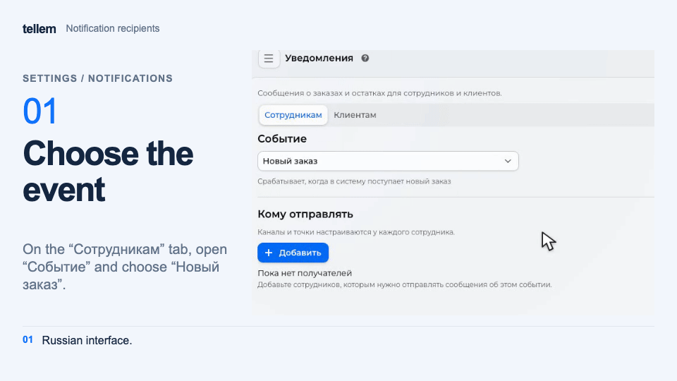

# Notifications { #notifications }

Configure order and stock messages for staff, and add text to customer notifications.

Open **Settings → Notifications**. On the **Staff** tab, choose an **Event**. On the **Customers** tab,
customize order status messages.

## For staff { #seller-notifications }

| Notification | When it is sent |
|---|---|
| Low stock | Stock changes and falls below **Stock below**; archived products are excluded |
| New order | An order is created as **New** or **Awaiting payment**, before payment |
| Order cancellation | A customer or staff member cancels an order |
| Overdue payment | An unpaid order is canceled or enters **Payment error** because the deadline expired or payment was declined |
| Unread orders | At the configured interval while **New** orders remain; **Repeat after** sets the interval in minutes |
| iiko errors | An order, status update, or stop list could not be transferred; the message includes [next steps](iiko-errors.md) |

Set the payment deadline in the [payment method](payment-providers.md).

## Recipients { #seller-recipients }

1. Under **Recipients**, click **Add** and select the staff member's account from the customer list. A Telegram account is not required.
2. Choose a delivery method in **Send via**. Contact details come from the customer card.
3. Choose the **Stores** whose notifications the staff member needs. Without a selected store, messages will not arrive. Low stock notifications do not have this field.

???+ example "Example: recipient of new order notifications"

    Example with demo data. The recording shows the Russian interface.

    <figure markdown="span">
    [{ width="960" height="540" loading=lazy }](../../media/crm/crm-staff-notifications.en.gif)
    </figure>

On a computer, the fields appear in the recipient's row. On a phone, tap **Settings** next to the recipient,
edit the fields in the dialog, and tap **Save**. **Cancel** and closing the dialog keep the previous settings.

To remove a recipient, click the trash icon in their row on a computer, or choose **Settings → Remove**
on a phone. Confirm removal. The staff member stops receiving messages only for the selected event;
their settings for other events stay unchanged.

| Send via | Result |
|---|---|
| Telegram | Only in Telegram |
| VK | Only in private messages with the VK community |
| Email | Only by email |
| Telegram, VK and email | Every available channel |
| Automatic | One available channel, preferring Telegram, then VK, then email |
| Do not send | Pause messages for this recipient and keep their settings |

On a computer, changes in the row save immediately. Telegram requires a linked account and an enabled [bot integration](../../getting-started/bot-setup.md). Email requires mail delivery to be configured on the platform. If a channel is unavailable, a warning appears below **Send via**.

For VK, connect the [store community](vk.md). The staff member must link VK to their account and [allow community messages](../app/customer-notifications.md#vk). VK supports every event in the table above. Customer notification and mailing switches in the staff member's profile do not affect these messages.

With **Automatic**, the CRM chooses an available channel before sending. If delivery fails in the chosen channel, the CRM does not redirect the message to another.

**iiko errors** is available while at least one iiko connection is saved. It shares recipients with the connection wizard's **Notifications** step. Without recipients, nobody receives a message; if the affected venue is unknown, the selected staff with delivery enabled receive it.

## For customers { #customer-status }

Customers receive **Order status change** messages through all [available channels they have enabled](../app/customer-notifications.md). Staff recipient settings do not affect them.

To add your own text to the system message:

1. Click **Create**, choose a **Status**, and enter a **Message**.
2. Review **Final message** and save. Each status can have one message; edit the existing one to change it.

The text is added to Telegram, VK, and email messages; push does not include it. The main text is sent without translations.

The `%name%` placeholder inserts an order system attribute's value, where `name` is the attribute name. [Custom integrations](integrations.md#пользовательские) can fill these attributes.
