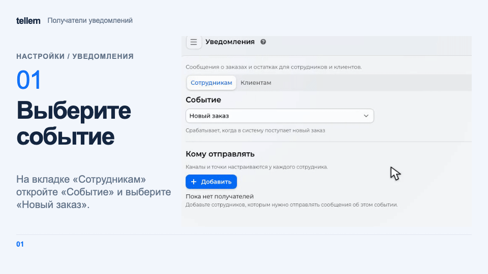

# Уведомления { #notifications }

Настройте сообщения сотрудникам о заказах и остатках и добавьте текст к уведомлениям покупателей.

Откройте **Настройки → Уведомления**. На вкладке **Сотрудникам** выберите **Событие**, а на вкладке
**Клиентам** настройте текст сообщений о статусе заказа.

## Сотрудникам { #seller-notifications }

| Уведомление | Когда приходит |
|---|---|
| Низкий остаток товара | Остаток изменился и стал меньше значения **Остаток меньше**; архивные товары не учитываются |
| Новый заказ | Создан заказ **Новый** или **Ожидает оплаты**, ещё до оплаты |
| Отмена заказа | Покупатель или сотрудник отменил заказ |
| Просроченная оплата | Неоплаченный заказ отменён или получил **Ошибка оплаты** из-за истечения срока либо отказа в оплате |
| Непросмотренные заказы | С заданным интервалом, пока есть заказы **Новый**; интервал в минутах задаётся полем **Повторять через** |
| Ошибки iiko | Не удалось передать заказ, обновить его статус или стоп-лист; сообщение содержит [дальнейшие действия](iiko-errors.md) |

Срок ожидания платежа задаётся в [способе оплаты](payment-providers.md).

## Получатели { #seller-recipients }

1. В разделе **Кому отправлять** нажмите **Добавить** и выберите аккаунт сотрудника из списка клиентов. Подойдёт аккаунт без Telegram.
2. В поле **Куда отправлять** выберите способ доставки. Контакты берутся из карточки клиента.
3. Выберите **Точки**, по которым сотрудник должен получать сообщения. Без выбранной точки сообщения не придут. У уведомления о низком остатке этого поля нет.

???+ example "Пример: получатель уведомлений о новом заказе"

    Пример с демонстрационными данными.

    <figure markdown="span">
    [{ width="960" height="540" loading=lazy }](../../media/crm/crm-staff-notifications.gif)
    </figure>

На компьютере поля доступны в строке получателя. На телефоне нажмите **Настройки** рядом с получателем,
измените поля в окне и нажмите **Сохранить**. **Отмена** и закрытие окна сохраняют прежние настройки.

Чтобы убрать получателя, на компьютере нажмите значок корзины в его строке, а на телефоне выберите
**Настройки → Удалить**. Подтвердите удаление. Сотрудник перестанет получать сообщения только
о выбранном событии; его настройки для других событий сохранятся.

| Куда отправлять | Результат |
|---|---|
| Telegram | Только в Telegram |
| VK | Только в личный диалог с сообществом VK |
| Почта | Только на почту |
| Telegram, VK и почта | Во все доступные каналы |
| Автоматически | В один доступный канал: сначала Telegram, затем VK, затем почта |
| Не отправлять | Приостановить сообщения этому получателю и сохранить его настройки |

На компьютере изменения в строке сохраняются сразу. Для Telegram нужны привязанный аккаунт и включённая [интеграция с ботом](../../getting-started/bot-setup.md). Для почты нужна настроенная отправка на платформе. Если канал недоступен, у поля **Куда отправлять** видно предупреждение.

Для VK подключите [сообщество магазина](vk.md), а сотрудник должен привязать VK к своему аккаунту и [разрешить сообщения сообщества](../app/customer-notifications.md#vk). VK доступен для всех событий из таблицы выше. Переключатели покупательских уведомлений и рассылок в профиле сотрудника на эти сообщения не влияют.

При **Автоматически** CRM выбирает доступный канал перед отправкой. После ошибки в выбранном канале CRM не перенаправляет сообщение в другой.

**Ошибки iiko** доступны, пока сохранено хотя бы одно подключение iiko. Получатели общие с шагом **Уведомления** в мастере подключения. Без получателей сообщение не придёт никому; если заведение ошибки неизвестно, его получат выбранные сотрудники с включённой доставкой.

## Для клиентов { #customer-status }

Покупатель получает **Изменение статуса заказа** во всех [доступных и включённых им каналах](../app/customer-notifications.md). Настройка получателей для сотрудников на него не влияет.

Чтобы добавить свой текст к системному сообщению:

1. Нажмите **Создать**, выберите **Статус** и введите **Сообщение**.
2. Проверьте **Итоговое сообщение** и сохраните. Для одного статуса допускается одно сообщение; для изменения правьте существующее.

Текст добавляется к сообщениям в Telegram, VK и почте; в push его нет. Отправляется основной текст, без переводов.

Маска `%name%`, где `name` — имя системного атрибута заказа, подставляет его значение. Такие атрибуты могут заполнять [пользовательские интеграции](integrations.md#пользовательские).
