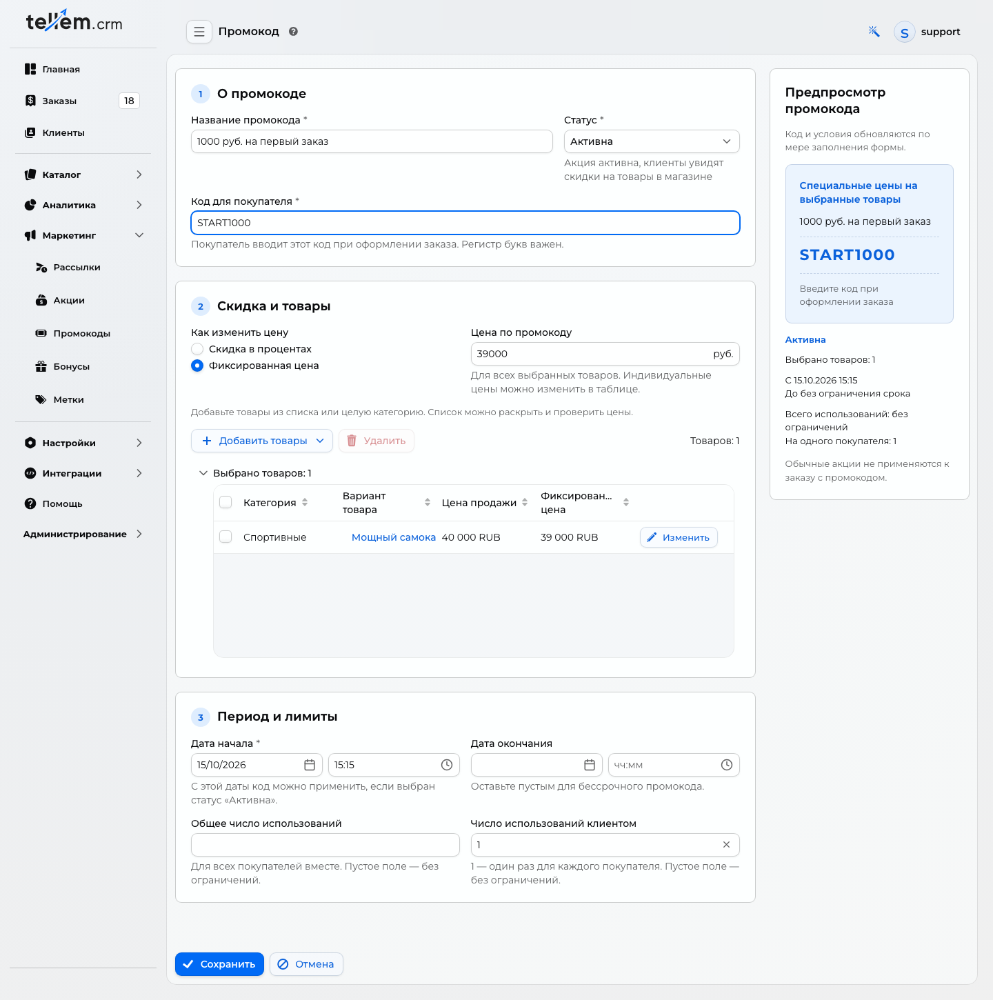
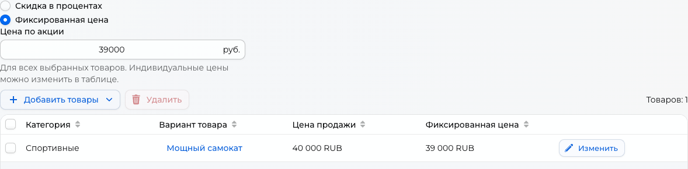

# First promo code for a new store { #first-promo-code-for-a-new-store }

In this example, a new store offers START1000: the selected product costs RUB 39,000 instead of RUB 40,000. The discount is RUB 1,000 per unit.

Where: **Marketing → Promo codes**. First [create the product](products-and-categories.md#products), set its regular price, and [add stock](inventory.md#by-store).

!!! note "One use does not enforce a first-order restriction"
    A customer limit of 1 allows one order with this code. If the buyer does not enter it on their first purchase, the code remains available for a later order. Give buyers the code before their first purchase and state this condition in the offer.

## 1. Set the code and limits { #1-set-the-code-and-limits }

Click “Create” and enter these example values:

| Field | Value |
| --- | --- |
| “Promo code name” | RUB 1,000 off your first order |
| “State” | “Active” |
| “Start date” | Current date and time |
| “End date” | Empty for an indefinite code, or the offer's end date |
| “Code for customers” | START1000; letter case matters |
| “Maximum uses” | Empty, without a total limit |
| “Maximum uses for client” | 1 |

The shared screenshots show the Russian interface.

A total limit of 1 would allow only one use across the store. For one use per buyer, leave the total limit empty.

## 2. Select the product and final price { #2-select-the-product-and-final-price }

1. In “Discount and products”, choose the fixed-price option.
2. Use **Add products → Select from the list** to select a product. This example uses a scooter priced at RUB 40,000.
3. Enter 39000 in “Price with promo code” and move to another field. Check the final price of RUB 39,000 in the selected product table.

For your own product, subtract the discount from the regular price. The result must be at least RUB 1. Entering 1000 in the price field would mean selling it for RUB 1,000.

!!! note "State the offer conditions"
    The example discounts each unit of the selected product by RUB 1,000: two units give RUB 2,000 off. Other products keep their regular prices. This is not a fixed RUB 1,000 discount on any cart. State the product and quantity rule alongside the offer.

## 3. Save and check { #3-save-and-check }

Check the code, active status, selected product, price, and customer limit of 1, then click “Save”.

In the application, add one unit and apply START1000 at [checkout](../app/checkout.md). The example price becomes RUB 39,000.

To check, apply the code before confirming the order. Creating an order consumes a use; cancellation does not restore it. For repeated checks, use a separate test buyer or test code.

To stop the offer, open the promo code, choose “Finished”, and save. See the general [pricing and limit rules](promo-codes.md#promo-codes).
