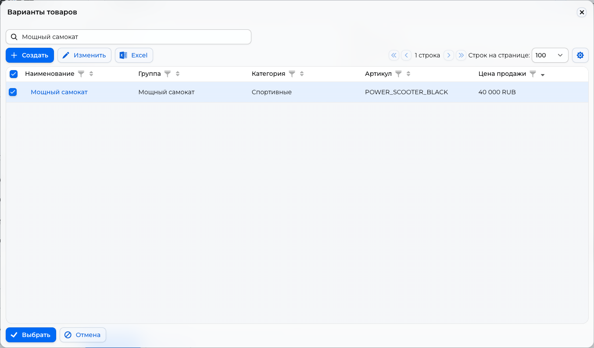
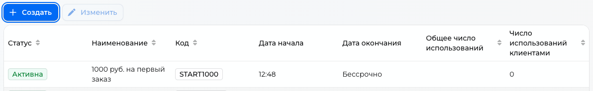

# Первый промокод для нового магазина

Настройте предложение **«Дарим 1000 руб. на первый заказ»**, пока магазин новый и заказов ещё нет. Выдайте код покупателям до первой покупки.

Где: **«Маркетинг → Промокоды»**.

В примере покупатель вводит **START1000** и получает выбранный товар за **39 000 руб. вместо 40 000 руб.** — выгоду **1000 руб. за одну единицу**. Для своего магазина выберите свой товар и вычтите 1000 руб. из его обычной цены. Итоговая цена должна быть не меньше 1 руб.

!!! note "Что означает «на первый заказ»"
    Лимит «Число использований клиентом — 1» разрешает каждому покупателю использовать этот код один раз. Покупатель должен ввести его при первой покупке: если первый заказ оформлен без кода, код останется доступен для следующего. Автоматической проверки первого заказа нет.

## 1. Откройте форму

В меню CRM раскройте **«Маркетинг»**, выберите **«Промокоды»** и нажмите **«Создать»**.

Перед настройкой товар должен быть добавлен в каталог, иметь цену и быть доступен покупателю — [Категории и товары](products-and-categories.md), [Наличие](inventory.md).

## 2. Задайте код и ограничения

Заполните верхнюю часть формы:

| Поле | Что указать в примере |
| --- | --- |
| «Наименование» | **1000 руб. на первый заказ** |
| «Статус» | **Активна**, чтобы код можно было применить после сохранения |
| «Дата начала» | Оставьте текущие дату и время |
| «Дата окончания» | Оставьте пустой для бессрочного предложения или задайте срок акции |
| «Код» | **START1000** — покупатель вводит именно этот текст; регистр важен |
| «Общее число использований» | Оставьте пустым, чтобы код был доступен всем покупателям |
| «Число использований клиентом» | **1**, чтобы каждый покупатель использовал код один раз |

[Открыть скриншот крупнее](../../media/crm/first-promo-code/settings.png).

Общий лимит **1** разрешил бы только один заказ с этим кодом во всём магазине. Для предложения каждому новому покупателю оставьте общий лимит пустым, а лимит клиента — **1**.

## 3. Выберите товар

1. Выберите **«Фиксированная цена»**.
2. Нажмите **«Добавить товары → Выбрать из списка»**.
3. Найдите товар по названию. На скриншоте — **«Мощный самокат»** за **40 000 руб.**
4. Поставьте флажок слева от нужной строки и нажмите **«Выбрать»** внизу окна. Товар появится в таблице промокода.

[Открыть скриншот крупнее](../../media/crm/first-promo-code/select-product.png).

## 4. Укажите цену после скидки

В поле **«Цена по акции»** введите **39000**. Затем нажмите на другое поле: в строке товара должна появиться **«Фиксированная цена» — 39 000 руб.**

Расчёт для примера: **40 000 − 1000 = 39 000 руб.** В поле вводится конечная цена товара. Значение **1000** означало бы продажу товара за 1000 руб.

[Открыть скриншот крупнее](../../media/crm/first-promo-code/price.png).

!!! note "Размер выгоды зависит от товаров и количества"
    Этот промокод снижает цену выбранного товара на 1000 руб. за каждую единицу. При двух единицах выгода составит 2000 руб.; остальные товары сохранят обычную цену. Фиксированной скидки 1000 руб. на произвольную корзину здесь нет. Укажите выбранный товар и эти условия рядом с предложением.

## 5. Сохраните и проверьте

Нажмите **«Сохранить»** внизу формы. В списке должна появиться запись с кодом **START1000** и статусом **«Активна»**.

[Открыть скриншот крупнее](../../media/crm/first-promo-code/saved.png).

В клиентском приложении добавьте **одну единицу выбранного товара**, перейдите к оформлению и введите **START1000** в поле **«Промокод»**. Нажмите кнопку применения справа от поля. В примере стоимость товара станет **39 000 руб.**, а скидка — **1000 руб.** Подробнее — [Оформление и заказы](../app/checkout.md).

Для проверки цены достаточно применить код до подтверждения заказа. Создание заказа расходует использование кода; отмена заказа его не возвращает. Для повторных проверок используйте отдельного тестового покупателя или отдельный тестовый код.

Когда предложение закончится, откройте промокод, выберите **«Завершена»** и сохраните. Все настройки промокодов — [Акции и промокоды](promo-codes.md).
