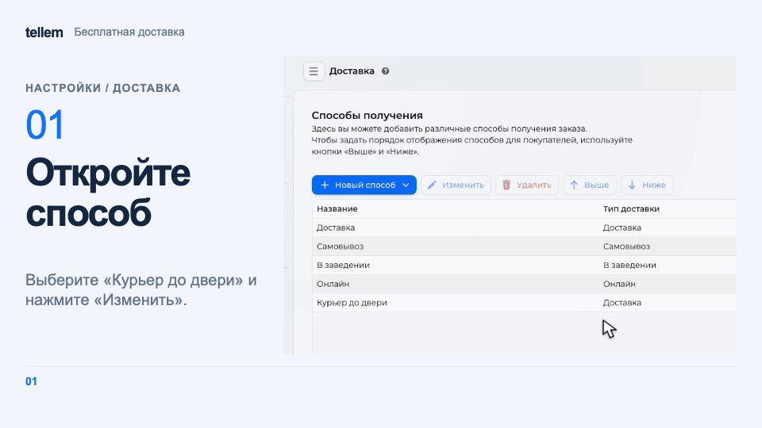

# Настроить бесплатную доставку { #set-up-free-delivery }

Задайте сумму, от которой магазин оплачивает доставку за покупателя. При оформлении покупатель увидит, сколько не хватает до порога.

Где: **Настройки → Доставка → нужный способ получения → Основное**.

???+ example "Пример: бесплатная доставка от 1500 ₽"

    Пример с демонстрационными данными.

    <figure markdown="span">
    [{ width="960" height="540" loading=lazy }](../../media/crm/crm-free-delivery.gif)
    </figure>

## Настроить порог { #set-the-threshold }

1. В «Бесплатная доставка от» введите сумму, например 1500 ₽, и нажмите «OK». Валюта уже указана рядом с полем: вводите только число.
2. Проверьте, что способ получения [включён для нужной сети](stores-and-delivery.md).
3. Проверьте [правила расчёта суммы и ограничения](delivery.md#free-delivery), затем откройте оформление заказа в приложении.

У каждого способа получения, своего или перевозчика, отдельный порог. Пустое поле или 0 выключает условие и подсказку. При бесплатной доставке тариф перевозчика оплачивает магазин, поэтому учтите его расходы при выборе суммы.

## Проверить в приложении { #check-in-the-application }

Например, при пороге 1500 ₽ и товарах на 1200 ₽ подсказка предложит добавить ещё 300 ₽.

При достижении порога доставка станет бесплатной. В примере товары на 1600 ₽ уже отвечают условию: подсказка меняется на «Доставка бесплатная», а в «Детали стоимости» доставка стоит 0 ₽.

Подсказка пересчитывается при изменении товаров, скидки и способа оплаты. При смене способа получения применяется его порог. Пока приложение уточняет сумму, покупатель видит общее условие «Бесплатная доставка при заказе от …».
