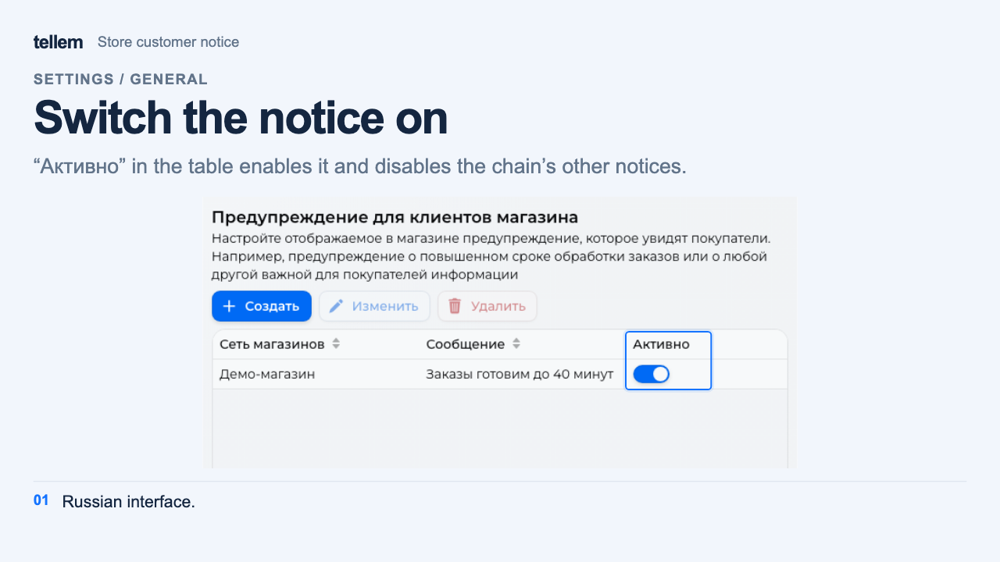
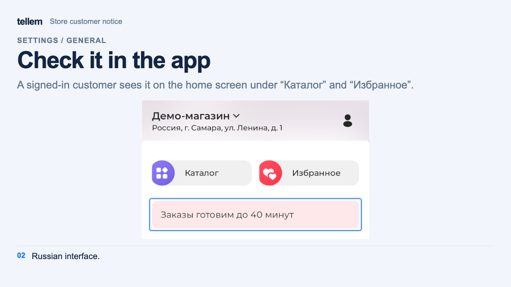
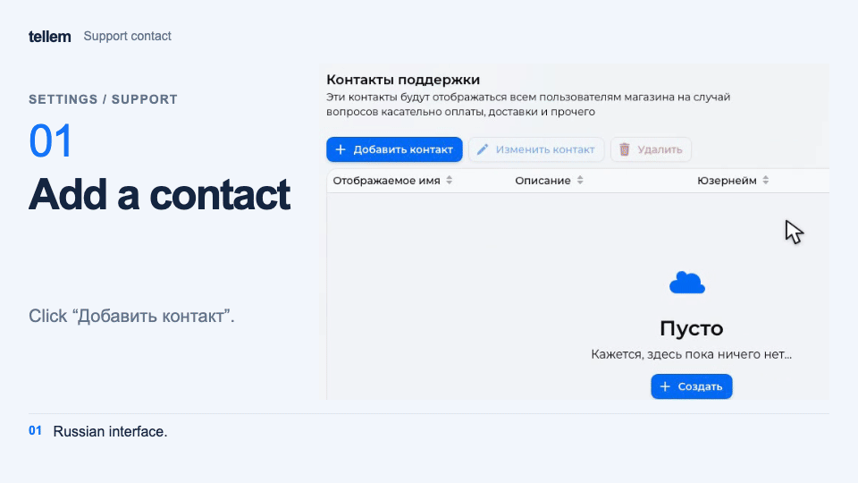

# General settings, support, and PWA { #general-settings }

Configure catalog behavior, customer messages, and support contacts. Most changes on the **General** and **PWA** screens save immediately.

## General { #general }

Open **Settings → General**.

- Choose the country before creating stores or orders: you cannot change it afterward.
- Choose catalog sorting. With **Automatically create assortment** enabled, a new product appears in every store with zero quantity. Configure sold-out product visibility using the [inventory guide](inventory.md).
- Enable **Product reservation** to hold products in carts. Set the customer's inactivity timeout after which the cart is cleared. **Reserve products instead of purchasing** lets customers reserve without paying for an order.
- Enable age confirmation when opening the app if needed.
- Enable **Multilingual editor** to enter names and descriptions in the app's languages. With it disabled, customers see the same text.

### Store customer notice { #customer-notice }

Create a message, such as an order delay notice, and select a chain. Only signed-in customers of that chain see it. Enable it using **Active** in the table: this switch disables the chain's other notices. The switch inside the notice editor does not. Customers see the message on the app's home screen, below the **Catalog** and **Favorites** buttons.

??? example "Example: an order preparation time notice"

    Example with demo data. The images show the Russian interface.

    <figure markdown="span">
    [{ width="1280" height="720" loading=lazy }](../../media/crm/crm-customer-notice.en.png)
    </figure>

    <figure markdown="span">
    [{ width="1280" height="720" loading=lazy }](../../media/app/app-customer-notice.en.png)
    </figure>

### Additional information in the customer profile { #profile-sections }

Add a section with a name and content, such as store rules. Enable **Public section** to show it to guests too; otherwise only signed-in customers see it.

## Support { #support }

Open **Settings → Support → Add contact**. In **Customer**, select the staff member's account and enter a display name and description. They must sign in to the app first; each account can be added once.

Customers see the contact in their profile and orders: the name, description, and available Telegram and email icons. The contact's phone number is hidden from customers. Until contacts are added, the app hides **Support**.

???+ example "Example: a support contact"

    Example with demo data. The recording shows the Russian interface.

    <figure markdown="span">
    [{ width="960" height="540" loading=lazy }](../../media/crm/crm-support-contact.en.gif)
    </figure>

Contacts with Telegram also receive iiko order error messages. Configure [CRM notification recipients](crm-notifications.md#seller-recipients) separately.

## PWA { #pwa-settings }

A PWA is an app customers [install from their browser](../app/account.md). Under **Settings → PWA**, set:

- **App name**, up to 64 characters. If empty, the store's subdomain name is used, with Tellem as the fallback.
- **Icon**, a PNG up to 2 MB. Use a square image of at least 512×512 pixels.

Names and icons on devices where the app is already installed take time to update.
