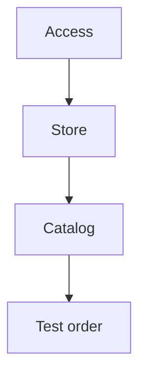

# Store launch checklist { #store-launch-checklist }

Set up your store in this order, then place a test order. Create fulfillment and payment methods under **Settings** first, then enable them for the store. Set stock separately for each location.

## 1. Access and general settings { #access }

1. **Sign in to the CRM** and complete **Welcome configuration**: [connection and first sign-in](../../getting-started/registration.md).
2. **Settings → General.** Check the country before creating your first store or order; it becomes locked afterwards. [General store settings](general-settings.md).

**Check:** the CRM opens, the wizard is complete, and the country is correct.

## 2. Store, fulfillment, and payment { #store }

1. **Settings → Delivery.** Choose the required fulfillment methods or connect a carrier: [delivery and pickup setup](delivery.md).
2. **Settings → Payments.** Choose payment on receipt or add online payment using **New service**. Check it with **Generate a test payment link**; enable it for the store after a successful test payment. [Connecting payments](payment-providers.md).
3. **Catalog → Stores.** Create a store or store chain and enable fulfillment and payment methods. Without an available fulfillment method, customers cannot place orders. [Store setup](stores-and-delivery.md).

**Check:** the required fulfillment and payment methods are enabled for the store; the online payment credentials passed the check, if connected.

## 3. Catalog and notifications { #catalog }

1. **Catalog → Categories and Products**, or **Import**. [Add the catalog manually](products-and-categories.md) or [import a file](catalog-import.md).
2. **Catalog → Inventory.** Set quantities at each location; customers see products with no stock as **Out of stock**. [Managing stock](inventory.md).
3. **Catalog → Design.** Set up [the home screen and app colors](main-page.md).
4. **Settings → Notifications.** Add new-order recipients and select their stores; without a selected store, notifications will not arrive. Employees need an app account to appear in **Clients**. [Employee notifications](crm-notifications.md).
5. **Integrations, optional.** Connect a [Telegram bot](../../getting-started/bot-setup.md), [VK community](vk.md), or [iiko](iiko.md) if you plan to use them.

**Check:** the app shows the intended categories and products; an available product can be added to the cart.

## 4. Test order { #test-order }

1. In the CRM user menu, open **Go to app**. Place an order with payment on receipt.
2. In the CRM, open **Orders**, find the **New** order, open it, and click **Accept order** in the **Order details** panel.
3. Check that the employee received a notification. For the next actions, see [order processing](orders.md).
4. If you accept online payments, also complete the [real-order payment check](payment-providers.md#testing): the test link does not check order status updates.

???+ example "Example: a test order from checkout to acceptance"

    Example with demo data. The recording shows the Russian interface. The chain has several open warehouses, so an accepted order waits for distribution in “Pending processing”.

    <figure markdown="span">
    [{ width="960" height="540" loading=lazy }](../../media/crm/launch-test-order.en.gif)
    </figure>

**Check:** the order appears in the CRM, the employee receives a notification, and the contents and total match checkout in the app.

If the app shows **Ordering is unavailable**, return to [store settings](#store) and check fulfillment methods. Find other cases in [Help](../../troubleshooting.md#store-owners). For a launch offer, [create your first promo code](first-promo-code.md).
