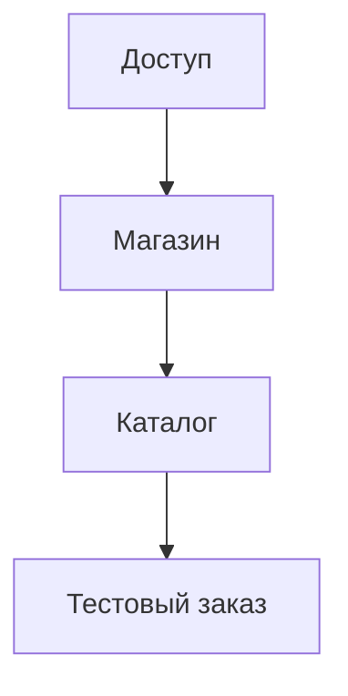

# Чек-лист запуска магазина { #store-launch-checklist }

Настройте магазин в указанном порядке, затем оформите тестовый заказ. Сначала создайте способы получения и оплаты в «Настройках», потом включите их для магазина. Наличие задайте отдельно в каждой точке.

## 1. Доступ и основные настройки { #access }

1. **Войдите в CRM** и завершите мастер «Приветственная конфигурация»: [подключение и первый вход](../../getting-started/registration.md).
2. **Настройки → Основные.** Проверьте страну до создания первого магазина или заказа; позже она блокируется. [Основные настройки магазина](general-settings.md).

**Проверка:** CRM открывается, мастер завершён, страна выбрана верно.

## 2. Магазин, получение и оплата { #store }

1. **Настройки → Доставка.** Выберите необходимые способы получения или подключите перевозчика: [настройка доставки и самовывоза](delivery.md).
2. **Настройки → Оплата.** Выберите оплату при получении или добавьте онлайн-оплату через «Новый сервис». Проверьте её кнопкой «Сгенерировать тестовую ссылку для оплаты»; включайте в магазине после успешного тестового платежа. [Подключение оплаты](payment-providers.md).
3. **Каталог → Магазины.** Создайте магазин или сеть магазинов и включите способы получения и оплаты. Без доступного способа получения оформить заказ нельзя. [Настройка магазинов](stores-and-delivery.md).

**Проверка:** у магазина включены необходимые способы получения и оплаты; проверка реквизитов онлайн-оплаты прошла успешно, если вы её подключили.

## 3. Каталог и уведомления { #catalog }

1. **Каталог → Категории и Товары** или **Импорт.** [Добавьте каталог вручную](products-and-categories.md) или [импортируйте файл](catalog-import.md).
2. **Каталог → Наличие.** Укажите количество в каждой точке: товары без остатка покупатель видит как «Нет в наличии». [Управление наличием](inventory.md).
3. **Каталог → Оформление.** Настройте [главный экран и цвета приложения](main-page.md).
4. **Настройки → Уведомления.** Добавьте получателей новых заказов и выберите их магазины: без выбранного магазина уведомление не придёт. Сотруднику нужен аккаунт в приложении, чтобы выбрать его из списка «Клиенты». [Уведомления сотрудникам](crm-notifications.md).
5. **Интеграции, по желанию.** Подключите [Telegram-бота](../../getting-started/bot-setup.md), [сообщество VK](vk.md) или [iiko](iiko.md), если планируете их использовать.

**Проверка:** в приложении видны нужные категории и товары; доступный товар добавляется в корзину.

## 4. Тестовый заказ { #test-order }

1. В меню пользователя CRM откройте «Перейти в приложение». Оформите заказ с оплатой при получении.
2. В CRM откройте «Заказы», найдите заказ со статусом «Новый» и нажмите «Принять заказ».
3. Проверьте, что сотрудник получил уведомление. Дальнейшие действия описаны в [обработке заказа](orders.md).
4. Если принимаете онлайн-оплату, отдельно выполните [проверку настоящим заказом](payment-providers.md#testing): тестовая ссылка не проверяет смену статуса заказа.

???+ example "Пример: тестовый заказ от оформления до принятия"

    Пример с демонстрационными данными.

    <figure markdown="span">
    [{ width="960" height="540" loading=lazy }](../../media/crm/launch-test-order.gif)
    </figure>

**Проверка:** заказ появился в CRM, сотрудник получил уведомление, состав и сумма совпадают с оформлением в приложении.

Если приложение показывает «Заказ недоступен», вернитесь к [настройкам магазина](#store) и проверьте способы получения. Другие случаи собраны в [разделе помощи](../../troubleshooting.md#store-owners). Для предложения к запуску [создайте первый промокод](first-promo-code.md).
