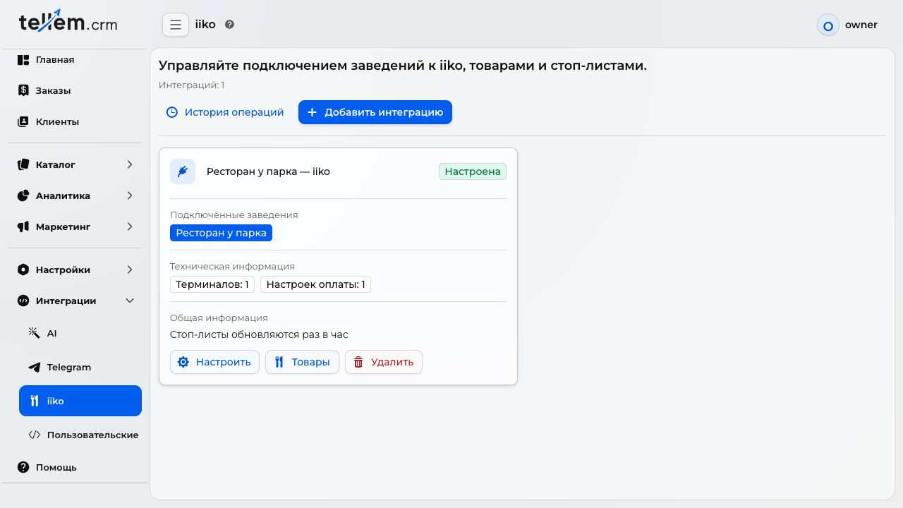
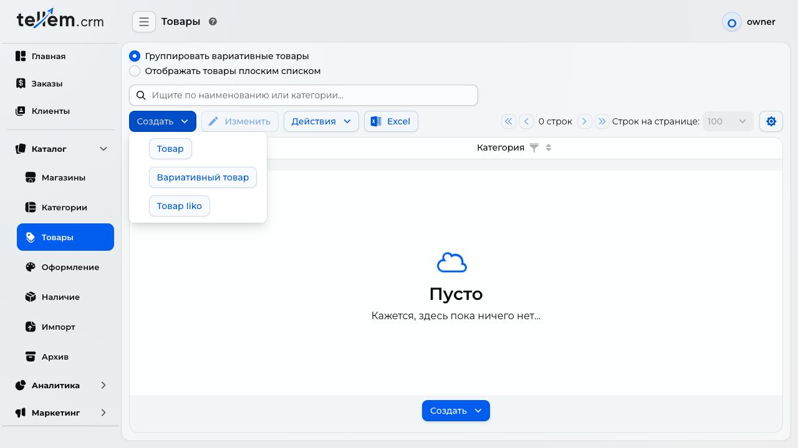
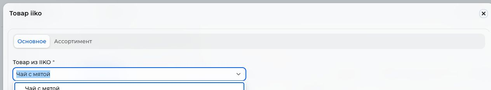
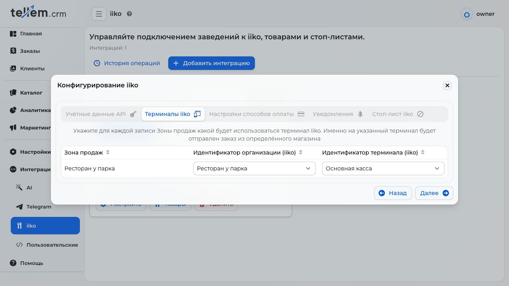
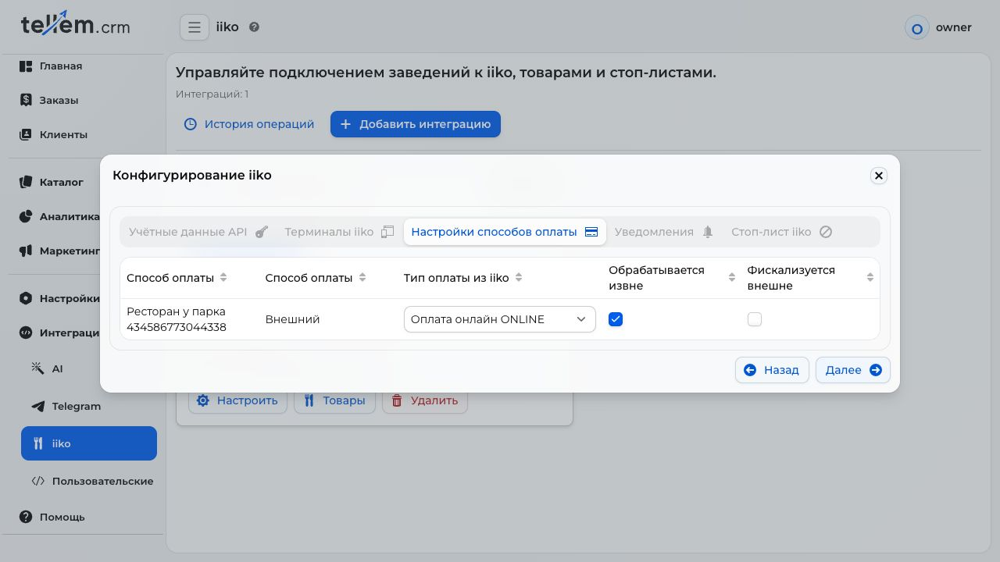
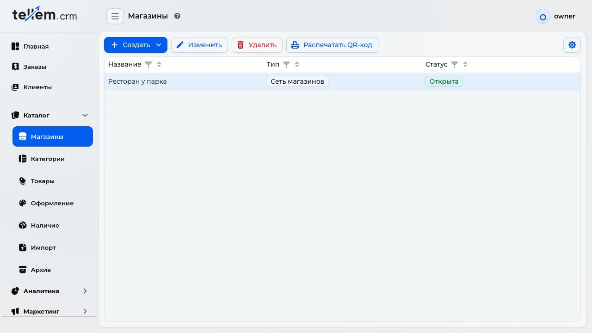
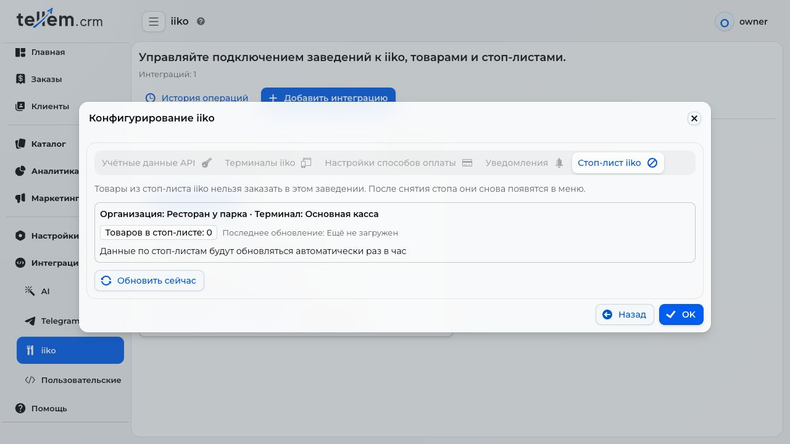
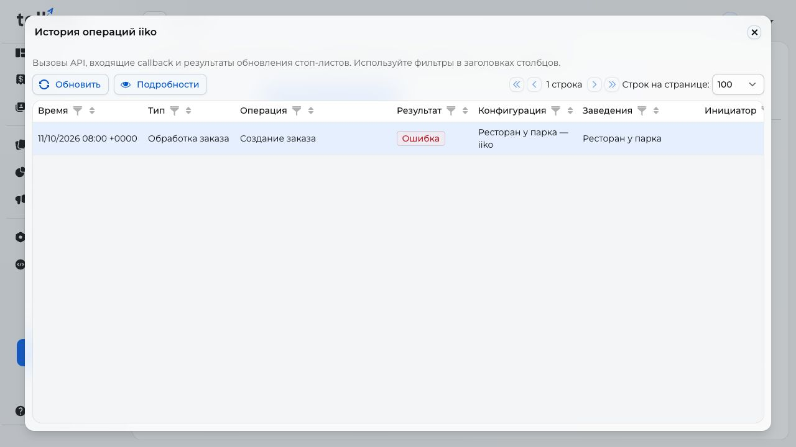
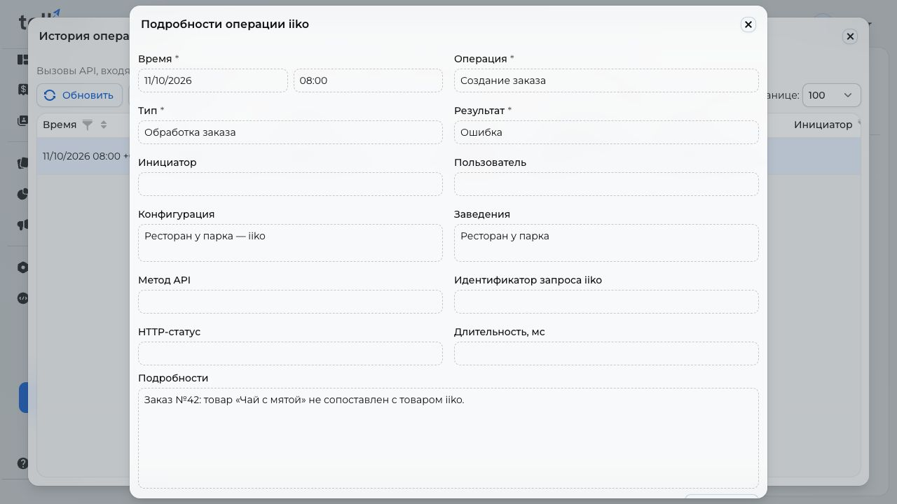

# iiko errors: a manager's guide { #iiko-errors }

An **iiko errors** notification reports an unsuccessful order transfer, status update, or stop list update. Find its cause in this guide and check the result after correcting it.

The screenshots show a demonstration CRM in Russian with fictional names. In your CRM, select the venue and connection from the notification.

## Check the order first { #first-check }

1. Under **Orders**, find the notification's order number. Check the venue, items, fulfillment method, and payment.
2. Ask the cashier to find it in iiko. Compare time, items, and total: the checkout number may differ from the CRM number.
3. If the order exists, continue handling it at the checkout. If the CRM status is behind, [check updates from iiko](#callback).
4. If it is missing, correct the cause below and agree on further processing with the shift manager.

!!! warning "Avoid duplicate orders and repeated payment"
    iiko may have created the order before its response was lost. Check the checkout before resending or entering it manually. Correcting a setting does not confirm that an old order was sent again. Do not change statuses or ask the customer to pay again to send it to iiko; account for existing payment when entering an order manually.

## Open the correct connection { #open-configuration }

Open **Integrations → iiko**, find the card by the notification's connection name or **Connected venues**, and click **Configure**.

Use **Next** through credentials, terminals, payments, notifications, and stop list. After changes, continue to the end and click **OK**. Closing the window does not save changes.

If a section or button is missing, ask the CRM owner to grant access or make the change. Correct the existing connection; create one only if the venue has none.

## A product is not linked to an iiko product { #product }

One unlinked item blocks the entire order.

1. Find the product from the notification under **Catalog → Products**. If the name is unknown, open [error details](#history).
2. For an existing catalog, use [linking by article code](iiko.md#link-existing-products). Review skipped items in the report. For dishes with sizes, use [menu import](iiko.md#import-products).
3. For a new individual item, click **Create → Add from iiko** and choose the dish. Check its name, price, and sizes. If it is missing, check the selected organization's menu and existing links: another product may already use the dish.
4. After creating a replacement, [remove the unlinked item from sale](products-and-categories.md) so customers stop ordering it. If an already linked product is incorrect or has lost its link, contact the person responsible for the catalog.

Creating a new product does not change an existing order's items. [Check it at the checkout](#first-check) and agree on processing. Verify the catalog with an agreed test order: it must appear in iiko with the correct items.

## Sizes or extras are missing or unavailable { #options }

If CRM asks you to import modifiers or update sizes, run a [full restaurant menu import](iiko.md#import-products). Linking by article code does not load extras. Allow for the full import's effect on prices and product visibility in the catalog.

Under **Catalog → Products**, check [sizes and the Modifiers section](iiko.md#sizes-and-extras). If a required extra cannot be selected, ask the person responsible for the menu to check its availability, price, and limits in iiko, then repeat the import. The customer must review their size and extras in the cart again. Until the issue is resolved, [remove the unavailable dish from sale](inventory.md).

## Connection, organization, or terminal is not configured { #terminal }

CRM cannot determine which checkout group should receive the order.

1. [Open the connection](#open-configuration). If none exists, [connect iiko](iiko.md#_1) with the person responsible for the restaurant; do not use another venue's credentials.
2. Under **iiko terminals**, find the store in **Sales area**. Choose its organization and checkout group. See [terms and mapping limits](iiko.md#terms).
3. If the required value is missing, [check access](#connection). Do not choose an arbitrary group to pass the step.
4. Save the connection and check a test order at the correct venue's checkout.

## A payment method is not mapped { #payment }

The order's payment method has no selected iiko payment type. This does not mean the customer's payment failed.

1. Check the payment method and payment status in the order.
2. [Open the connection](#open-configuration) and continue to **Payment method settings**. Select the row for the required store and method.
3. Set **Payment type from iiko** as agreed with the cashier. Confirm **Processed externally** and **Fiscalized externally** with the person responsible for the checkout using the [payment and receipt process](iiko.md#payments).
4. If the required type is missing, ask the iiko administrator to check its availability. Save changes and verify the test order's payment in iiko.

Before further processing of the current order, [check its checkout record and payment](#first-check).

## A table is missing, no tables are available, or a number is ambiguous { #table }

Possible causes include an incorrect terminal, an old QR code, a deleted table, or a duplicate number.

1. Check the order's venue and table; ask floor staff to show the QR code used.
2. [Check the terminal](#terminal). Its group must have a dining area with active tables; a table in another group does not qualify.
3. Ask the iiko administrator to check table availability. For duplicate numbers, assign unique numbers within the group or use a QR code for the specific table.
4. Under **Catalog → Stores → Print QR code**, select the venue and click **Refresh tables**. If the tables section is missing, check the connection first.
5. Select the specific table, check the preview caption, print the code, and replace the old one on the table. **Copy link** lets you check the same destination.
6. Scan it with a phone: it must open the correct venue and table. Then check an agreed test order in iiko.

## No suitable order type { #order-type }

The connection sends only **In establishment** and **Pickup** orders. If a notification reports an unsupported fulfillment method, agree on processing with the shift manager. Do not change it without the customer's agreement. For future orders, [check the store's methods](stores-and-delivery.md). Adding delivery in iiko does not enable its transfer from Tellem.

For a supported method, check the organization on the [terminal step](iiko.md#terminals). Ask the iiko administrator to enable an order type with the required service mode and grant the connection access to it. Renaming the type alone is insufficient. Reload connection data, then check a test order.

## Connection or access problems { #connection }

| Cause | Action |
|---|---|
| iiko does not respond | Check the checkout and its network. In [connection setup](#open-configuration), click **Next** on the credentials step to repeat the check. If it still fails, tell the person responsible for iiko the time and venue |
| iiko refuses the connection | Check credentials with the responsible person: iiko or its partner provides the API key; Tellem provides App ID and Client secret. A hidden password may look empty; do not replace it with arbitrary text. Check whether access was revoked |
| Insufficient permissions | Ask the iiko administrator to check access to the required organization, menu, payments, and orders. Then reload |
| Too many requests | Wait a few minutes and retry once. Do not click refresh repeatedly. If the error returns, report its time and frequency; changing credentials or deleting the connection is unnecessary |

After recovery, check previously failed orders and the [stop list](#stop-list) separately. Do not send credentials to support or include them in screenshots.

## iiko could not process an order { #order }

The request may have been accepted before processing failed.

1. [Check the order and checkout](#first-check), including whether the venue can handle ordinary orders.
2. Find the [reason in history](#history). If it concerns a [product](#product), [terminal](#terminal), [payment](#payment), or [table](#table), correct the relevant setting.
3. If the reason is unknown, ask for help. State whether the order exists at the checkout and how it has been handled. Until agreed, do not resend it through different methods.

## Updates from iiko are not arriving { #callback }

Delayed updates may leave the CRM order status or stop list different from the checkout.

1. Confirm the actual order status with the cashier.
2. On the [last connection step](iiko.md#setup-stop-list), check the successful update time. **Hourly** mode means instant stop list updates are not connected.
3. If the failure repeats, [find the record and ask for help](#history). Until recovery, compare orders with the checkout and [update the stop list manually](#stop-list).

## The stop list did not update or availability could not be checked { #stop-list }

A failure to retrieve availability differs from a sold-out dish message: a sale restriction is not itself a connection failure.

1. Ask the cashier which dishes are unavailable. Until recovery, do not rely only on old CRM data.
2. On the [last connection step](iiko.md#setup-stop-list), find the required terminal and successful update time.
3. Click **Update now** once. Reopen the connection to see the result: the request does not complete immediately.
4. Check the new successful update time and confirm the list matches the checkout. If it fails again, [check access](#connection) and [ask for help](#history).
5. Repeat the pre-order availability check after recovery; do not order a dish known to be unavailable.

## Another data exchange error { #other }

For an order error, [check the checkout](#first-check) first. Then [find the details](#history). Do not change all settings at once; if the cause is unknown, pass it to the person responsible for iiko or Tellem support.

## Find details and ask for help { #history }

1. Under **Integrations → iiko**, open **Operation history**. Select **Error** in the **Result** column, then find the record by time, venue, and connection.
2. Select it and click **Details**. A successful neighboring operation does not confirm successful order processing.
3. Give the responsible person or support the order number, venue, time, problem description, and what you have done. State whether the order appeared at the checkout.

If attaching a screenshot, hide passwords, keys, and unnecessary personal data. Review the contents before forwarding a full service response.

## Who receives notifications { #recipients }

Add responsible staff under **Settings → Notifications → iiko errors** or on the connection's **Notifications** step. They share one list: [choose recipients' stores and channels](crm-notifications.md#seller-recipients). Messages will not arrive without recipients.
