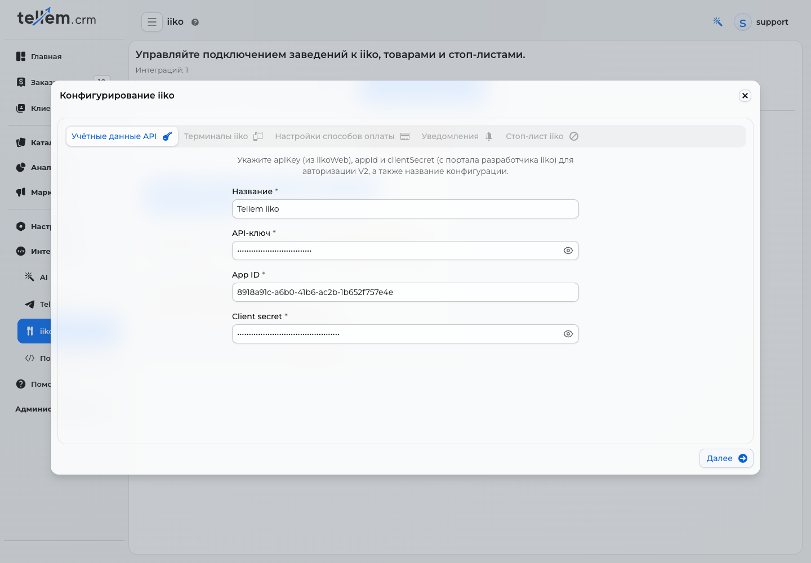
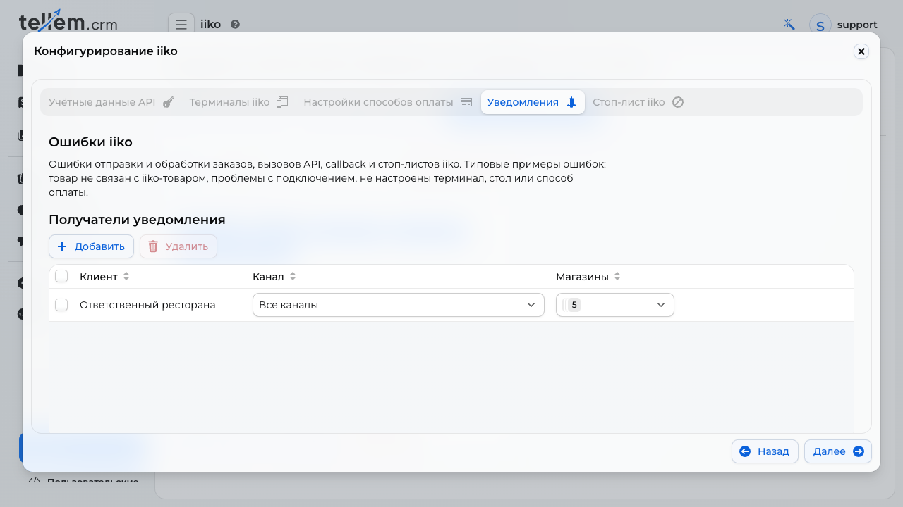

# iiko

Интеграция (в русскоязычных материалах её называют «Айко») отправляет заказы магазина в iiko, подставляет стол по QR-коду и скрывает блюда из стоп-листа.

Где: **Интеграции → iiko**.

## Что нужно в iiko { #iiko_1 }

- «API-ключ» ресторана из iikoWeb с доступом к нужным организациям;
- «App ID» и «App Secret» от команды Tellem; в CRM поле App Secret называется **«Client secret»**;
- опубликованное меню с ценами;
- активная терминальная группа iikoFront;
- типы заказа для зала и для самовывоза;
- тип оплаты для каждого способа онлайн-оплаты;
- залы и столы — для QR-кодов столов.

!!! note "Кто выдаёт реквизиты"
    Ресторан получает API-ключ у iiko или своего обслуживающего партнёра. **App ID и App Secret выдаём мы — команда Tellem, которая выступает интегратором.** Ресторану не нужно регистрировать своё приложение на портале разработчика iiko. Упоминание портала в подсказке CRM относится к реквизитам приложения интегратора.

Для текущего подключения внешнее меню не требуется: Tellem получает опубликованную номенклатуру через iiko Cloud API, метод `/api/1/nomenclature`. Попросите партнёра iiko настроить именно эту выгрузку меню с ценами.

До открытия мастера создайте магазины в **«Каталог → Магазины»**, включите способы «В заведении» и/или «Самовывоз» и нужную оплату. Для онлайн-оплаты сначала подключите платёжный сервис — [«Оплата»](payment-providers.md).

### Что такое организация и терминал iiko { #terms }

**Магазин в Tellem** — место оформления заказа. На шаге подключения магазины и сети показаны в колонке «Зона продаж».

**Организация iiko** — заведение в справочнике iiko, к которому относятся меню, типы оплаты и кассовые настройки. Выбирайте организацию, в которой кассир должен видеть заказы этого магазина.

**Терминал в этом мастере** — терминальная группа iikoFront: кассовое назначение, куда Tellem отправляет заказ. Например, администратор iiko может назвать её «Основная касса» или «Самовывоз». В CRM выбирается группа из справочника iiko; вводить номер компьютера или IP-адрес не нужно. Количество физических кассовых рабочих мест само по себе не определяет количество привязок: сначала уточните у партнёра iiko, к каким группам они относятся.

## Подключение { #_1 }

Откройте **«Интеграции → iiko»** и нажмите **«Добавить интеграцию»**. Мастер открывает пять вкладок по порядку. Кнопка **«Далее»** проверяет текущий шаг, **«Назад»** возвращает к предыдущему; на последнем шаге **«OK»** сохраняет конфигурацию.

На снимках показаны существующие экраны демонстрационной CRM. Видимые названия и идентификаторы служат примером: используйте свои заведения и выданные вам реквизиты. Значения API-ключа и Client secret скрыты.

### 1. Учётные данные API { #credentials }

Этот шаг даёт Tellem доступ к справочникам и заказам ресторана.

| Поле | Что указать | Пример или источник |
|---|---|---|
| «Название» | Понятное название подключения | «Ресторан у парка» или «Сеть — iiko» |
| «API-ключ» | Ключ ресторана, которому доступны нужные организации | Ресторан получает у iiko или своего партнёра |
| «App ID» | Идентификатор приложения интегратора | Выдаёт команда Tellem |
| «Client secret» | App Secret приложения интегратора | Выдаёт команда Tellem |

**Один ресторан:** используйте его API-ключ и название заведения. **Несколько ресторанов:** заранее проверьте с партнёром iiko, что выбранный ключ даёт доступ ко всем нужным организациям. Привязки каждого магазина задаются на следующем шаге.

Нажмите **«Далее»**. CRM проверит доступ и загрузит справочники. Если шаг не проходит, проверьте все три реквизита. Если среди организаций нет ресторана, попросите партнёра iiko проверить доступ API-ключа; другое название подключения доступ не расширяет.

### 2. Терминалы iiko { #terminals }

Этот шаг определяет, **на какую кассовую группу попадёт заказ каждого магазина**.

Для каждой строки выберите **«Идентификатор организации (iiko)»** и **«Идентификатор терминала (iiko)»**. Несмотря на слово «идентификатор» в заголовке, в списках выбираются названия организаций и групп. Группа должна принадлежать выбранной организации — подтвердите соответствие с администратором iiko.

| Сценарий бизнеса | Как настроить |
|---|---|
| Один ресторан, заказы обслуживаются вместе | Одна строка магазина → организация ресторана → «Основная касса» |
| Несколько кассовых рабочих мест ресторана входят в одну группу iiko | Одна привязка магазина к этой группе; отдельных привязок на каждый компьютер не требуется |
| Два независимых ресторана | «У парка» → организация «У парка» → её кассовая группа; «В центре» → организация «В центре» → её кассовая группа |
| Две витрины одного ресторана обслуживаются совместно | Обе строки магазинов → одна организация → одна терминальная группа; стоп-лист будет общим |
| Один ресторан, две независимые кассовые группы, например зал и самовывоз | Для раздельного направления заказов нужны отдельные магазины/зоны продаж Tellem с соответствующими привязками; схему согласуйте с командой Tellem до запуска |

**Пример сети:** сначала создайте в «Каталог → Магазины» отдельные магазины «У парка» и «В центре», если их заказы должны поступать в разные заведения. В мастере заполните обе строки; название конфигурации «Сеть — iiko» само по себе не объединяет их кассы.

!!! note "Ограничения привязки"
    В одной строке магазина выбираются одна организация и одна терминальная группа. Автоматического распределения между несколькими группами или выбора группы по способу получения нет. Заполнить нужно все магазины и сети, которые мастер показывает: подключить только часть строк нельзя. У магазина одна привязка; создание второй конфигурации не позволяет добавить ему второй терминал.

Нажмите **«Далее»** после заполнения всех строк. Если нужна другая бизнес-схема, сначала определите с командой Tellem, какие магазины должны оформлять заказы независимо.

### 3. Настройки способов оплаты { #payments }

Этот шаг объясняет iiko, **как учитывать уже оплаченную онлайн-покупку**. Здесь сопоставляются только способы **онлайн-оплаты по ссылке** из подключённых магазинов.

| Настройка | Зачем нужна |
|---|---|
| «Тип оплаты из iiko» | Под каким видом оплаты iiko учтёт платёж. Выберите тип, предназначенный в вашем ресторане для этого онлайн-сервиса |
| «Обрабатывается извне» | Оплату принимает внешняя система, а iiko получает уже проведённый платёж |
| «Фискализуется внешне» | Чек для этого платежа формирует внешняя система |

**Пример:** покупатель оплатил заказ по ссылке через подключённый банк. Выберите согласованный тип «Оплата онлайн» в iiko и отметьте внешнюю обработку. Если чек также оформляет внешняя касса/сервис, отметьте внешнюю фискализацию; если чек оформляется в iiko, эта отметка должна быть снята. Флаги должны соответствовать вашему реальному процессу оплаты и выдачи чека — подтвердите его с ответственным за платёжную интеграцию.

**Только оплата при получении:** если онлайн-способов нет, таблица пустая — это нормальный сценарий. Перейдите дальше. Заказ поступит в iiko без платежа, оплату примет кассир.

**Несколько ресторанов или онлайн-сервисов:** заполните каждую строку, выбирая тип оплаты для организации соответствующего магазина. Одинаковые названия типов в разных ресторанах не заменяют отдельного сопоставления строк.

После заполнения нажмите **«Далее»**. Новый онлайн-способ впоследствии потребует отдельной настройки.

### 4. Уведомления { #notifications }

Этот шаг задаёт, **кто узнает о сбое передачи заказа, связи с iiko или обновления стоп-листа**. Например, уведомление придёт, если в заказе оказался обычный товар без связи с iiko или не настроена онлайн-оплата.

Нажмите **«Добавить»**, выберите ответственного из списка клиентов, укажите магазины и доступные каналы. Контакты берутся из карточки клиента. Для Telegram сотрудник должен быть связан с ботом магазина, для почты нужна настроенная на платформе отправка — [«Уведомления»](crm-notifications.md).

| Сценарий | Пример получателей |
|---|---|
| Один ресторан | Управляющий или менеджер смены, выбран магазин «У парка», включён рабочий канал связи |
| Несколько ресторанов | Управляющий «У парка» получает ошибки своего магазина, управляющий «В центре» — своего |
| Централизованная поддержка сети | Один ответственный, которому выбраны все обслуживаемые магазины; местные менеджеры могут быть добавлены отдельно |

Если заведение ошибки определить нельзя, например при сбое получения токена, уведомление получают все выбранные получатели этого типа.

Настройка общая с **«Настройки → Уведомления → Ошибки iiko»**: правки в одном месте видны в другом. Отдельного переключателя отправки нет. Получатели необязательны для завершения мастера: можно нажать **«Далее»**, но без них никто не получит сообщение об ошибке.

### 5. Стоп-лист iiko и сохранение { #setup-stop-list }

Этот шаг показывает, **какие блюда касса временно не разрешает продавать** и когда данные обновлялись. Здесь не вводят остатки вручную.

При первом подключении состояние появится **после сохранения**. Снимок показывает уже сохранённую конфигурацию; «Ещё не загружен» означает, что успешного обновления пока не было, даже если количество позиций равно нулю.

1. Нажмите **«OK»**. CRM проверит все шаги и вернёт к тому, где не хватает данных.
2. Откройте сохранённую карточку через **«Настроить»** и пройдите кнопкой **«Далее»** до стоп-листа.
3. Проверьте организацию, терминал и время последнего успешного обновления. **«Обновить сейчас»** ставит запрос в очередь; результат виден при повторном открытии конфигурации.

**Один ресторан:** блюдо, закончившееся на его кассовой группе, скрывается в меню этого магазина. **Две витрины с общим терминалом:** стоп действует в обеих. **Независимые рестораны:** проверяйте состояние каждой привязанной группы отдельно — данные одного ресторана не подтверждают доступность в другом.

Режим «раз в час» означает, что мгновенные события стоп-листа сейчас не подключены. Такое бывает, если у iiko уже есть другой получатель событий; подробности — [«Стоп-листы»](#-).

### Проверка перед первым рабочим заказом { #launch-check }

Для **каждого независимого назначения** магазин → организация → терминал оформите согласованный тестовый заказ и проверьте в iikoFront:

- он попал в нужный ресторан и кассовую группу;
- состав и сумма совпадают, используются «Товары Iiko»;
- при получении оплату принимает кассир, при оплате по ссылке платёж учитывается верным типом;
- чек оформляется по согласованной схеме, статус заказа возвращается в CRM;
- стоп-лист и выбранные получатели ошибок относятся к нужному магазину.

Новый магазин или способ онлайн-оплаты сами не подключатся: откройте «Настроить» и заполните новые строки.

Карточка конфигурации показывает режим обновления стоп-листов и последнюю синхронизацию. «Нужно завершить настройку» — не всё заполнено; «Требует внимания» — последнее обновление стоп-листа не удалось или автоматическое обновление не подключено (работает часовой опрос); «Настроена» — всё в порядке. «Удалить» требует подтверждения: магазины перестанут передавать заказы в iiko.

## Товары { #_2 }

В iiko отправляются только «Товар Iiko»: «Каталог → Товары» → «Создать» → «Товар Iiko» (пункт есть, когда сохранена хотя бы одна конфигурация). В поле «Товар из IIKO» выберите позицию меню, которая ещё не связана с другим товаром. Название, «Цена продажи», «Артикул», описание, вес и пищевая ценность копируются один раз; цена потом не синхронизируется, берётся первый размер, модификаторы не передаются, а связь с позицией iiko не меняется. Заказ уходит по цене Tellem. Один обычный товар блокирует отправку всего заказа.

Карточка подключения показывает рестораны. «Настроить» открывает параметры подключения, а «Выгрузить товары» в строке ресторана — выбор операции с его меню. При единственном ресторане дополнительный выбор не нужен.

### Привязка уже созданных товаров { #link-existing-products }

Если товары уже созданы в CRM, откройте **«Интеграции → iiko»** и нажмите
**«Выгрузить товары»** в строке нужного ресторана.
Откроется экран выбора с заголовком, пояснением и карточками действий — такой же,
как при [создании акции](promo-codes.md#birthday). **«Закрыть»** возвращает
к подключениям без запуска операции.

Выберите **«Связать существующие товары»**. Откроется отдельный экран операции:
подключение и ресторан уже выбраны. Запустите привязку; выбор карточки сам по себе
ещё не меняет товары.
CRM получит свежее меню и найдёт позиции с одинаковым артикулом: «Артикул»
товара CRM должен точно совпадать с кодом товара iiko, включая ведущие нули,
регистр и пробелы. У вариативного товара каждый вариант сопоставляется отдельно
по своему артикулу. Проверяется весь каталог, включая скрытые и архивные товары.

Связь сохраняет ID, название, описание, цены, фотографии, остатки и историю
товара CRM. Новые товары не создаются. В отчёте показаны связанные и уже
связанные товары, а также причины пропуска: пустой артикул, отсутствие или
несколько совпадений, занятая позиция iiko, размеры или модификаторы самой позиции iiko.
Пропуск одного варианта не мешает привязке остальных; атрибуты вариантов сохраняются.
Исправьте причину и повторите действие — существующие связи сохраняются.
При ошибке получения меню товары не меняются.

### Выгрузка всего меню { #import-menu }

Нажмите **«Выгрузить товары» → «Всё меню»** в строке ресторана. CRM создаст
недостающие товары и категории. Категория с тем же названием используется повторно.
Переносятся название, артикул, описание, вес, пищевая ценность, фотографии и текущая
цена iiko с округлением до целого: 79,90 → 80. Если фото недоступно, товар создаётся
с предупреждением. Позиции с размерами или модификаторами пропускаются.

Остатки записываются на склад выгрузки соответствующего терминала:

| Состояние iiko | Количество CRM |
|---|---:|
| Есть количественный лимит | Остаток iiko; дробная часть отбрасывается |
| Блюдо в полном стопе | 0 |
| Блюдо продаётся без лимита | 1000 |

1000 — технический запас для продажи, а не подтверждение физического наличия тысячи порций.
При ошибке получения остатков выгрузка не запускается.

Повторная выгрузка добавляет недостающие товары и обновляет количество ранее
выгруженных. Дубли не создаются; названия, цены, описания и фотографии существующих
карточек сохраняются. Ранее связанные товары с ручными остатками сохраняют свой
складской учёт. Количество обновляется при выгрузке; обычная обработка заказов
и резервов CRM сохраняется.

Новые товары скрыты от покупателей. Проверьте карточки и включите показ в каталоге.
В отчёте доступны причины пропусков и ссылки на созданные товары.

## Заказы { #_3 }

Заказы магазинов с привязкой отправляются автоматически, отдельная «Пользовательская интеграция» не нужна. Уходят только способы получения «В заведении» и «Самовывоз». В iikoFront номер заказа — «T» и номер из CRM, источник «Tellem»; передаются телефон, имя, почта покупателя и комментарий.

| Оплата | Когда заказ уходит в iiko | Что дальше |
|---|---|---|
| При получении | Сразу, в статусе «Новый», без платежа | Закрывает кассир в iikoFront, он же принимает оплату |
| Онлайн по ссылке | После статуса «Оплачено» | Закрывается автоматически; нужно сопоставление с шага 3 |

Статусы возвращаются сами: закрытый в iiko заказ становится «Завершён», отменённый или удалённый — «Отменён». CRM принимает события iiko и раз в 5 минут сама опрашивает заказы, о которых больше 3 минут нет новостей. Повторное закрытие бонусы второй раз не начисляет.

Если iiko принял заказ, но сообщил об ошибке, заказ получает статус «Ожидает обработки» (при одном открытом складе сразу «Собирается»). Ошибка сохраняется в истории и отправляется выбранным получателям [«Ошибки iiko»](crm-notifications.md). Ошибки подготовки до отправки, например обычный товар, неверный стол или несопоставленная онлайн-оплата, также видны в истории; HTTP-статус у них может быть пустым.

## Столы и QR-коды { #qr- }

Сохранение конфигурации само добавляет необязательное поле «Стол» ко всем способам «В заведении» привязанных магазинов, в том числе добавленным позже. Печать QR-кода открывается из [«Магазины»](stores-and-delivery.md). Для магазина с iiko в окне печати появляются залы: нажмите стол на плане (или карточку с номером) — QR-код будет для этого стола, «QR для всего заведения» вернёт общий. Залы и столы CRM берёт из iiko при выборе магазина; «Обновить столы» повторяет запрос. Если столов нет, проверьте привязку на шаге «Терминалы iiko» и залы со столами этого терминала в iiko. «Настроить столы» в окне печати добавляет поле «Стол» выбранному магазину, если его там ещё нет.

Что видит покупатель, сканируя код, — [«Оформление и заказы»](../app/checkout.md).

## Стоп-листы { #- }

Блюдо с остатком 0 или меньше в стоп-листе iiko скрывается в меню магазинов этого терминала, даже если включён показ товаров с нулевым количеством. Если на терминал ходят несколько магазинов, стоп действует во всех. Стоп одного размера скрывает весь товар. Положительный остаток оставляет товар в меню и ограничивает количество при оформлении.

После снятия стопа товар возвращается с текущей доступностью CRM: ручное отключение, склад и резервы сохраняются. Количество склада обновляется при [выгрузке всего меню](#import-menu); фоновое обновление стоп-листа его не переписывает.

Список обновляется при настройке интеграции, при запуске CRM, сразу по событию iiko и раз в час. Если в iiko уже подключён чужой вебхук, CRM его не заменяет, и тогда работает только часовой опрос. При ошибке остаётся последний успешный список. «Обновить сейчас» на шаге «Стоп-лист iiko» (в сохранённой конфигурации: «Настроить» и «Далее» до последнего шага) ставит обновление в очередь, результат виден при повторном открытии конфигурации.

При оформлении, до создания заказа и платёжной ссылки, CRM проверяет корзину в iiko. Покупатель увидит «Блюда недоступны в iiko или превышен остаток. Удалите позицию или уменьшите количество» либо «Не удалось проверить наличие блюд в iiko. Повторите оформление позже».

## Если не работает { #_4 }

Откройте [руководство по типовым ошибкам iiko с подробными шагами и скриншотами](iiko-errors.md).

«Интеграции → iiko» → «История операций»: вызовы API iiko, события от iiko, обновления стоп-листов и ошибки подготовки/обработки заказов. Фильтры — в заголовках колонок, «Обновить» подгружает новые записи, «Подробности» открывает операцию. «Успешно» у вызова API значит лишь, что iiko ответил без HTTP-ошибки. Перед повторной отправкой проверьте наличие заказа на кассе.
