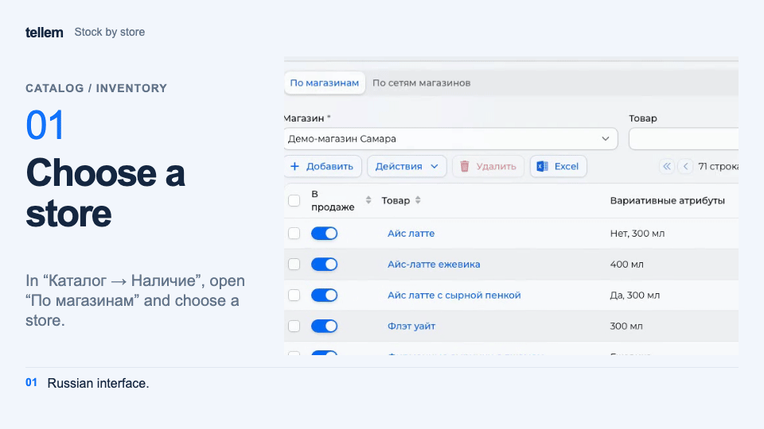
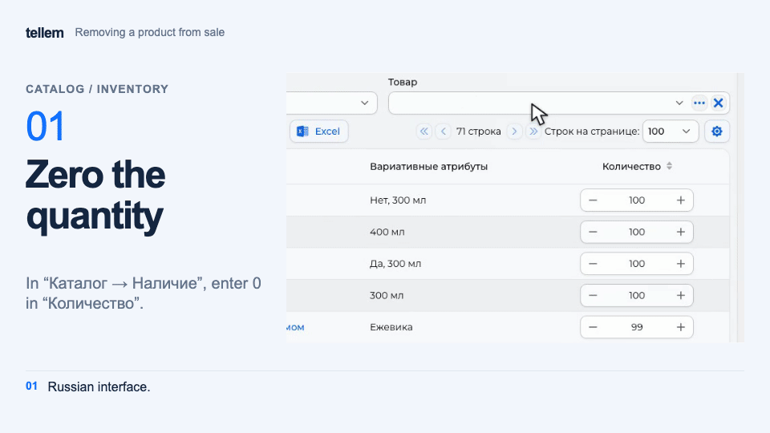

# Inventory and removing products from sale { #inventory-and-removing-products-from-sale }

Set product quantities in each store or remove a product from sale.

Where: **Catalog → Inventory**.

## Change stock in a store { #by-store }

1. Open “By stores” and select a store. Filter by product if needed.
2. Change “Quantity” or “On sale” in the row. Changes are saved immediately.
3. For several rows, use the quantity action under “Actions”: set a value, add a number, or multiply the quantity. Check the selected rows before applying.

???+ example "Example: cappuccino stock in a store"

    Example with demo data. The recording shows the Russian interface.

    <figure markdown="span">
    [{ width="960" height="540" loading=lazy }](../../media/crm/crm-inventory-by-store.en.gif)
    </figure>

If a product is missing, click “Add”: the new row has quantity 0. The same stock entries are available under “Assortment” in the product record.

New products appear with quantity 0 in all stores when automatic assortment creation is enabled; this always happens after [import](catalog-import.md). A store created after the products has no stock entries yet: add them. The “Assortment with zero quantity” setting in **Settings → General** determines whether buyers see sold-out products marked “Out of stock” or do not see them in the catalog.

## Check chain availability { #check-chain-availability }

Under “By retail chains”, review available stock and export the table to Excel. Change quantities under “By stores”.

A chain counts stock from open stores with “On sale” enabled, subtracts products in “New” and “Pending processing” orders, and also subtracts carts when reservation is enabled. Items on the iiko stop list are unavailable. A store's stock can therefore exceed the quantity available to the buyer.

## Remove a product from sale { #remove-a-product-from-sale }

| Action | Where | How to restore |
| --- | --- | --- |
| Disable “On sale” or set quantity 0 | “By stores”, in every store in the chain | Enable sales or set a quantity |
| Archive the product | **Catalog → Products → Actions → Archive** | **Catalog → Archive → Publish** |
| Disable “Show in catalog” for a variant | Product record → “Main” → variants | Enable it and save the record |

Changing quantity or sale availability leaves an “Out of stock” label when “Assortment with zero quantity” is on and hides the product when it is off. A product is sold out when no store of the chain has it. Archiving hides it regardless of stock. A variant's checkbox removes it from catalog lists; it remains selectable inside the product card, as in the [color example](product-colors.md).

??? example "Example: a product sells out"

    Example with demo data: the product is stocked in one store, so the recording zeroes it only there. The recording shows the Russian interface.

    <figure markdown="span">
    [{ width="960" height="540" loading=lazy }](../../media/crm/crm-stop-sale-effect.en.gif)
    </figure>

The [iiko](iiko.md) stop list limits availability separately from manually entered stock. [Importing an iiko menu](iiko.md#import-products) also sets stock for imported products; importing again replaces it with the current quantity from iiko.
