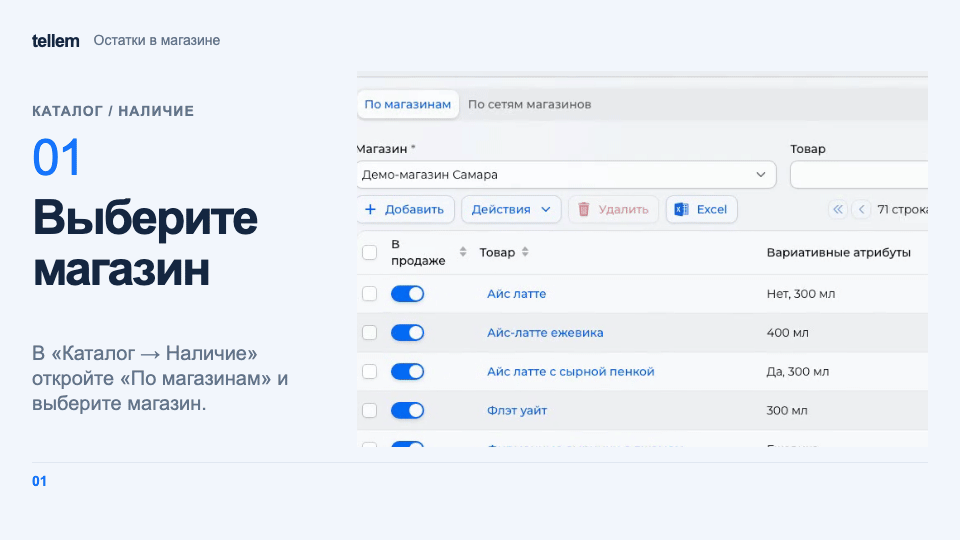

# Наличие и снятие с продажи { #inventory-and-removing-products-from-sale }

Задайте количество товара в каждом магазине или уберите товар с продажи.

Где: **Каталог → Наличие**.

## Изменить количество в магазине { #by-store }

1. Откройте «По магазинам» и выберите магазин. При необходимости отфильтруйте товар.
2. Измените «Количество» или «В продаже» в строке. Изменения сохраняются сразу.
3. Для нескольких строк используйте **Действия → Изменить количество**: можно задать значение, прибавить число или умножить количество. Проверьте выбранные строки перед применением.

???+ example "Пример: остатки капучино в магазине"

    Пример с демонстрационными данными.

    <figure markdown="span">
    [{ width="960" height="540" loading=lazy }](../../media/crm/crm-inventory-by-store.gif)
    </figure>

Если товара нет в списке, нажмите «Добавить»: у новой строки количество 0. Те же остатки доступны во вкладке «Ассортимент» карточки товара.

Новый товар появляется с количеством 0 во всех магазинах при включённом «Автоматическое создание ассортимента»; после [импорта](catalog-import.md) это происходит всегда. У магазина, созданного позже товаров, записей об остатках ещё нет: добавьте их. Настройка «Товары с нулевым количеством» в **Настройки → Основные** определяет, увидит покупатель закончившийся товар с отметкой «Нет в наличии» или не увидит его в каталоге.

## Проверить доступность в сети { #check-chain-availability }

На вкладке «По сетям магазинов» можно проверить доступный остаток и выгрузить таблицу Excel. Менять количество нужно на вкладке «По магазинам».

Сеть учитывает остатки открытых магазинов с включённым «В продаже», вычитает товары в заказах «Новый» и «Ожидает обработки», а при включённом бронировании ещё и корзины. Позиции из стоп-листа iiko недоступны. Поэтому остаток в отдельном магазине может быть больше количества, которое доступно покупателю.

## Снять товар с продажи { #remove-a-product-from-sale }

| Действие | Где выполнить | Как вернуть |
| --- | --- | --- |
| Выключить «В продаже» или задать количество 0 | «По магазинам», во всех магазинах сети | Включить продажу или задать количество |
| Архивировать товар | **Каталог → Товары → Действия → Архивировать** | **Каталог → Архив → Опубликовать** |
| Выключить «Показывать в каталоге» у варианта | Карточка товара → «Основное» → «Варианты» | Включить и сохранить карточку |

Изменение количества или выключение продажи оставляют отметку «Нет в наличии» либо скрывают товар согласно настройке нулевого остатка. Архив скрывает товар независимо от остатка. Флажок варианта убирает его из списков каталога; выбор варианта внутри карточки остаётся доступен, как в [примере с цветами](product-colors.md).

Стоп-лист [iiko](iiko.md) ограничивает доступность отдельно от ручных остатков. [Добавление меню из iiko](iiko.md#import-products) также задаёт остатки выгруженных товаров; повторная выгрузка заменяет их актуальным количеством из iiko.
