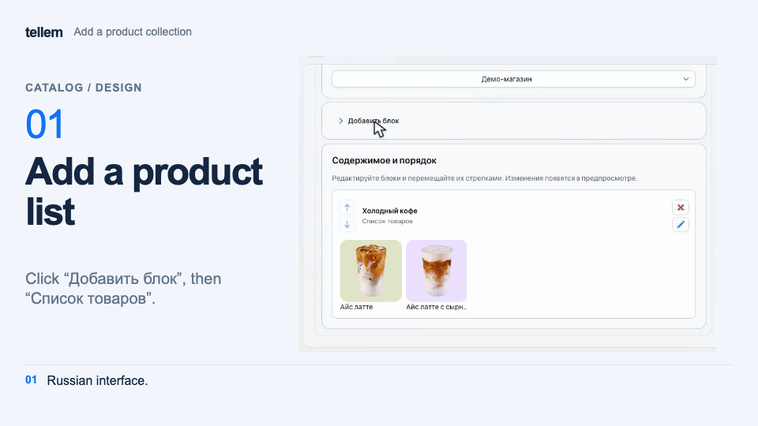
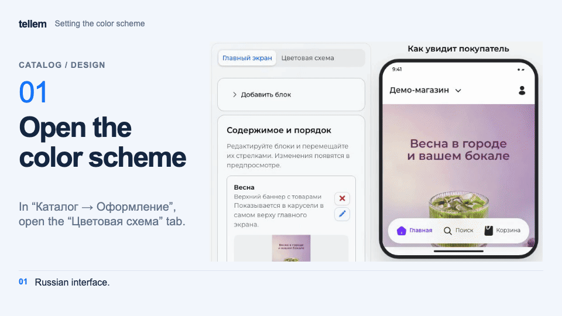

# Appearance { #appearance }

Configure the application's home screen and store colors. Buyers see saved changes without a separate publication step.

Where: **Catalog → Design**.

## Home screen { #home-screen }

1. Open “Main page” and select a store for the preview if there are several.
2. Click “Add a section” and choose a product collection, category collection, or banner. For a regular promotion, use “Upper sales banner”; a [personal birthday discount](promo-codes.md#birthday) cannot be added to it.
3. Select the chains where the block should appear in “Stores”. You can then add products from their assortments. Enter a name and content; also add an image for a banner.
4. Under “Content and order”, reorder blocks with the arrows. Top banners stay first and the catalog of top-level categories stays last. The arrows do not reorder items within the top banner.
5. Check the result in the phone preview. The pencil opens a block's settings; × deletes it after confirmation.

???+ example "Example: product collections"

    The example uses demo products and shows the Russian interface. The GIF has English captions.

    <figure markdown="span">
    [{ width="960" height="540" loading=lazy }](../../media/crm/home-screen-editor.en.gif)
    </figure>

Without a name, a block is visible in the preview but hidden from buyers. A top promotion banner takes its name from the promotion. With the [multilingual editor](general-settings.md) enabled, enter a name for each language.

Images have a 10 MB limit. Recommended proportions are 2:3 for top banners, for example 600×900, and 2:1 for feed banners, for example 1200×600. Small GIF files load faster.

## Color scheme { #color-scheme }

1. Open “Color scheme” and select “Light” or “Dark”.
2. Set colors and check text, buttons, and the price in the preview. Each color is saved as soon as you select it.
3. To reset the open theme, click “Make colors by default” and confirm.

??? example "Example: color scheme"

    Example with demo data. The recording shows the Russian interface.

    <figure markdown="span">
    [{ width="960" height="540" loading=lazy }](../../media/crm/crm-color-scheme.en.gif)
    </figure>

The preview uses the most recently added catalog product with a photo; if none exists, add one to the [catalog](products-and-categories.md#products). Preview availability is an example. Buyers choose a theme in their [application profile](../app/account.md).
