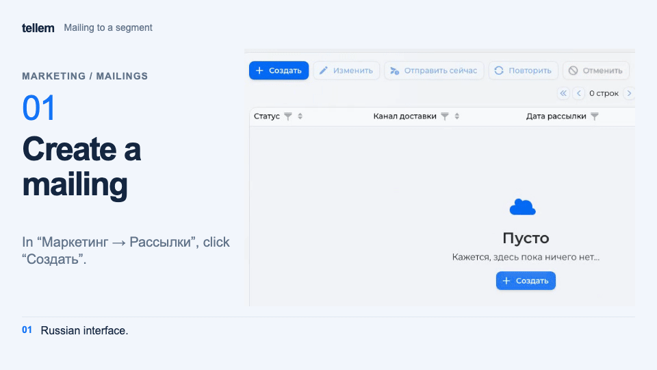

# Mailings { #mailings }

Send a customer message immediately or at a scheduled time. Recipients can be all customers or selected [RFM segments](analytics.md#rfm) at one location.

Where: **Marketing → Mailings**. On a phone, choose **Actions → Create**.

## Recipients and channels { #recipients }

Mailings go to customers with mailings enabled, through every available channel they have not disabled in their [profile](../app/account.md#channels):

- Telegram: the integration is enabled, and the customer has started the bot and has not blocked it;
- VK: the [store community is connected](vk.md), and the customer has linked VK ID and allowed messages;
- email: the address is verified and email sending is available to the store.

Channels cannot be selected in the form: automatic selection uses the channels available at sending. A disabled channel is not replaced. Images go only to Telegram; VK receives text and links, and email receives text. An image-only message goes only to Telegram. Mailings do not use push.

“Available audience: N customers” counts subscribed customers in the selected audience, including those without an available channel; it is not a delivered-message count.

!!! warning "Advertising requires separate consent"
    The mailing switch covers informational messages. It does not replace separate prior consent for advertising. Sellers obtain consent and are responsible for message content; see [Legal documents](../../legal/index.md).

[Points expiry reminders](bonus-system.md#expiry) are configured separately and are unaffected by opting out of mailings.

## Create and send { #create-and-send }

1. Click “Create”. For a selected audience, enable “Use RFM segments”, choose segments and a “Sales area”. The calculation covers all time; a single location is selected automatically. Without the checkbox, recipients are all customers with mailings enabled.
2. Set a date at least 2 minutes ahead. Sending starts within a minute after that time.
3. Enter up to 4,000 characters. Choose Markdown or HTML for Telegram text formatting and check “Show preview”. The form checks formatting before saving; correct any errors it reports.
4. If needed, add an image up to 10 MB: SVG, PNG, JPEG, GIF, WebP, BMP, or HEIC.
5. Click “Save”, check the audience and channel in the confirmation, then click “Yes”.
6. To send a scheduled message early, choose “Send now” and confirm.

???+ example "Example: a mailing to one RFM segment"

    Example with demo data. The recording shows the Russian interface.

    <figure markdown="span">
    [{ width="960" height="540" loading=lazy }](../../media/crm/crm-mailing-create.en.gif)
    </figure>

In Telegram, the image and text arrive in one card. You can also send an image-only card. HTML preserves emphasis, links, and line breaks. Markdown uses the previous Telegram formatting rules, so saved mailings do not need to be rewritten.

Only an “Await” mailing can be edited or cancelled. RFM segments require a sales area; if an older scheduled mailing has none, add it with “Edit” or sending will fail. Saved audiences from [Analytics → Segments](segments.md) are not used for mailings.

### Email behavior { #email-behavior }

The first line becomes the subject and heading, up to 100 characters. HTML keeps formatting; Markdown arrives as text without conversion. Tellem adds the layout and footer. Without text, no email is sent.

## Check the result { #results }

| Status | Meaning and next action |
| --- | --- |
| “Await” | Waiting for its date; edit, cancel, or send now |
| “In progress” | Sending; wait for the result |
| “Sent” | Every channel accepted the message for at least one customer; this does not confirm reading |
| “Canceled” | Cancelled manually or nobody has an available channel |
| “Failed” | No channel accepted the message or validation failed before sending |
| “Partially sent” | Some channels accepted the message and others did not |
| “Unknown result” | A channel did not confirm acceptance; the message may have arrived. Repeat is blocked |

“Repeat” opens a copy with the image, format, segments, and sales area for editing. After partial sending, repeating duplicates messages in channels that already accepted them. Check the result before sending again.

## Create with AI { #ai }

To draft with artificial intelligence (AI), connect the [AI integration](integrations.md#ai), then click “Create with AI”. Choose the purpose, optionally segments and a sales area, add up to 1,000 characters of wishes, and click “Generate”.

Segments require a sales area; this selection replaces the main form's audience. AI uses information about stores, the catalog, popular products, active promotions, and promo codes, including their codes. Before saving, check text, prices, conditions, and the audience against CRM.
