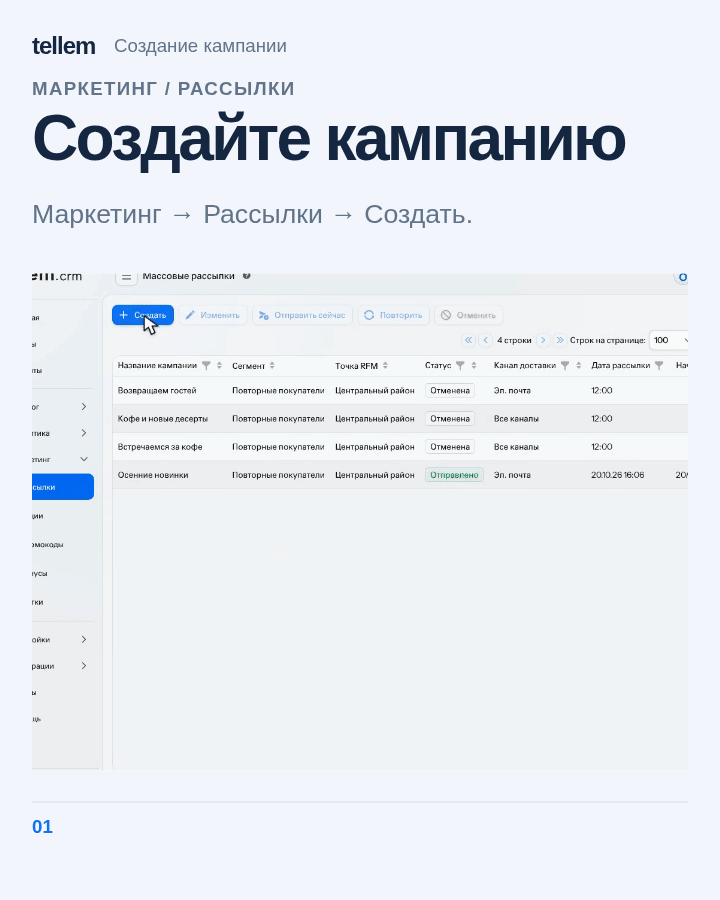

# Кампании и рассылки { #mailings }

Создайте кампанию для клиентов выбранных сегментов и отправьте сообщение сразу или в назначенное время. Создавать и запускать кампании может владелец CRM.

Где: **Маркетинг → Рассылки**. На телефоне выберите **Действия → Создать**.

На компьютере команды «Отправить сейчас», «Повторить» и «Отменить» находятся в меню **«Ещё»**. На телефоне они доступны в **«Действиях»**.

## Получатели и каналы { #recipients }

Рассылка приходит клиентам с включёнными «Рассылками» во все доступные каналы, которые они не выключили в [профиле](../app/account.md#channels):

- Telegram: интеграция включена, клиент запускал бота и не заблокировал его;
- VK: [сообщество магазина подключено](vk.md), клиент привязал VK ID и разрешил сообщения;
- почта: адрес подтверждён и отправка почты доступна магазину.

Выберите отдельный канал, **«Авто»** или **«Все каналы»**. Последние два варианта используют все включённые каналы клиента. Изображение приходит только в Telegram, VK получает текст и ссылки, почта текст. Сообщение только с изображением уйдёт только в Telegram. Push для рассылок не используется.

В **«Сегментах»** объедините до 20 обычных RFM-сегментов и [сохранённых сегментов](segments.md) одной точки. Клиент, который подходит нескольким пунктам, входит в аудиторию один раз. Используется RFM за всё время; период отчёта аналитики не меняет аудиторию. Архивный сегмент выбрать или запустить нельзя.

Единственную точку CRM выбирает автоматически. При смене точки обычные RFM-пункты остаются, а несовместимые сохранённые снимаются.

Справа проверьте число доступных получателей. В **«Исключено»** посмотрите причины: отказ от рассылок, отсутствие канала, частотный лимит. Аудиторию меньше 30 клиентов CRM отмечает предупреждением; сохранить кампанию можно.

При запуске CRM фиксирует состав аудитории. Позднейшие изменения сегмента и новые заказы его не меняют; перед отправкой CRM проверяет согласие и доступность канала. По умолчанию клиент участвует не более чем в одной новой кампании точки за семь дней, суммарно по каналам. Неизвестный исход сохраняет ограничение. Для старых отправок CRM не восстанавливает состав аудитории задним числом.

!!! warning "Реклама требует отдельного согласия"
    Переключатель «Рассылки» относится к информационным сообщениям. Он не заменяет отдельное предварительное согласие на рекламу. Продавец получает согласие и отвечает за содержание сообщений; см. [правовые документы](../../legal/index.md).

[Напоминания о сгорании бонусов](bonus-system.md#expiry) настраиваются отдельно и не зависят от отказа от рассылок.

## Создать и отправить { #create-and-send }

1. Нажмите **«Создать»**. В **«Кому и зачем»** задайте название, точку, цель и аудиторию. Поле **«Сегменты»** содержит группы **«Обычные»** и **«Сохранённые»**.
2. В **«Сообщении»** выберите канал и напишите текст. Предпросмотр обновляется при вводе. Для «Авто» и «Все каналы» переключайте **«Вид сообщения»** между Telegram, VK и почтой; канал отправки от этого не меняется.
3. В **«Отправке»** задайте дату минимум через две минуты и окно наблюдения: 7, 14 или 30 дней. За выбранное окно CRM показывает результат кампании.
4. Нажмите **«Запланировать»**, проверьте аудиторию и канал, затем подтвердите. Отправка начинается в течение минуты после назначенного времени. Для срочной отправки выберите **«Отправить сейчас»** в списке и подтвердите.

???+ example "Пример: создание кампании"

    Пример с демонстрационными данными: обычный и сохранённый сегменты, текст, предпросмотр и планирование.

    <figure markdown="span">
    [{ width=720 height=900 loading=lazy }](../../media/crm/campaign-creation.gif)
    </figure>

В **«Форматировании»** выберите Markdown или HTML и откройте справку. Лимит текста: 4000 символов, для VK 9000. VK получает обычный текст и ссылки. Форма проверяет разметку перед сохранением; исправьте ошибки, если появится сообщение о них.

**«Добавить изображение»** принимает SVG, PNG, JPEG, GIF, WebP, BMP или HEIC до 10 МБ. В Telegram изображение и текст приходят одной карточкой. HTML сохраняет выделение, ссылки и переносы строк; для Markdown действуют прежние правила Telegram, поэтому переписывать сохранённые рассылки не нужно.

Изменить и отменить можно только кампанию в статусе «Запланирована»; остальные доступны для просмотра. Уже начавшуюся кампанию повторяйте через новую, а не редактированием исходной.

### Особенности письма { #email-behavior }

Первая строка становится темой и заголовком, до 100 символов. HTML сохраняет форматирование, Markdown приходит как текст без преобразования. Tellem добавляет оформление и подвал. Без текста письмо не отправляется.

## Проверить результат { #results }

| Статус | Что означает и что делать |
| --- | --- |
| «Запланирована» | Ждёт даты; можно изменить, отменить или отправить сейчас |
| «Рассылается» | Идёт отправка; дождитесь результата |
| «Отправлено» | Каждый канал принял сообщение хотя бы для одного клиента; это не подтверждение прочтения |
| «Отменена» | Отменена вручную либо ни у кого нет доступного канала |
| «Неудача» | Ни один канал не принял сообщение или не пройдена проверка перед отправкой |
| «Отправлено частично» | Часть каналов приняла сообщение, часть нет |
| «Результат неизвестен» | Канал не подтвердил приём; сообщение могло дойти. Повтор заблокирован |

**«Повторить»** создаёт новую кампанию с текстом, изображением, форматом, всеми сегментами, точкой и окном исходной. При запуске CRM заново отбирает аудиторию и проверяет частоту. После частичной отправки повтор может продублировать сообщения в каналах, которые уже приняли их; проверьте результат до повторной отправки.

## Оценить кампанию { #campaign-result }

В **«Маркетинг → Рассылки»** выберите отправленную кампанию и нажмите **«Результат»**.
В карточке клиента откройте **«Кампании»**, выберите строку и нажмите **«Результат кампании»**.
Предпросмотр рядом с показателями показывает содержание выбранной рассылки. Нажмите **«Открыть»**,
чтобы прочитать длинное сообщение целиком; для нескольких каналов можно переключить его вид.

Экран показывает размер исходной аудитории, уникальных посетителей и покупателей, число заказов,
выручку, средний чек, выручку на участника и долю купивших. Эти показатели находятся на экране
результата. В списке рассылок название и короткий текст, аудитория и точка, статус и дата
собраны в общие ячейки; канал указан отдельно. Нажмите на короткий текст, чтобы открыть сообщение целиком.

Окно 7, 14 или 30 дней включает весь день отправки и следующие 6, 13 или 29 дней в календаре CRM.
Утренний визит и вечерний заказ в день дневной рассылки входят в результат. Внутри дня время
отправки не ограничивает визиты и покупки. CRM учитывает только точку кампании и завершённые
заказы; заказ с нулевой выручкой остаётся заказом.

Доля купивших делит число покупателей на исходную аудиторию. Выручка на участника делит выручку
на ту же аудиторию, средний чек — на число заказов. Повторные просмотры и визиты в разные дни
дают одного посетителя за окно. Посетителями считаются клиенты, открывшие товар или категорию
после входа в аккаунт; часть просмотров может не попасть в статистику. Покупки учитываются отдельно.

Пока окно открыто, результат предварительный. CRM обновляет его ежедневно; после закрытия
учитывает поздние возвраты и исправления заказов. Нажмите **«Обновить»**, чтобы запросить свежие
показатели. На время обновления экран сохраняет прежние числа. Если данные недоступны,
экран отмечает сохранённые значения. «—» означает отсутствие значения, включая недоступную историю посещений.

Аудитория означает участие в кампании, без подтверждения доставки каждому клиенту. Отписка после
запуска не меняет исходный размер аудитории. Клиенты могли получить другие рассылки или купить
по другим причинам, поэтому эти числа не измеряют дополнительную выручку от кампании.
При аудитории меньше 30 клиентов учитывайте малый размер выборки при сравнении. Старые рассылки без сохранённой
аудитории и кампании с неподтверждённой отправкой могут не иметь результата.

## Помощь ИИ { #ai }

Кнопка **«Написать с ИИ»** видна, когда включена [интеграция AI](integrations.md#ai) и указан API-ключ. Сначала выберите аудиторию и точку кампании.

Выберите цель или **«Подобрать автоматически»**: ИИ предложит цель по условиям всех выбранных сегментов. При желании добавьте пожелания до 1000 символов и нажмите **«Сгенерировать»**. Проверьте предложение, затем нажмите **«Применить»**. До применения цель и текст кампании не меняются; аудиторию и точку ИИ не меняет. Можно отменить запрос или запросить новый вариант. Для VK ИИ готовит обычный текст.

Для текста ИИ использует условия сегментов, сведения о магазинах, каталоге, популярных товарах, действующих акциях и промокодах, включая коды. Список получателей в запрос не входит. Перед применением проверьте цены, условия и коды по данным CRM.

## История клиента { #customer-history }

В [карточке клиента](clients.md#campaigns) выберите точку и откройте **«Кампании»**. Выберите строку и нажмите **«Открыть кампанию»** для просмотра исходного сообщения и аудитории или **«Результат кампании»** для показателей. Участие не подтверждает доставку или прочтение. При объединении аккаунтов CRM объединяет строки истории и показывает отметку объединения; исходный размер аудитории сохраняется.
