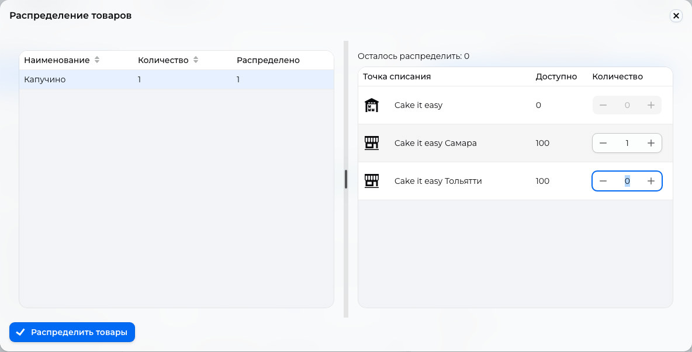

# Orders { #orders }

Find an order, check its payment and products, then move it through its statuses.

Open **Orders**. Search by order number, or select a status and fulfillment method in **Filter**. Collapsing the filter keeps the selected conditions; on a computer, you can also use column header filters.

On a phone, browse the compact list: each row shows the customer, status, total, fulfillment, and payment method. Open a row to view details: on a computer, they appear to the right of the list; on a phone, they open over it. To export to Excel on a phone, open **Actions**.

## Check the order { #check-the-order }

In the details, check the customer, fulfillment, products, and order total. Expand the comment when needed. Links open the customer and applied promo code. Additional product fields appear below the product card.

With iiko connected, check the **Selection** column for the dish size and selected extras, including quantities and extra charges. On a phone, the selection appears below the product name. See [iiko product setup](iiko.md).

Product cost includes discounts and payment method fees, but excludes delivery; redeemed points have not yet been deducted. The final total includes delivery and deducts redeemed points.

In “Payment and total”, check the method and online payment state. CDEK and Yandex Delivery orders also have delivery information; Ozon and Russian Post orders do not. See [Delivery](delivery.md) for shipment actions.

## Statuses and actions { #statuses-and-actions }

Action buttons sit below the order information and remain available while you scroll. Choose an action and confirm the transition; the available buttons depend on the status. Custom statuses and transitions cannot be added.

| Status | Action | New status |
| --- | --- | --- |
| “New”, “Awaiting payment”, “Awaiting payment confirmation”, “Paid” | “Accept order” | “Pending processing” |
| “Awaiting payment confirmation” | “Confirm payment received” | “Paid” |
| “Pending processing” | “Distribute products”, then “Complete distribution” | “Getting ready” |
| “Getting ready” | “Send an order” for delivery, or “Order is pending pickup” | “In delivery” or “Pending pickup” |
| “In delivery”, “Pending pickup” | “Complete order” | “Completed” |
| “Completed” | “Return order” | “Returned” |

During distribution, select warehouses for all items, then complete the action. If the sales area, meaning the order's store or chain, has one open warehouse, acceptance distributes products and immediately sets “Getting ready”, including for “Online” fulfillment.

<figure markdown="1">

{ loading=lazy }

<figcaption>Example warehouse selection for one unit before completing allocation. The screenshot shows the Russian interface.</figcaption>
</figure>

If an “Online” order remains “Pending processing”, it can be completed without distribution. For CDEK and Yandex Delivery, carrier acceptance and delivery to the recipient set “In delivery” and “Completed”.

## Online payment { #online-payment }

An order paid through a link starts as “Awaiting payment”. The payment provider changes it to “Paid”, or “Payment error” if payment fails or the [payment deadline](payment-providers.md) expires.

!!! warning "Wait for payment before accepting"
    “Accept order” is available before payment. After acceptance, CRM stops updating the payment state and will not set “Paid”. If you accepted the order earlier, check receipt of funds in the payment provider's account.

“Awaiting payment confirmation” applies to “Online transfer”: check receipt and confirm it according to the [payment settings](payment-providers.md).

## Cancellation and return { #cancellation }

Before completion, choose “Cancel order”; after completion, choose “Return order”. Distributed products return to stock.

With one open warehouse in the sales area, confirmation returns products and sets “Canceled” or “Returned”. With several, choose where to return items in the return window and save.

“Canceled”, “Returned”, and “Payment error” are final statuses with no action buttons.

!!! warning "Refunding payment"
    Changing the status to **Canceled** or **Returned** does not itself refund the customer. For a paid order, arrange the refund separately using the original payment method; for an online payment, check the procedure and result with the payment provider. The order status does not confirm that money has been refunded.

Set channels and texts for buyer status messages and staff notifications in [notification settings](crm-notifications.md).
