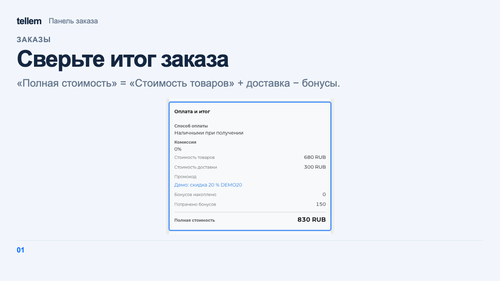
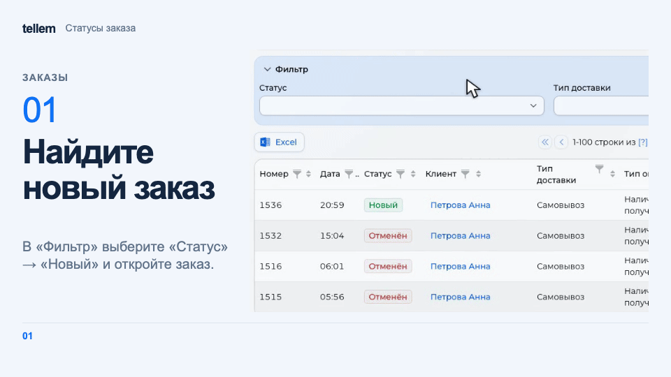

# Заказы { #orders }

Найдите заказ, проверьте оплату и состав, затем проведите его по статусам.

Откройте **Заказы**. Ищите по номеру заказа или выберите статус и способ получения в блоке **Фильтр**. Сворачивание фильтра сохраняет выбранные условия; на компьютере можно также использовать фильтры в заголовках колонок.

На телефоне просматривайте заказы плотным списком: в каждой строке видны клиент, статус, сумма, получение и способ оплаты. Откройте строку, чтобы посмотреть детали: на широком экране они появятся в панели справа поверх таблицы, сохраняя её ширину; на небольшом экране — в диалоге. Для выгрузки в Excel на телефоне откройте **Действия**.

На широком экране потяните левую границу панели, чтобы изменить её ширину. Пока раздел открыт, выбранная ширина сохраняется при переходе к другому заказу и повторном открытии деталей.

Закройте детали крестиком в шапке или Escape.

## Проверить заказ { #check-the-order }

В деталях проверьте клиента, получение, состав и итог заказа. Раскройте комментарий, если он нужен. Клиент и применённый промокод открываются по ссылкам. Дополнительные поля товара показаны под его карточкой.

При подключённой iiko проверьте колонку **Состав**: в ней указаны размер блюда и выбранные добавки с количеством и доплатой. На телефоне состав находится под названием товара. [Настройка товаров iiko](iiko.md).

«Стоимость товаров» включает скидки и комиссию способа оплаты, но не доставку; списание бонусов ещё не вычтено. «Полная стоимость» учитывает доставку и списанные бонусы.

??? example "Пример: итог заказа с промокодом и бонусами"

    Пример с демонстрационными данными.

    <figure markdown="span">
    [{ width="1280" height="720" loading=lazy }](../../media/crm/crm-order-panel.png)
    </figure>

В блоке «Оплата и итог» проверьте способ и состояние онлайн-платежа. У заказов со СДЭК и Яндекс Доставкой также есть «Информация о доставке»; у Ozon и Почты России такого блока нет. Действия с отправлением описаны в [доставке](delivery.md).

## Статусы и действия { #statuses-and-actions }

Кнопки действий находятся под сведениями о заказе и остаются доступны при прокрутке. Выберите действие и подтвердите переход; набор кнопок зависит от статуса. Добавить свои статусы и переходы нельзя.

???+ example "Пример: заказ на самовывоз от «Новый» до «Завершён»"

    Пример с демонстрационными данными. У магазина один открытый склад, поэтому после принятия заказ сразу переходит в «Собирается».

    <figure markdown="span">
    [{ width="960" height="540" loading=lazy }](../../media/crm/crm-order-status-flow.gif)
    </figure>

| Статус | Действие | Новый статус |
| --- | --- | --- |
| «Новый», «Ожидает оплаты», «Ожидает подтверждения оплаты», «Оплачено» | «Принять заказ» | «Ожидает обработки» |
| «Ожидает подтверждения оплаты» | «Подтвердить получение оплаты» | «Оплачено» |
| «Ожидает обработки» | «Распределить товары», затем «Завершить распределение» | «Собирается» |
| «Собирается» | «Отправить заказ» для доставки или «Заказ ожидает получения» | «В доставке» или «Ожидает получения» |
| «В доставке», «Ожидает получения» | «Завершить заказ» | «Завершён» |
| «Завершён» | «Вернуть заказ» | «Возврат» |

При распределении выберите склады для всех позиций, нажмите «Распределить товары» в окне, затем «Завершить распределение». Если у зоны продаж, то есть магазина или сети заказа, один открытый склад, принятие распределяет товары и сразу переводит заказ в «Собирается», в том числе для способа «Онлайн».

??? example "Пример: распределение заказа по складам"

    Пример с демонстрационными данными. У сети несколько открытых складов, поэтому принятый заказ ждёт распределения в «Ожидает обработки».

    <figure markdown="span">
    [{ width="960" height="540" loading=lazy }](../../media/crm/crm-order-stock-distribution.gif)
    </figure>

Если заказ «Онлайн» остался в «Ожидает обработки», его можно завершить без распределения. Для СДЭК и Яндекс Доставки приём и вручение посылки перевозчиком меняют статус на «В доставке» и «Завершён».

## Оплата онлайн { #online-payment }

Заказ с оплатой по ссылке создаётся в статусе «Ожидает оплаты». Платёжный провайдер меняет его на «Оплачено» или «Ошибка оплаты», если платёж не прошёл либо истёк [срок ожидания](payment-providers.md).

!!! warning "Дождитесь оплаты перед принятием"
    «Принять заказ» доступен до оплаты. После принятия CRM перестаёт обновлять состояние платежа и не переведёт заказ в «Оплачено». Если приняли его раньше, проверьте поступление денег в кабинете платёжного провайдера.

«Ожидает подтверждения оплаты» относится к способу «Перевод онлайн»: проверьте поступление и подтвердите его согласно [настройкам оплаты](payment-providers.md).

## Отмена и возврат { #cancellation }

До завершения выберите «Отменить заказ», после завершения «Вернуть заказ». Распределённые товары возвращаются на склад.

При одном открытом складе зоны продаж подтверждение возвращает товары и меняет статус на «Отменён» или «Возврат». При нескольких в окне «Возврат товаров на склады» укажите, куда вернуть позиции, и сохраните.

«Отменён», «Возврат» и «Ошибка оплаты» являются конечными статусами: кнопок действий в них нет.

!!! warning "Возврат оплаты"
    Смена статуса на «Отменён» или «Возврат» сама по себе не возвращает деньги покупателю. Если заказ оплачен, оформите возврат отдельно по использованному способу оплаты; для онлайн-платежа проверьте порядок и результат у платёжного провайдера. Не считайте статус заказа подтверждением возврата денег.

Каналы и тексты сообщений о статусе покупателю, а также уведомления сотрудникам задаются в [настройках уведомлений](crm-notifications.md).
