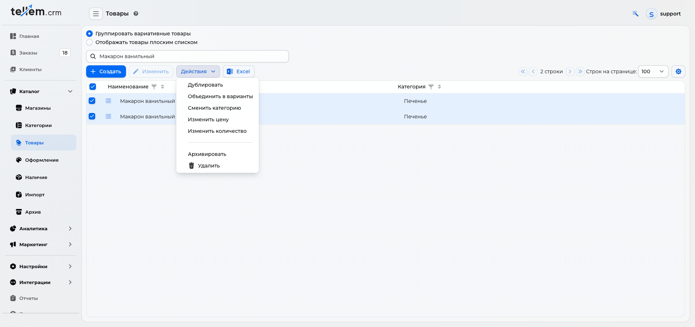
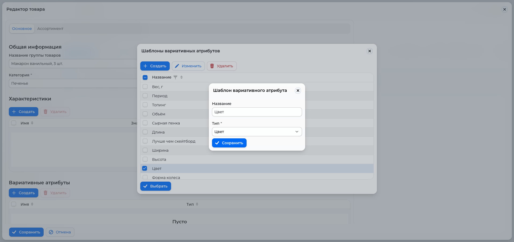
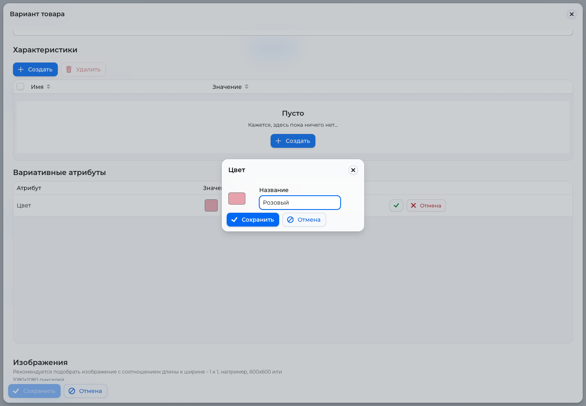
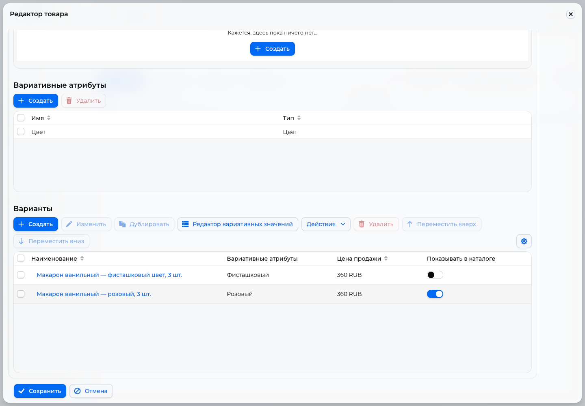
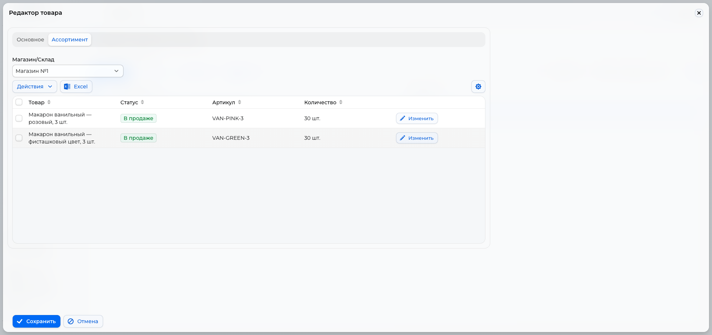
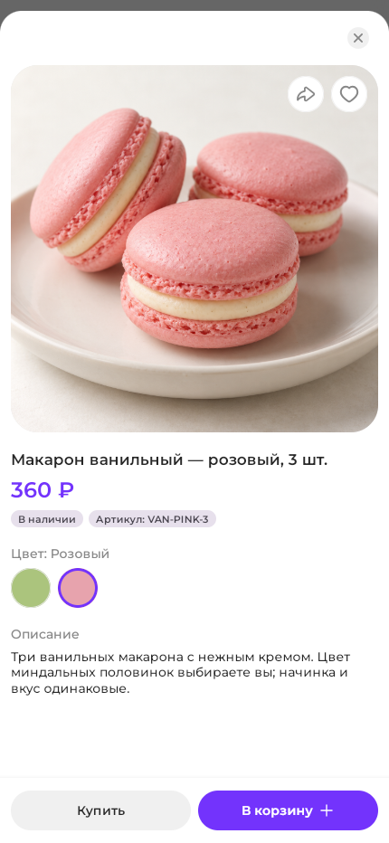
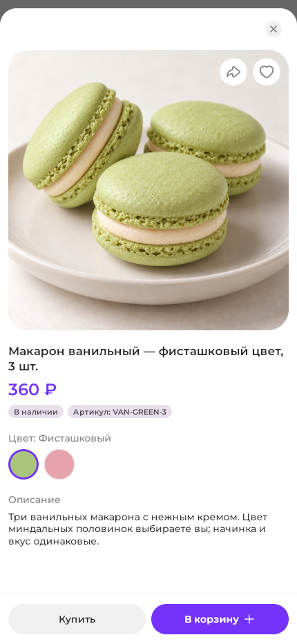

# Как объединить два товара по цвету

Объедините два отдельных товара в одну группу, чтобы покупатель выбирал цвет прямо в карточке.

Где: **Каталог → Товары**.

В примере кафе продаёт **ванильные макароны, 3 шт.** за **360 руб.**: розовые и фисташкового цвета. Начинка и вкус одинаковые, меняется только цвет миндальных половинок. Такой же подход подходит для пончиков с разной глазурью или десертов с цветным декором.

## 1. Подготовьте два товара

В каталоге уже должны быть два простых товара:

| Товар | Фото | Цена |
| --- | --- | --- |
| Макарон ванильный — розовый, 3 шт. | Розовые макароны | 360 руб. |
| Макарон ванильный — фисташковый цвет, 3 шт. | Зелёные макароны | 360 руб. |

Если товаров ещё нет, добавьте каждый через **«Создать → Создать вручную»** — [Категории и товары](products-and-categories.md). Для ресторанного меню, которое передаётся в iiko, используйте **«Добавить из iiko»** и соответствующие позиции меню.

!!! warning "До объединения"
    У выбранных товаров ещё не должно быть заказов. Объединяйте товары одного типа: обычные с обычными, товары из iiko — с товарами из iiko. Запишите остатки по магазинам и артикулы: после объединения их понадобится задать заново. При сохранении новая группа заменит исходные товары.

## 2. Объедините товары

1. Выберите **«Группировать вариативные товары»**.
2. Найдите товары по слову «Макарон» и нажмите **Enter**.
3. Отметьте флажками обе строки.
4. Откройте **«Действия → Объединить в варианты»**.
5. В «Редакторе товара» задайте **«Название группы товаров» — «Макарон ванильный, 3 шт.»** и проверьте категорию.

## 3. Добавьте атрибут «Цвет»

На вкладке **«Основное»**, в блоке **«Вариативные атрибуты»**, нажмите **«Создать»**. В окне «Шаблоны вариативных атрибутов» отметьте **«Цвет»** и нажмите **«Выбрать»**.

Если подходящего шаблона нет, создайте его в этом же окне: **«Название» — «Цвет»**, **«Тип» — «Цвет»**, затем **«Сохранить»**. После сохранения выберите шаблон для группы.

Именно тип **«Цвет»** даёт покупателю цветные кружки. Текстовый атрибут с таким же названием покажет текстовые кнопки.

## 4. Назначьте цвета вариантам

В блоке **«Варианты»** отметьте розовый макарон и нажмите **«Изменить»**. В открывшейся карточке прокрутите до блока **«Вариативные атрибуты»** и нажмите **«Изменить»** в строке «Цвет».

Выберите готовый оттенок или **«Создать...»**. Для нового цвета задайте название и оттенок через цветной квадрат:

| Вариант | Название цвета | Пример кода цвета |
| --- | --- | --- |
| Розовый макарон | Розовый | `#E7A3AD` |
| Зелёный макарон | Фисташковый | `#ABC47D` |

Сохраните цвет, проверьте фото и цену варианта, задайте артикул, например **VAN-PINK-3**, и нажмите **«Сохранить»** в карточке варианта. Повторите для фисташкового цвета с артикулом **VAN-GREEN-3**. Значения цвета должны различаться.

Чтобы в категории была **одна карточка**, оставьте **«Показывать в каталоге»** только у розового варианта. Фисташковый останется доступен через переключатель внутри карточки. Если нужны обе карточки в категории, включите этот флажок у обоих вариантов.

## 5. Задайте наличие и сохраните

На вкладке **«Ассортимент»** выберите магазин и задайте количество каждого варианта через **«Изменить»** в его строке. Подтвердите каждую строку кнопкой с галочкой. В примере — по **30 наборов** каждого цвета. Повторите для остальных нужных магазинов — [Наличие](inventory.md).

Нажмите **«Сохранить»** внизу «Редактора товара». Если CRM предложит настроить пустые остатки в других магазинах, выберите «Да» для настройки или «Нет», если в этих магазинах товар пока не продаётся.

## 6. Проверьте результат глазами покупателя

Откройте приложение, выберите нужный магазин и найдите макарон в категории. В карточке под ценой появится **«Цвет: Розовый»** и два цветных кружка. Нажатие на фисташковый кружок переключит вариант: изменятся фото, название, подпись цвета и артикул. Выбранный кружок выделен обводкой.

{ width="300" }

{ width="300" }

Цена в примере остаётся **360 руб.**; если у вариантов разные цены, она тоже изменится. Кнопки **«Купить»** и **«В корзину»** относятся к выбранному цвету. Перед открытием продаж переключите оба цвета и проверьте фото, цену и наличие. Подробнее — [Витрина и корзина](../app/ui-and-pages.md).
