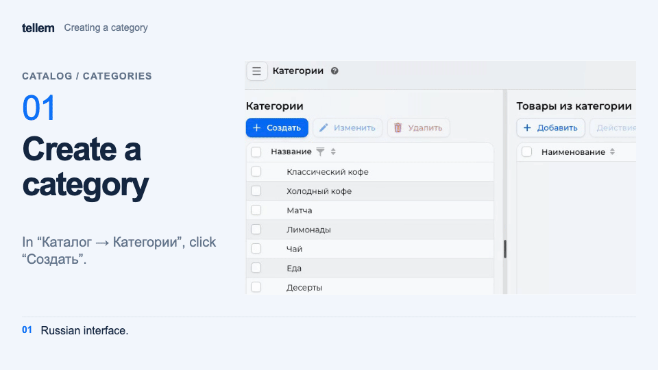
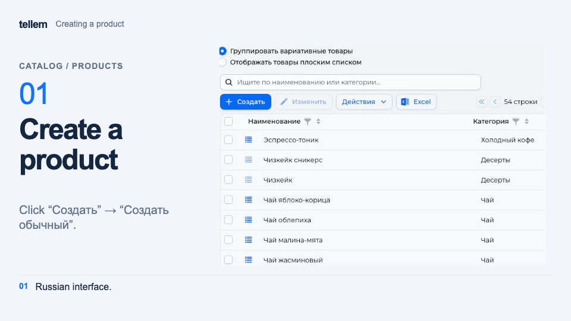

# Categories and products { #categories-and-products }

Create categories and products, then set [stock](inventory.md#by-store). To upload a file, use [catalog import](catalog-import.md).

Where: **Catalog → Categories**, **Catalog → Products**, **Catalog → Archive**.

## Create categories { #categories }

1. In **Catalog → Categories**, click “Create”, enter a name, and add an image if needed.
2. For a nested category, select “Parent category”; without one, the category is at the top level. Selecting a category before creation makes it the parent.
3. Save. To change the order, drag a category to the top edge of another row; to nest it, drop it on the middle of a row. Dropping it on the uncategorized row moves it back to the top level.

??? example "Example: creating and nesting a category"

    Example with demo data. The recording shows the Russian interface.

    <figure markdown="span">
    [{ width="960" height="540" loading=lazy }](../../media/crm/crm-category-create.en.gif)
    </figure>

Use a square image up to 10 MB. The selected category's products appear to the right of the list; on a narrow screen, use “Actions → View products”; “Remove from category” moves them to the uncategorized category.

Buyers cannot see the uncategorized category, so assign products a category. A category is also hidden if the chain has no active products in it, or no available products when zero-stock items are hidden.

!!! warning "Deleting a category removes its products from sale"
    Deleting a category also deletes its subcategories. Their products are archived and become uncategorized. To restore them for buyers, publish the products from the archive and assign a new category.

## Create a product { #products }

In **Catalog → Products → Create**, choose the appropriate method:

| Method | When to use it |
| --- | --- |
| “Create single” | A separate product without a color, size, or other variant selector |
| “Create variants” | Variants of one product differ by color, size, price, article code, or photo |
| “Add from iiko” | The product must be sent to iiko; an [integration](iiko.md#products) is required |

For a simple product, enter a category and sale price under “Main”. You can add up to 6 photos of up to 10 MB each; a 1:1 ratio is recommended. Buyers see the product's characteristics in its card. Set quantities by store under “Assortment”; CRM offers to configure zero quantities on the first save. Answering “No” saves the product with zero quantity in those stores.

???+ example "Example: creating a simple product"

    Example with demo data. The recording shows the Russian interface.

    <figure markdown="span">
    [{ width="960" height="540" loading=lazy }](../../media/crm/crm-product-create.en.gif)
    </figure>

Enter prices in the store currency with its allowed number of decimal places. For example, a ruble price can be `79.90`. CRM rejects excess significant decimal places when saving a price.

For a product with variants, add at least one variative attribute and set each variant's price, article code, and photo. Attribute combinations must be unique. See [Combining two products by color](product-colors.md) for an example of a color selector and merging existing products.

For [iiko products](iiko.md#products), CRM creates variants from the menu sizes. Manage those sizes in iiko; you cannot add, delete, or copy these variants manually in CRM.

If using carriers, enter the weight in grams. It affects [delivery calculations](delivery.md); length, width, and height do not. These fields are in the variant record. For a simple product, open it with “Edit” in “Display products list” mode.

## Change or remove products { #change-or-remove-products }

Select rows and the required action under “Actions”. Check the whole selection before changing price, quantity, or category. When duplicating products, photos are copied only with “Product photos” enabled.

A product used in an order cannot be deleted from the regular list; archive it instead. Archiving hides it regardless of stock. See [Inventory](inventory.md) for other ways to remove a product temporarily.

In **Catalog → Archive**, “Publish” restores a product. Deletion from the archive is available if the product is not in an unfinished order.
