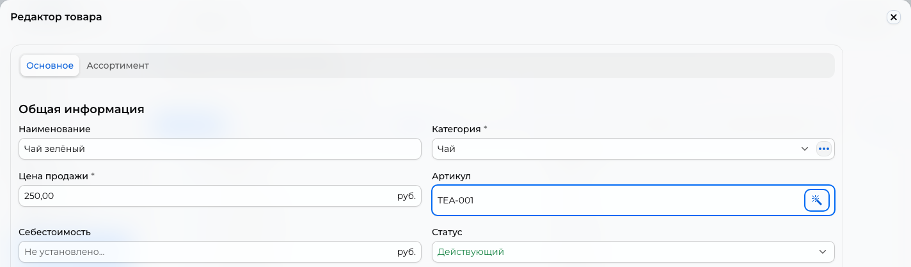

# Категории и товары { #categories-and-products }

Создайте категории и товары, затем задайте [наличие](inventory.md#by-store). Для загрузки из файла используйте [импорт каталога](catalog-import.md).

Где: **Каталог → Категории**, **Каталог → Товары**, **Каталог → Архив**.

## Создать категории { #categories }

1. В **Каталог → Категории** нажмите «Создать», укажите название и при необходимости изображение.
2. Для вложенной категории выберите «Родительская категория»; без неё категория будет верхнего уровня. Если перед созданием выделить существующую категорию, она станет родительской.
3. Сохраните. Перетаскивайте категории, чтобы менять порядок; перенесите категорию на другую, чтобы вложить её.

Для изображения используйте квадратную картинку до 10 МБ. «Смотреть товары» открывает товары выбранной категории; «Исключить из категории» переносит их в «Без категории».

Покупатель не видит «Без категории», поэтому назначайте товарам категорию. Категория также скрыта, если в сети нет её действующих товаров, а при скрытии нулевых остатков нет доступных товаров.

!!! warning "Удаление категории убирает её товары из продажи"
    Вместе с категорией удаляются вложенные категории. Их товары архивируются и переходят в «Без категории». Чтобы вернуть их покупателям, опубликуйте товары из архива и назначьте новую категорию.

## Создать товар { #products }

В **Каталог → Товары → Создать** выберите подходящий способ:

| Способ | Когда использовать |
| --- | --- |
| «Создать обычный» | Отдельный товар без выбора цвета, размера и других вариантов |
| «Создать варианты» | Варианты одного товара отличаются цветом, размером, ценой, артикулом или фото |
| «Добавить из iiko» | Товар должен передаваться в iiko; нужна [интеграция](iiko.md#products) |

У простого товара на вкладке «Основное» заполните категорию и цену продажи. Можно добавить до 6 фотографий по 10 МБ; рекомендуется пропорция 1:1. Покупатель видит «Характеристики» в карточке товара. На вкладке «Ассортимент» задайте количество по магазинам; при нулевых остатках CRM предложит настроить их при первом сохранении.

<figure markdown="1">

{ loading=lazy }

<figcaption>Пример заполнения основных полей товара. Название, категория и цена учебные.</figcaption>
</figure>

Указывайте цены в валюте магазина с допустимым для неё количеством знаков после запятой. Например, для рублей можно указать `79,90`. Лишние значащие знаки CRM отклоняет при сохранении цены.

Для вариативного товара добавьте хотя бы один «Вариативный атрибут» и задайте цену, артикул и фото вариантов. Сочетания значений атрибутов не должны повторяться. Пример выбора цвета и объединения существующих товаров: [два товара по цвету](product-colors.md).

У [товаров iiko](iiko.md#products) CRM создаёт варианты по размерам меню. Список размеров меняйте в iiko; добавлять, удалять или копировать такие варианты вручную в CRM нельзя.

Если используете перевозчиков, заполните «Вес, г». Он влияет на [расчёт доставки](delivery.md); длина, ширина и высота в расчёте не участвуют. Поля находятся в карточке варианта. У простого товара откройте её кнопкой «Изменить» в режиме «Отображать товары плоским списком».

## Изменить или убрать товары { #change-or-remove-products }

Выберите строки и нужное действие в «Действия». Перед изменением цены, количества или категории проверьте весь выбор. При дублировании фотографии копируются только с включённым флажком «Фотографии товара».

Товар, который был в заказе, нельзя удалить из обычного списка; используйте архивирование. Архив скрывает товар независимо от остатка. Другие способы временно убрать товар описаны в [наличии](inventory.md).

В **Каталог → Архив** кнопка «Опубликовать» возвращает товар. Удаление из архива доступно, если товар не участвует в незавершённом заказе.
