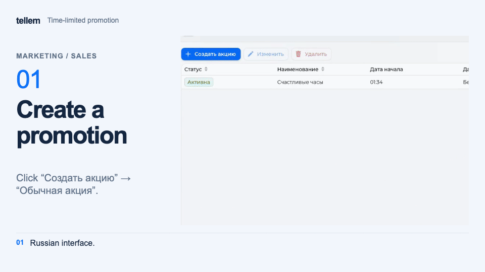
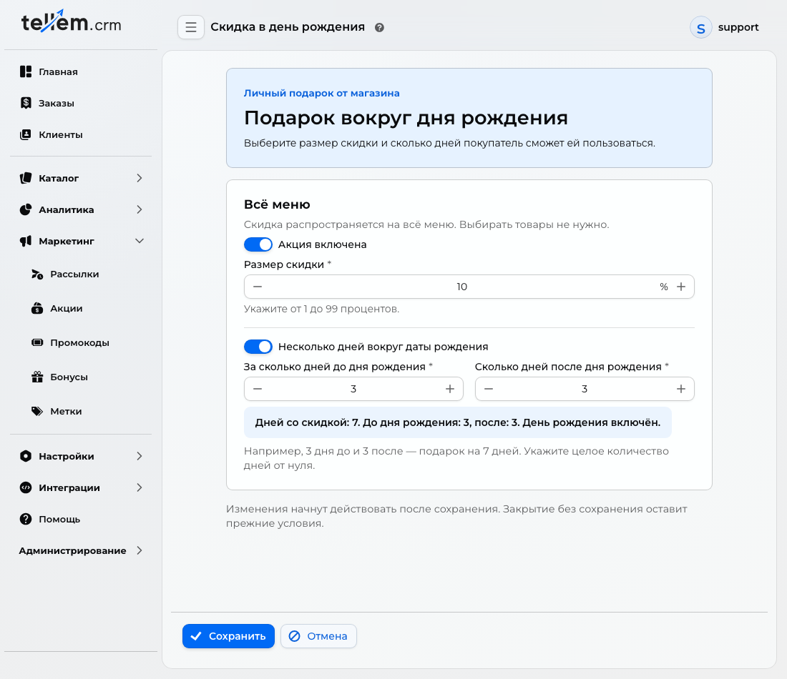

# Promotions and promo codes { #promotions-and-promo-codes }

Set a discount for all buyers, a personal birthday gift, or a price available with a code. Buyers see regular promotions in the catalog and enter promo codes at checkout.

Where: **Marketing → Sales** and **Marketing → Promo codes**.

## Create a regular promotion { #promotions }

1. In **Marketing → Sales**, click “Create promotion” and choose “Regular promotion”.
2. Enter a name for buyers. With the [multilingual editor](general-settings.md) enabled, enter it for each store language.
3. In “Discount and products”, choose a [price change type](#price-types). Add products through “Add products → Select from the list” or “From category”, or choose “Entire menu”.
4. Set the overall period. Without an end date, the promotion is indefinite. “Active” starts it as soon as you save; choose “Await” for an automatic start; for a discount during certain hours, set a [daily schedule](#schedule).
5. Check prices and conditions in the preview, then click “Save”. “Cancel” keeps the previous settings.

Adding a category includes only its current products. “Entire menu” also includes products added later and supports percentage discounts only. Removing a row from a promotion does not delete the product from the catalog.

For example, to offer 20% off the entire menu from 08:00 to 12:00, choose “Entire menu”, enter 20, and set daily hours:

The shared illustrations on this page show the Russian interface.

???+ example "Example: 20% off the entire menu from 08:00 to 12:00"

    Example with demo data. The recording shows the Russian interface.

    <figure markdown="span">
    [{ width="960" height="540" loading=lazy }](../../media/crm/crm-sale-happy-hours.en.gif)
    </figure>

“Await”, “Active”, and “Finished” change according to the overall dates; updates can be delayed. Daily hours do not change the status: an active promotion gives no discount outside its schedule. To end it early, open it, choose “Finished”, and save.

### Price change type { #price-types }

These options apply to both promotions and promo codes:

| Type | How to set the price | What to consider |
| --- | --- | --- |
| Percentage discount | Enter 1–99% | The price follows the current sale price. Individual row prices cannot be set |
| Fixed price | Enter a final price of at least 1; change individual rows if needed | It does not follow the sale price. A new shared value overwrites prices in every row |

Expand “Selected products: N” to check each product's price. Before saving, finish editing rows, fill in all fixed prices, and check that the end is not before the start.

!!! warning "Check the final price"
    A fixed price is the product cost after the discount. For example, to reduce a price from RUB 500 to RUB 400, enter 400 rather than 100.

    A discount applies only below the regular price. A higher price does not increase the product cost in the order.

### Daily schedule { #schedule }

Enable “Make this a timed promotion” and set “From” and “Until”. The schedule repeats daily within the promotion's overall period. Examples:

| Setting | When the discount applies |
| --- | --- |
| 08:15–12:00 | From 08:15; it no longer applies at 12:00 |
| Start 20:00, empty end | From 20:00 until midnight |
| 20:00–02:00 | From the evening until 02:00 the next day |

Start and end times must differ. Times use the user's time zone saved when the schedule was enabled. Check the resulting condition below the preview. Overall dates also limit overnight promotions: they stop when the overall period ends.

For a weekend promotion, set the overall period, for example Saturday 00:00 to Monday 00:00, and leave the daily schedule disabled.

### Show the promotion to buyers { #show-the-promotion-to-buyers }

Buyers see the promotional price in the catalog and product card. To feature a regular promotion on the home screen, add “Upper sales banner” in **Catalog → Design** and select the promotion. See [Appearance](main-page.md#home-screen) for setup. Personal birthday discounts cannot be added to that banner.

## Birthday promotion { #birthday }

The discount covers the entire menu, including new products, and does not change regular catalog prices.

1. In **Marketing → Sales**, click “Create promotion”, choose “Birthday discount”, and click “Create discount”.
2. Enable “Promotion enabled” and enter a discount from 1 to 99%.
3. For a period around the birthday, enable “Several days around the birthday” and enter nonnegative whole numbers of days before and after. Without this setting, the discount applies only on the birthday.
4. Check the duration and click “Save promotion”.

For example, 3 days before, the birthday, and 3 days after give 7 days. An October 15 birthday gives a period of October 12–18 inclusive.

If a birthday promotion exists, open it with “Edit”, even if it is disabled. To replace it, delete the existing promotion first. Deleting it does not give buyers a second gift for a year already used.

Only one gift can be enabled: a discount or [birthday points](bonus-system.md#birthday). Before changing the gift type, disable the previous one in its editor.

Buyers must save their date before their period begins; entering it later does not unlock a gift already in progress. February 29 uses February 28 in a non-leap year. Buyers see conditions and dates in their [profile](../app/account.md#birthday).

After the first order, gift conditions are saved for the current period. Disabling the original promotion stops the discount; a new promotion does not award a second gift for the same year. Delivery is excluded. Rules for comparing discounts appear [below](#combining-discounts).

## Create a promo code { #promo-codes }

For a step-by-step numerical example, see [First promo code for a new store](first-promo-code.md).

1. In **Marketing → Promo codes**, click “Create”.
2. In “About the promo code”, enter a name, status, and unique “Code for customers”. Letter case matters. With the multilingual editor, enter a name for each language.
3. In “Discount and products”, choose a [percentage or fixed price](#price-types) and add products from a list or category. At least one product is required.
4. In “Period and usage limits”, set dates and limits. Without an end date, the code is indefinite. Choose “Await” for an automatic start, or “Active” for use after saving within the specified dates.
5. Check the code, products, prices, and limits in the preview, then click “Save”.

The code becomes active and ends according to its dates with a delay. To stop it early, choose “Finished” and save; promo codes cannot be deleted.

### Code and limits { #usage-limits }

- “Maximum uses” limits all orders with the code in the store.
- “Maximum uses for client” limits one buyer.
- An empty limit means unlimited use. For example, an empty total limit and a customer limit of 1 let every buyer use the code once.

In the list, “Maximum uses” shows the configured limit; “Number of uses” shows how many uses have been consumed. Reaching the total limit sets the code to “Finished”.

!!! warning "Cancellation does not restore a use"
    Creating an order consumes a use. To check the price, apply the code in the application without confirming the order. Cancelling an order does not restore the limit.

Buyers enter the code at [checkout](../app/checkout.md). In CRM, an order links to its applied promo code record.

## Combining discounts { #combining-discounts }

- If several regular promotions apply to a product, the lowest price wins; percentages do not add together.
- Regular promotions do not apply to an order with a promo code: its products use the code's prices, and other products use regular prices.
- For a personal birthday discount, checkout compares the price after a regular promotion or promo code with the birthday-discounted price. The lower price applies to each item; percentages do not add together.
