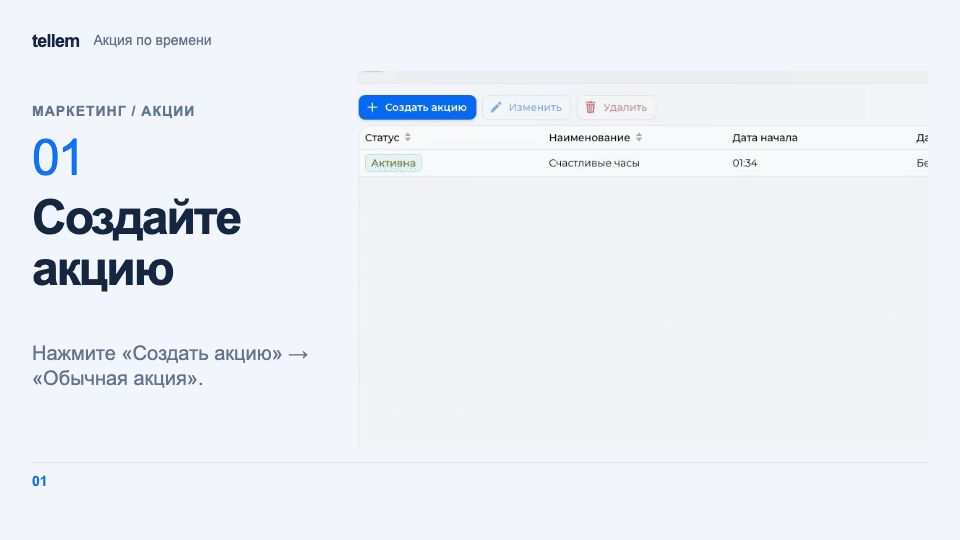
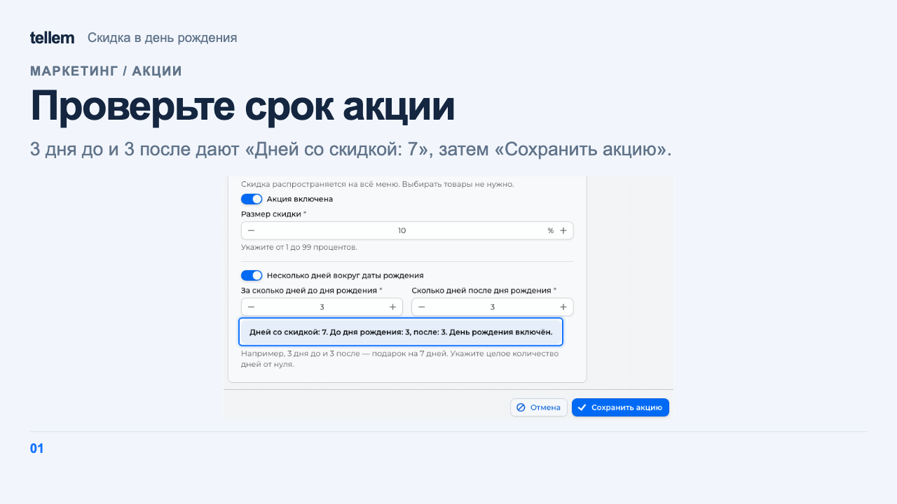
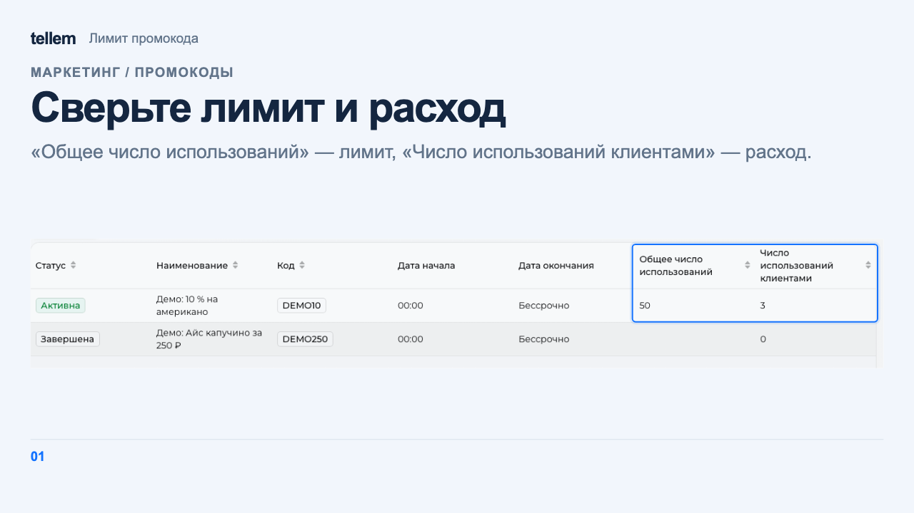

# Акции и промокоды { #promotions-and-promo-codes }

Настройте скидку для всех покупателей, персональный подарок ко дню рождения или цену по коду. Обычные акции покупатель видит в каталоге; промокод вводит при оформлении заказа.

Где: **Маркетинг → Акции** и **Маркетинг → Промокоды**.

## Создать обычную акцию { #promotions }

1. В **Маркетинг → Акции** нажмите «Создать акцию» и выберите «Обычная акция».
2. Укажите название для покупателя. При включённом [мультиязычном редакторе](general-settings.md) заполните его для каждого языка магазина.
3. В «Скидка и товары» выберите [способ изменения цены](#price-types). Добавьте товары через «Добавить товары → Выбрать из списка» или «Из категории», либо выберите «Всё меню».
4. Задайте общий период. Без даты окончания акция бессрочная. «Активна» включает акцию сразу после сохранения, если дата начала уже наступила; для автоматического начала выберите «Запланирована»; если скидка нужна в определённые часы, задайте [ежедневное расписание](#schedule).
5. Проверьте цены и условия в предпросмотре, затем нажмите «Сохранить». «Отмена» оставит прежние настройки.

Добавление категории включает только её текущие товары. «Всё меню» включает и товары, которые вы добавите позже; для него доступна только процентная скидка. Удаление строки из акции не удаляет товар из каталога.

Например, для скидки 20 % на всё меню с 08:00 до 12:00 выберите «Всё меню», укажите 20 и задайте ежедневное время:

???+ example "Пример: скидка 20 % на всё меню с 08:00 до 12:00"

    Пример с демонстрационными данными.

    <figure markdown="span">
    [{ width="960" height="540" loading=lazy }](../../media/crm/crm-sale-happy-hours.gif)
    </figure>

Статусы «Запланирована», «Активна» и «Завершена» меняются по общим датам; обновление может происходить с задержкой. Ежедневное расписание статус не меняет: вне заданных часов скидки нет и у активной акции. Для досрочного завершения откройте акцию, выберите «Завершена» и сохраните.

### Тип изменения цены { #price-types }

Эти способы доступны и для акций, и для промокодов:

| Способ | Как задать цену | Что учитывать |
| --- | --- | --- |
| «Скидка в процентах» | Укажите от 1 до 99 % | Цена зависит от текущей «Цены продажи». Отдельную цену строки задать нельзя |
| «Фиксированная цена» | Введите конечную цену не меньше 1; при необходимости измените цену отдельных строк | Она не меняется вслед за «Ценой продажи». Новое общее значение перезапишет цены всех строк |

Раскройте «Выбрано товаров: N», чтобы проверить цены каждого товара. Перед сохранением завершите редактирование строк, заполните все фиксированные цены и проверьте, что окончание не раньше начала.

!!! warning "Проверьте конечную цену"
    Фиксированная цена означает стоимость товара после скидки. Например, чтобы снизить цену с 500 до 400 руб., введите 400, а не 100.

    Скидка применяется только при цене ниже обычной. Более высокая цена не увеличит стоимость товара в заказе.

### Ежедневное расписание { #schedule }

Включите «Сделать акцию по времени» и задайте «С» и «До». Расписание повторяется каждый день в пределах общего периода акции. Примеры:

| Настройка | Когда действует скидка |
| --- | --- |
| 08:15–12:00 | С 08:15; в 12:00 уже не действует |
| Начало 20:00, окончание пустое | С 20:00 до полуночи |
| 20:00–02:00 | С вечера до 02:00 следующего дня |

Начало и окончание не должны совпадать. Время учитывается в часовом поясе пользователя, сохранённом при включении расписания. Проверьте итоговое условие под предпросмотром. Общие даты ограничивают и ночную акцию: она не продолжится после окончания общего периода.

Для акции на выходные задайте общий период, например с субботы 00:00 до понедельника 00:00, и оставьте ежедневное расписание выключенным.

### Показать акцию покупателю { #show-the-promotion-to-buyers }

Покупатель видит акционную цену в каталоге и карточке товара. Чтобы вынести обычную акцию на главный экран, добавьте «Верхний баннер с акцией» в **Каталог → Оформление** и выберите акцию. Порядок настройки описан в [оформлении](main-page.md#home-screen). Персональную скидку ко дню рождения в такой баннер добавить нельзя.

## Акция ко дню рождения { #birthday }

Скидка действует на всё меню, включая новые товары, и не меняет обычные цены каталога.

1. В **Маркетинг → Акции** нажмите «Создать акцию», выберите «Скидка в день рождения» и нажмите «Создать скидку».
2. Включите «Акция включена» и задайте скидку от 1 до 99 %.
3. Для периода вокруг праздника включите «Несколько дней вокруг даты рождения» и укажите целые неотрицательные числа дней до и после. Без этой настройки скидка действует только в день рождения.
4. Проверьте длительность и нажмите «Сохранить акцию».

Например, 3 дня до, день рождения и 3 дня после дают 7 дней. Для дня рождения 15 октября это 12–18 октября включительно.

??? example "Пример: скидка ко дню рождения"

    Пример с демонстрационными данными.

    <figure markdown="span">
    [{ width="1280" height="720" loading=lazy }](../../media/crm/crm-birthday-discount.png)
    </figure>

Если такая акция уже есть, откройте её через «Редактировать», даже если она выключена. Для замены сначала удалите существующую. Удаление не даёт покупателю второй подарок за использованный год.

Одновременно можно включить один подарок: скидку или [бонусы ко дню рождения](bonus-system.md#birthday). Перед сменой варианта выключите прежний в его редакторе.

Покупатель должен сохранить дату до начала своего периода; поздний ввод не открывает уже начавшийся подарок. Для 29 февраля в невисокосный год используется 28 февраля. Условия и даты покупатель видит в «Личных данных» [профиля](../app/account.md#birthday).

После первого заказа условия подарка сохраняются для текущего периода. Выключение исходной акции прекращает скидку; новая акция не выдаёт второй подарок за тот же год. Доставка в скидке не участвует. Правила сравнения с другими скидками приведены [ниже](#combining-discounts).

## Создать промокод { #promo-codes }

Пошаговый числовой пример: [первый промокод для нового магазина](first-promo-code.md).

1. В **Маркетинг → Промокоды** нажмите «Создать».
2. В «О промокоде» укажите название, статус и уникальный «Код для покупателя». Регистр важен. При мультиязычном редакторе заполните название для каждого языка.
3. В «Скидка и товары» выберите [процент или фиксированную цену](#price-types) и добавьте товары из списка или категории. Нужен хотя бы один товар.
4. В «Период и лимиты» задайте даты и ограничения. Без даты окончания код бессрочный. Для автоматического начала выберите «Запланирована», для применения после сохранения в пределах заданных дат выберите «Активна».
5. Проверьте код, товары, цены и ограничения в предпросмотре и нажмите «Сохранить».

Код становится активным и завершается по датам с задержкой. Чтобы остановить его раньше, выберите «Завершена» и сохраните; удалить промокод нельзя.

### Код и ограничения { #usage-limits }

- «Общее число использований» ограничивает все заказы с кодом в магазине.
- «Число использований клиентом» ограничивает одного покупателя.
- Пустое ограничение означает отсутствие лимита. Например, общий лимит без значения и лимит клиента 1 разрешают каждому покупателю применить код один раз.

В списке «Общее число использований» показывает заданный лимит, а «Число использований клиентами» показывает уже использованное количество. При исчерпании общего лимита код становится «Завершена».

??? example "Пример: лимит и число использований"

    Пример с демонстрационными данными.

    <figure markdown="span">
    [{ width="1280" height="720" loading=lazy }](../../media/crm/crm-promo-code-limits.png)
    </figure>

!!! warning "Отмена заказа не возвращает использование"
    Использование засчитывается при создании заказа. Для проверки цены примените код в приложении, не подтверждая заказ. Отмена созданного заказа не восстановит лимит.

Покупатель вводит код при [оформлении заказа](../app/checkout.md). Из заказа в CRM можно открыть карточку применённого промокода.

## Как сочетаются скидки { #combining-discounts }

- Из нескольких обычных акций для товара применяется самая низкая цена; проценты не складываются.
- В заказе с промокодом обычные акции не действуют: товары кода получают его цены, остальные продаются по обычным.
- Для персональной скидки ко дню рождения при оформлении сравниваются цена с учётом обычной акции или промокода и цена с подарочной скидкой. Для каждой позиции применяется меньшая цена; проценты не складываются.
