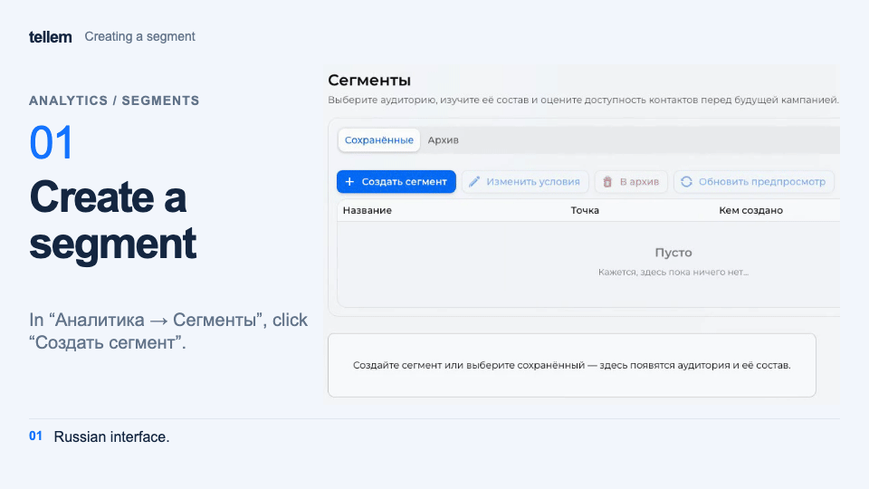

# Segments { #segments }

Select customers by conditions and check how many you can contact. This screen does not send messages.

Where: **Analytics → Segments**. On narrow screens, the table buttons are under “Actions”.

## Explore an audience { #explore-an-audience }

Select a segment to see its sales area, conditions, customer counts, and contacts. Membership uses current data; RFM groups use the [saved calculation](analytics.md#rfm).

Contact requires mailings to be enabled and a contact in the selected channel. The table also includes customers you cannot contact. Changing the channel updates the availability estimate without changing conditions. “Refresh preview” recalculates results; the list is not fixed for a future campaign.

## Create or edit { #create-or-edit }

1. Click “Create segment” and enter a name and sales area. A single location is selected automatically. Customer profiles are evaluated across all time for that area.
2. Choose conditions for purchases, RFM groups, products, fulfillment, time, or source.
3. Check the customer count and click **Create segment**; in an existing segment, **Save changes**. The detailed table appears on the main screen.

???+ example "Example: creating a segment"

    Example with demo data. The recording shows the Russian interface.

    <figure markdown="span">
    [{ width="960" height="540" loading=lazy }](../../media/crm/crm-segment-create.en.gif)
    </figure>

All selected conditions apply together; an empty field imposes no restriction. An unknown value does not match a condition: for example, no profile does not mean zero orders. Avoid the negative-feedback condition: its data is not collected, so both “Yes” and “No” produce an empty audience.

“Edit conditions” opens an existing segment. “Save changes” updates it; “Save as new” creates a copy. “Cancel” keeps the previous conditions. If the segment was changed in another tab, save your input as new or reopen it.

## Archive { #archive }

“Archive” removes a segment from “Saved”. Under “Archive”, choose “Restore and save”, review the conditions, and save to restore it. Segments cannot be deleted.

Segments are shared: any CRM user can change or archive them. The [RFM matrix](analytics.md#rfm) uses its own filters. A [mailing](mass-mailings.md) cannot select a segment saved here; it has a separate RFM group filter.
