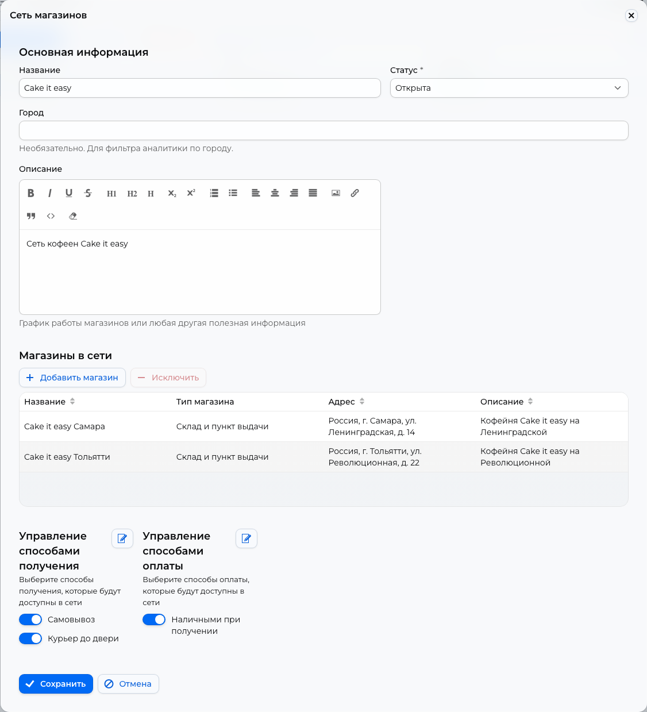

# Stores { #stores }

Create sales locations, enable fulfillment and payment methods, then share a store link or QR code.

Open **Catalog → Stores**.

## Store or chain { #store-or-chain }

Click **Create**, or **Actions → Create** on a phone. Choose **Single store** for one location or **Store chain** for locations sharing fulfillment and payment methods.

- Enter the store's name, city, and street. Its warehouse and pickup point are created with it; add products through [Inventory](inventory.md).
- Add at least one store to a chain. **Add store** selects an existing one; **Create** in the selection window adds a new one. A store can belong to several chains; its name must be unique within a chain.
- **Temporarily closed** keeps the chain in the customer's list but hides its products. **Store chain closure message** is not displayed in the app. **Archived** hides the entire chain.

## Fulfillment methods { #fulfillment-methods }

Enable the required methods in **Manage fulfillment methods**. Create missing ones under [Settings → Delivery](delivery.md).

!!! warning "Method restrictions"
    Customers cannot check out without an enabled method. **Online** is incompatible with other methods: enabling one disables the other. A chain using **Online** can contain only one store.

## Payment methods { #payment-methods }

Under **Manage payment methods**, enable services created in [Settings → Payments](payment-providers.md). New chains have **Cash on receipt** and **Card on receipt** enabled. Two methods of the same type, such as two YooKassa configurations, cannot be enabled together.

<figure markdown="1">

{ loading=lazy }

<figcaption>Example chain settings: enable fulfillment and payment methods separately. The screenshot shows the Russian interface.</figcaption>
</figure>

## QR code and link { #qr-links }

Select a store or chain row and click **Print QR code**. Check **Location** in the print window. Print the code or click **Copy link** to share it on your website or social media. The link opens the selected store in a browser; Telegram is not required.

For an iiko store, you can [create a QR code for a specific table](iiko.md#qr-).

## Deletion { #deletion }

Stores or chains with orders cannot be deleted. For an individual store, first set quantities to zero or remove the rows under [Catalog → Inventory](inventory.md). Deleting it also deletes its warehouse and pickup point.
