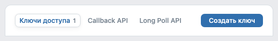
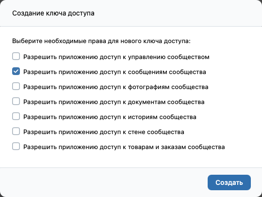
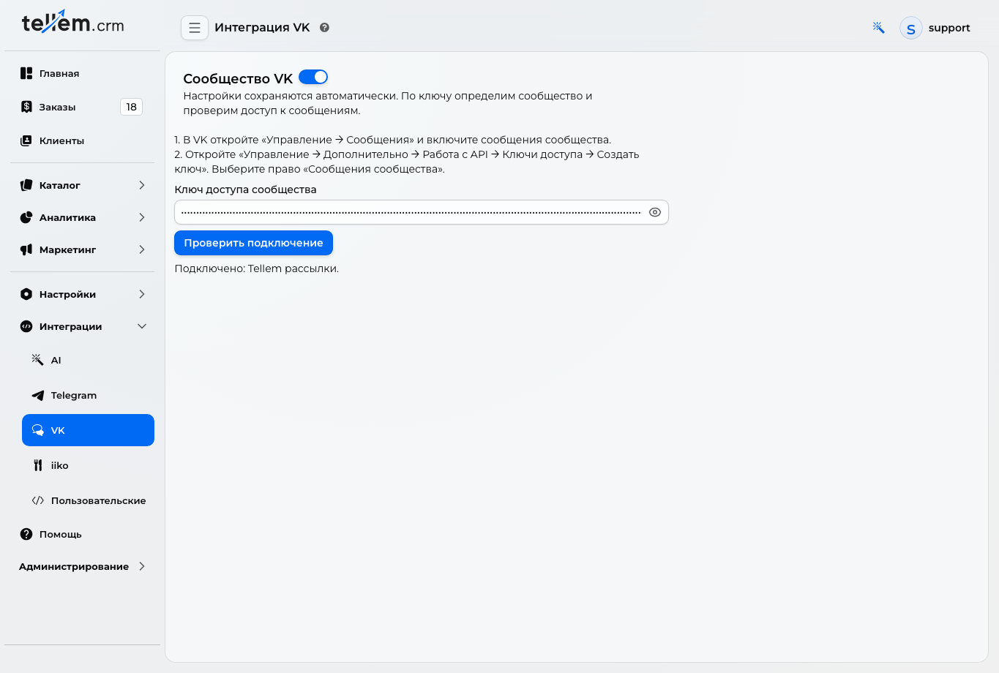

# VK: connect a community { #vk }

Your store's community sends order status messages and marketing mailings to customers in their VK private messages.

Open **Integrations → VK** as the CRM owner or a full administrator. The screenshots below show the Russian interface.

## 1. Prepare the community { #prepare-community }

Open VK in a browser, signed in as an administrator of your store's community.

1. In the community, select **Manage → Messages**.
2. Enable **Community messages** and save the change.
3. Go to **Manage → Advanced → API usage → Access tokens**.

4. Click **Create token**. Select only **Allow the application to access community messages**, then click **Create**. Complete any confirmation requested by VK.

5. Return to the token list, click **Show**, and copy the entire new token.

If you do not have a community, create one first. The location of **API usage** in VK's management menu may differ.

!!! warning "Keep the token secret"
    Paste it only into CRM. Do not send it to customers or publish it in screenshots.

## 2. Connect it in CRM { #connect-crm }

1. Open **Integrations → VK**.
2. Enable the switch beside **VK community** to show the connection fields.
3. Paste the token into **Community access token**, then leave the field.
4. Wait for **Connected: …** and check the community name.

Settings save automatically; there is no separate **Save** button. CRM identifies the community from the token, so you do not need to enter its ID. **Check connection** repeats the check. It does not send messages to customers.

VK ID sign-in and the community token are configured separately: the token is used for messages.

## 3. Enable customer notifications { #customer-notifications }

The token lets the store send messages, but each customer must separately allow messages from the community. After signing in with VK ID or linking VK, the application offers **VK notifications**. The customer confirms permission in that window.

Share the [connection guide with screenshots](../app/customer-notifications.md#vk). Customers do not need to follow the community's news to receive order notifications.

Customers choose their [notification channels in their profile](../app/customer-notifications.md). Marketing mailings also require **Mailings** to be enabled; see [Send a mailing](mass-mailings.md).

## If the connection fails { #connection-errors }

| What you see | What to do |
|---|---|
| The token is invalid or revoked | Create a new community token and replace it in CRM |
| The token does not have the required access | Create a token with the Community messages permission |
| Settings could not be checked or saved | Try the check again later and wait for Connected |
| The customer does not see the prompt | Check the CRM connection and whether VK is linked to their store account; the prompt appears after linking or signing in again |
| The customer receives no messages | Check message permission in VK and whether VK notifications are enabled in the app profile; for mailings, also check that the customer has not opted out |
